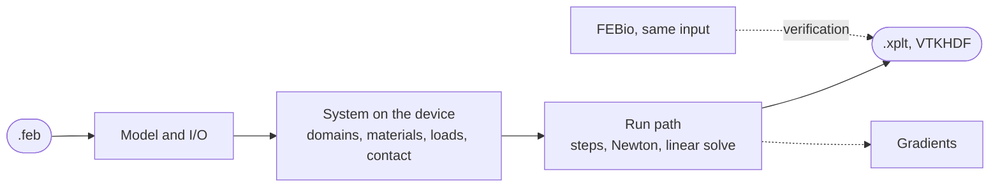

# FEBio-Warp-Python

GPU-accelerated, differentiable finite element mechanics for cardiovascular simulation,
written in Python on [Warp](https://github.com/NVIDIA/warp) and built in concert with the
[FEBio](https://febio.org) team. The formulations follow FEBio. The architecture is designed
for the GPU and for differentiation.

FEBio-Warp is intended to stand next to FEBio, not to replace it. FEBio remains the place for
broad constitutive modeling and general biomechanics. FEBio-Warp targets a focused set of
applications where speed and gradients matter.

## Project status

This project is at an early stage. Interfaces will change, and most areas listed below are in
design or draft. Nothing here is released.

Development has now moved to a design-led process. Each area is specified in a design note,
reviewed by the FEBio and Warp developers involved, implemented, and verified against FEBio
reference problems where one exists. The pilot work is preserved in [`pilots/`](pilots/README.md) and at the
[`pilot-2026-11`](https://github.com/JolleyLab/FEBio-Warp-Python/tree/pilot-2026-11) tag.

## Driving applications

The first targets set the scope. Capabilities are added because one of these needs them.

| Application | Needs |
|---|---|
| Atrioventricular valve closure and repair | Quadrilateral shell leaflets, fiber-reinforced hyperelastic tissue, chordae as trusses or springs, pressure loading, leaflet self-contact |
| Self-expanding nitinol devices (transcatheter pulmonary valve replacement, septal occluders) | Beam frames, nitinol material, device-to-vessel contact, hyperelastic vessel wall |
| Patch and material verification problems | Small problems with known or FEBio reference solutions, used to verify each component |

## Design at a glance



| Piece | In one line | State |
|---|---|---|
| Model and I/O | One model object for what a FEBio input defines; reads and writes FEBio files; says whether an input can run | Draft ([PR #5](https://github.com/JolleyLab/FEBio-Warp-Python/pull/5)) |
| Materials | FEBio's material structure, compiled into one Warp kernel per material tree | Draft ([PR #2](https://github.com/JolleyLab/FEBio-Warp-Python/pull/2)) |
| Contact | Point-based contact potential with pair search on the device | Draft ([PR #1](https://github.com/JolleyLab/FEBio-Warp-Python/pull/1)) |
| Run path | From a model to a result on small cases, with adjoint gradients | Template, draft ([PR #6](https://github.com/JolleyLab/FEBio-Warp-Python/pull/6)) |
| Verification | The same inputs run in FEBio and compared | Draft ([PR #4](https://github.com/JolleyLab/FEBio-Warp-Python/pull/4)) |

The [design overview](docs/design/overview.md) shows how these fit together, where the design
follows FEBio and where it differs, and what is only a first template. It is the place to start.

## Development areas

Status as of November 26, 2026. "Draft" means code exists in a draft pull request and is under
review. "Template" means a first working shape exists in the run path draft
([PR #6](https://github.com/JolleyLab/FEBio-Warp-Python/pull/6)), checked against FEBio on small
cases and not settled. "Design" means a design note with a proposed approach exists and no code.
No application input runs end to end yet.

| Area | Package | Scope for the first targets | Status |
|---|---|---|---|
| Materials | `materials/` | Common material interface; neo-Hookean, HGO, Ogden, Lee-Sacks, nitinol | Draft ([PR #2](https://github.com/JolleyLab/FEBio-Warp-Python/pull/2)), under redesign |
| Contact | `contact/` | Potential-based contact for leaflets and devices; sliding contact later | Draft ([PR #1](https://github.com/JolleyLab/FEBio-Warp-Python/pull/1)). Design: [contact in a run](docs/design/contact_in_run.md) |
| Assembly | `assembly/` | Full assembly of residual and tangent on the GPU | Decided ([note](docs/design/assembly.md)). Template: one block buffer and pattern map |
| Elements | `elements/` | Shells, solids, trusses, springs, beams | Template: hex8, tet4, quad4 shell. Design: [trusses and springs for chordae](docs/design/chordae.md), then [three-field solid, penta6, tri3 shell](docs/design/elements.md). Beams: design shell |
| Mesh and discretization | `mesh/`, `discretization/` | Mesh types, degree-of-freedom maps, quadrature | Template: unknowns by (node, variable). `mesh/` holds no code; the mesh is in the central model |
| Loads and constraints | `loads/`, `constraints/` | Follower pressure, nodal loads, prescribed and multipoint constraints | Template: pressure, fixed and prescribed displacements. Design: [mass damping](docs/design/dynamics.md), [normal displacement](docs/design/constraints.md) |
| Solvers | `solvers/` | Newton with line search; iterative linear solvers and preconditioners | Template: full Newton, Warp's iterative solvers. Design: [preconditioning for shells, line search, quasi-Newton](docs/design/linear_solve.md) |
| Analysis | `analysis/` | Static and implicit dynamic steps, load stepping, staged procedures | Template: one static step with FEBio's time stepper. Design: [dynamics and several steps](docs/design/dynamics.md) |
| Sensitivity | `sensitivity/` | Gradients through equilibrium and through trajectories | Template: adjoint through one equilibrium solve. Design: [over steps](docs/design/sensitivity.md) |
| Central model, input and output | `model/`, `io/` | One model object holding what a FEBio input defines; FEBio input (`.feb`) and plot (`.xplt`) files read and written here; VTKHDF output and a VTK adapter for 3D Slicer | Draft ([PR #5](https://github.com/JolleyLab/FEBio-Warp-Python/pull/5)). Design: [output registry](docs/design/output.md) |
| Verification | `tests/`, `references/` | FEBio-Warp run on FEBio input files and compared with pinned FEBio references; cases from the FEBio test suite and the driving applications | Draft ([PR #4](https://github.com/JolleyLab/FEBio-Warp-Python/pull/4)), tabled until input and output |

Design notes live in [`docs/design/`](docs/design/README.md). What is left before the application
inputs run, in order, is in [remaining areas](docs/design/remaining_areas.md). Each design note ends with
the decision points for the team, and that page lists them by reviewer. Testing uses the
[FEBio test suite](https://github.com/febiosoftware/TestSuite) first, then the open models in the
[FEBio model repository](https://repo.febio.org/modelRepo/UserProjects) user projects, with small
generated inputs only where neither has a case that fits. The pilot examples are not test targets.

The four drafts are reviewed separately. They are also merged, and made consistent where they
meet, on the branch
[`mattjolley/integration-base`](https://github.com/JolleyLab/FEBio-Warp-Python/tree/mattjolley/integration-base);
its note `docs/design/integration.md` says what that involved and what is left open.

### Relation to FEBio's structure

The package layout under `src/warp_febio/` follows FEBio's separation of concerns.

| FEBio-Warp | FEBio counterpart |
|---|---|
| `mesh/`, `discretization/` | FECore mesh, degrees of freedom, element traits |
| `elements/` | FEBioMech domains |
| `materials/` | FEBioMech materials |
| `loads/`, `constraints/`, `contact/` | FEBioMech loads, constraints and contact interfaces |
| `assembly/`, `solvers/` | FECore solver interfaces, NumCore linear solvers |
| `analysis/` | FECore analysis steps |
| `io/` | FEBioXML, FEBioPlot |
| `sensitivity/` | Added here |

## How code enters the package

1. A design note in `docs/design/` states the formulation, the FEBio source it follows, and
   how it will be verified.
2. A draft pull request implements it and is reviewed.
3. It is verified against FEBio reference problems where one exists, in double precision.

Exploratory work is welcome and belongs in `pilots/` until it has been through these steps.
See [CONTRIBUTING.md](CONTRIBUTING.md).

## Pilot work

The initial prototypes were contributed by [@aslanseda9](https://github.com/aslanseda9): an
explicit membrane patch solver, Lee-Sacks and neo-Hookean material-point functions, and a solid
elasticity check built on `warp.fem`. They were written to explore the approach, not as verified
implementations, and each one lists what it does and does not establish. They remain available
and runnable in [`pilots/`](pilots/README.md). They are not maintained and are not a dependency
of the package.

The FEBio inputs and results assembled during the pilot phase are kept in `references/febio/`.
They will be reviewed for inclusion in the verification harness and should not be read as
verified benchmarks until then.

## Install

The project uses [uv](https://docs.astral.sh/uv/) for environments and
[Ruff](https://docs.astral.sh/ruff/) for linting and formatting, as Warp does.

```bash
uv sync --extra dev
uv run -m unittest discover -s tests -v
```

`uv sync` creates `.venv` with the versions recorded in `uv.lock`. The `dev` extra installs
everything the tests use, including Warp. To use the package, the `warp` extra
(`uv sync --extra warp`, or `pip install -e ".[warp]"`) installs Warp, which compiling and
running a model needs. Without it, `pip install -e .` installs only the model and the FEBio
file readers and writers (`warp_febio.model`, `warp_febio.io`), which depend on NumPy alone
and can be used inside 3D Slicer.

Python 3.11 or later; 3.12 is the tested version and the one uv selects from
`.python-version`. Warp is pinned to 1.19.0; see the
[Warp installation guide](https://nvidia.github.io/warp/v1.19/user_guide/installation.html).

See [CONTRIBUTING.md](CONTRIBUTING.md) for formatting and the pre-commit hooks.

## Acknowledgments

FEBio-Warp builds on the formulations, documentation and test suites of
[FEBio](https://github.com/febiosoftware/FEBio), developed at the University of Utah, and on
[Warp](https://github.com/NVIDIA/warp).

## License

FEBio-Warp-Python is released under the [Apache License 2.0](LICENSE), the same license as
[Warp](https://github.com/NVIDIA/warp). Contributions are accepted under the same terms.

[FEBio](https://github.com/febiosoftware/FEBio) is distributed separately under the MIT license.
Material in this repository that derives from FEBio, including the reference inputs under
`references/febio/`, keeps its attribution to the FEBio project.
