# FEBio-Warp-Python

GPU-accelerated, differentiable finite element mechanics for cardiovascular simulation,
written in Python on [Warp](https://github.com/NVIDIA/warp) and built in concert with the
[FEBio](https://febio.org) team. The formulations follow FEBio, but deviate where it makes sense for warp. The architecture is designed
for the GPU and for differentiation, follows the development conventions of Warp, and is
meant to work with [Newton](https://github.com/newton-physics/newton),
[3D Slicer](https://www.slicer.org) and [SlicerHeart](https://github.com/SlicerHeart/SlicerHeart).

FEBio-Warp is intended to stand next to FEBio, not to replace it. FEBio remains the place for
broad constitutive modeling and general biomechanics. FEBio-Warp targets a focused set of
applications where speed and gradients matter.

## Project status

Early stage, nothing released. As of November 27, 2026, first implementations of the model and
FEBio input and output, materials, contact, and a run path from a model to a result are on `main`.
They agree with FEBio on single elements and small meshes, on CPU and on a GPU. No application
input runs end to end yet, and interfaces will change.

## Try it

```bash
uv sync --extra dev                                                        # environment with Warp
uv run -m warp_febio inspect references/single_element/hex8_pressure.feb   # what the input needs, and whether it can run
uv run -m warp_febio run references/single_element/hex8_pressure.feb -o hex8_pressure.xplt
uv run examples/run_path/basic_example.py                                  # the run path step by step, with gradients
```

`inspect` lists every feature of a FEBio input by its FEBio name and says whether FEBio-Warp
implements it. `run` solves the input and writes a FEBio plot file (`.xplt`). The example
prints each stage, compares the result with FEBio, and ends with adjoint gradients. Add
`--device cuda:0` to `run`, or `cuda:0` after the example, to use a GPU. [Install](#install) has
the details.

## Driving applications

The first targets set the scope. Capabilities are added because one of these needs them.

| Application | Needs |
|---|---|
| Atrioventricular valve closure and repair | Quadrilateral shell leaflets, fiber-reinforced hyperelastic tissue, chordae as trusses or springs, pressure loading, leaflet self-contact |
| Self-expanding nitinol devices (transcatheter pulmonary valve replacement, septal occluders) | Beam frames, nitinol material, device-to-vessel contact, hyperelastic vessel wall |
| Patch and material verification problems | Small problems with known or FEBio reference solutions, used to verify each component |

## Design and status

```mermaid
flowchart LR
    feb([".feb"]):::done --> model["Model and I/O"]:::done
    model --> system
    subgraph system["System on the device"]
        direction TB
        mat["Materials"]:::done
        elem["Solids and shells<br/>hex8, tet4, quad4"]:::done
        loads["Pressure, fixed and<br/>prescribed displacements"]:::done
        pot["Contact potential<br/>on its own"]:::done
        chord["Trusses and springs<br/>for chordae, static"]:::done
        inrun["Contact in a run"]:::todo
        beams["Beams, three-field solid,<br/>constraints"]:::todo
    end
    system --> run
    subgraph run["Run path"]
        direction TB
        static["One static step, Newton,<br/>iterative linear solve"]:::done
        dyn["Dynamics, several steps,<br/>line search, preconditioning"]:::todo
    end
    run --> results([".xplt, VTKHDF"]):::done
    run -.-> grad["Gradients through<br/>one equilibrium solve"]:::done
    grad -.-> traj["Gradients over steps"]:::todo
    febio["FEBio, same input"] -.->|verification| results
    classDef done fill:#d8f0e1,stroke:#1a7f47,color:#0b3d20
    classDef todo fill:#f6f6f6,stroke:#8a8a8a,color:#444444,stroke-dasharray:5 4
```



Green boxes work today. Dashed boxes have a design note and no code yet.

The table gives the same picture by area. "Works today" means code on `main`, tested on CPU and
on a GPU, and compared with FEBio where a counterpart exists. It is a first implementation, not a
settled design: the run path in particular is a template, and each design note ends with decision
points that are still open.

| Area | Package | Works today | Still to do | Design notes and diagrams |
|---|---|---|---|---|
| Model, input and output | `model/`, `io/` | One model object for what a FEBio input defines. Reads and writes `.feb` (all 538 FEBio test suite inputs read and write back equal), reads and writes `.xplt`, writes VTKHDF, exchanges meshes with 3D Slicer. A coverage report and the command line say whether an input can run | Registry of plot and log variables; log file output | [Model and I/O](docs/design/model.md) ([diagram](docs/design/model.md#2-big-picture), [decisions](docs/design/model.md#9-decision-points)), [output](docs/design/output.md) ([diagram](docs/design/output.md#2-from-a-state-to-a-file)) |
| Materials | `materials/` | FEBio's material structure, compiled into one Warp kernel per material tree, with gradients. Neo-Hookean, isotropic elastic, isotropic Lee-Sacks, HGO (unconstrained and uncoupled), solid mixtures; spring and linear truss laws for chordae. Effective-modulus nitinol: the device model of Zelonis et al. ([arXiv 2507.06337](https://arxiv.org/abs/2507.06337)) and Maheshwari et al. ([J Mech Behav Biomed Mater 2026](https://doi.org/10.1016/j.jmbbm.2026.107642), arXiv 2601.05410), an elastic frame whose Young's modulus steps between compression and release | Under redesign after review. Superelastic nitinol: only a shell of the interface exists (a simple uniaxial law, not for device results), and FEBio has no counterpart to verify against. Ogden, `tangent_scale`, per-element material axes | [Materials](docs/design/materials.md) ([diagram](docs/design/materials.md#at-a-glance), [decisions](docs/design/materials.md#decision-points)) |
| Contact | `contact/` | Point-based contact potential: pair search on the device, force, tangent, gradients; reads FEBio's `contact potential` block. Tested on its own | Contact inside a run; sliding, sticky and tied contact | [Contact](docs/design/contact.md) ([diagram](docs/design/contact.md#at-a-glance), [decisions](docs/design/contact.md#decision-points)), [contact in a run](docs/design/contact_in_run.md) ([diagram](docs/design/contact_in_run.md#2-where-contact-sits-in-one-iteration)) |
| Elements | `elements/` | hex8 and tet4 solids, quad4 shell. Draft: two-node trusses (regular and tension-only) and springs for chordae in static steps, with gradients of chord tension. Tested on CPU and on a GPU | Mass and dynamics for trusses; three-field solid, penta6, tri3 shell; beams | [Chordae](docs/design/chordae.md) ([diagram](docs/design/chordae.md#2-from-the-input-to-a-term)), [elements](docs/design/elements.md) ([diagram](docs/design/elements.md#3-selection)) |
| Unknowns and assembly | `discretization/`, `assembly/` | Unknowns by (node, variable); full assembly of residual and tangent into a block sparse matrix with a fixed pattern | Timing on a GPU at application size | [Run path](docs/design/run_path.md) ([diagram](docs/design/run_path.md#2-the-path), [decisions](docs/design/run_path.md#12-decision-points)), [assembly](docs/design/assembly.md) |
| Loads and constraints | `loads/`, `constraints/` | Follower pressure; nodal loads; fixed and prescribed displacements | Body force, mass damping; normal-displacement and multipoint constraints | [Dynamics](docs/design/dynamics.md), [constraints](docs/design/constraints.md) ([diagram](docs/design/constraints.md#2-how-a-constrained-component-is-handled)) |
| Solvers | `solvers/` | Full Newton; Warp's CG, BiCGSTAB and GMRES on the device; a dense direct solve for checks | Line search, quasi-Newton, preconditioning for shells, a direct solver on the device | [Run path](docs/design/run_path.md) ([one Newton iteration](docs/design/run_path.md#3-one-newton-iteration)), [linear solve](docs/design/linear_solve.md) ([diagram](docs/design/linear_solve.md#2-choosing-a-method)) |
| Analysis | `analysis/` | One static step with FEBio's automatic time stepper | Implicit dynamics; several steps | [Run path](docs/design/run_path.md), [dynamics](docs/design/dynamics.md) ([one dynamic step](docs/design/dynamics.md#2-one-dynamic-step)) |
| Sensitivity | `sensitivity/` | Adjoint gradients through one equilibrium solve, checked against finite differences and a closed form | Gradients over steps and trajectories | [Sensitivity](docs/design/sensitivity.md) ([diagram](docs/design/sensitivity.md#2-forward-run-and-reverse-sweep)) |
| Verification | `tests/`, `references/` | Stored FEBio references for material points, single elements, small meshes and 22 small problems; agreement to about 1e-12. Tests in a quick and a full tier, on CPU and on a GPU | A runner for FEBio test suite problems; the application inputs | [Verification](docs/design/verification.md) ([diagram](docs/design/verification.md#at-a-glance), [decisions](docs/design/verification.md#decision-points)) |

Where to read more:

- [Design overview](docs/design/overview.md): how the pieces fit ([the whole path](docs/design/overview.md#1-the-whole-path), [one run](docs/design/overview.md#3-one-run)), and where the design follows FEBio and where it differs. Start here.
- [Remaining areas](docs/design/remaining_areas.md) ([diagram](docs/design/remaining_areas.md#2-the-path)): what stands between today's code and the applications, in order, with the open decisions listed by who is best placed to make them.
- [All design notes](docs/design/README.md), each with a flow diagram and its decision points.

Testing uses the [FEBio test suite](https://github.com/febiosoftware/TestSuite) first, then the
open models in the [FEBio model repository](https://repo.febio.org/modelRepo/UserProjects) user
projects, with small generated inputs only where neither has a case that fits.

### Relation to FEBio's structure

The package layout under `src/warp_febio/` follows FEBio's separation of concerns.

| FEBio-Warp | FEBio counterpart |
|---|---|
| `mesh/`, `discretization/` | FECore mesh, degrees of freedom, element traits |
| `elements/` | FEBioMech domains |
| `materials/` | FEBioMech materials |
| `loads/`, `constraints/`, `contact/` | FEBioMech loads, constraints and contact interfaces |
| `assembly/`, `solvers/` | FECore solver interfaces, NumCore linear solvers |
| `analysis/` | FECore analysis steps |
| `io/` | FEBioXML, FEBioPlot |
| `sensitivity/` | Added here |

## Contributing

Large new sections start as a design note in [`docs/design/`](docs/design/README.md): a template
of the approach and its open decisions, for discussion before and alongside the code. Exploratory
work is welcome and belongs in `pilots/` until it has been designed, reviewed and verified against
FEBio. See [CONTRIBUTING.md](CONTRIBUTING.md).

## Pilot work

The initial prototypes were contributed by [@aslanseda9](https://github.com/aslanseda9): an
explicit membrane patch solver, Lee-Sacks and neo-Hookean material-point functions, and a solid
elasticity check built on `warp.fem`. They were written to explore the approach, not as verified
implementations, and each one lists what it does and does not establish. They remain available
and runnable in [`pilots/`](pilots/README.md) and at the
[`pilot-2026-11`](https://github.com/JolleyLab/FEBio-Warp-Python/tree/pilot-2026-11) tag. They are not maintained and are not a dependency
of the package.

The FEBio inputs and results assembled during the pilot phase are kept in `references/febio/`.
They will be reviewed for inclusion in the verification harness and should not be read as
verified benchmarks until then.

## Install

The project uses [uv](https://docs.astral.sh/uv/) for environments and
[Ruff](https://docs.astral.sh/ruff/) for linting and formatting, as Warp does.

```bash
uv sync --extra dev
uv run -m unittest discover -s tests -v                                  # quick tier, CPU, about 15 s
WARP_FEBIO_TEST_DEVICE=cuda:0 uv run -m unittest discover -s tests -v    # the same on a GPU
WARP_FEBIO_TEST_LEVEL=full uv run -m unittest discover -s tests -v       # full tier, before merging
```

The tests run on CPU or on a GPU and come in two tiers; see
[CONTRIBUTING](CONTRIBUTING.md#writing-and-running-tests).

`uv sync` creates `.venv` with the versions recorded in `uv.lock`. The `dev` extra installs
everything the tests use, including Warp. To use the package, the `warp` extra
(`uv sync --extra warp`, or `pip install -e ".[warp]"`) installs Warp, which compiling and
running a model needs. Without it, `pip install -e .` installs only the model and the FEBio
file readers and writers (`warp_febio.model`, `warp_febio.io`), which depend on NumPy alone
and can be used inside 3D Slicer.

Python 3.11 or later; 3.12 is the tested version and the one uv selects from
`.python-version`. Warp is pinned to 1.19.0; see the
[Warp installation guide](https://nvidia.github.io/warp/v1.19/user_guide/installation.html).

See [CONTRIBUTING.md](CONTRIBUTING.md) for formatting and the pre-commit hooks.

## Acknowledgments

FEBio-Warp builds on the formulations, documentation and test suites of
[FEBio](https://github.com/febiosoftware/FEBio), developed at the University of Utah, and on
[Warp](https://github.com/NVIDIA/warp).

## License

FEBio-Warp-Python is released under the [Apache License 2.0](LICENSE), the same license as
[Warp](https://github.com/NVIDIA/warp). Contributions are accepted under the same terms.

[FEBio](https://github.com/febiosoftware/FEBio) is distributed separately under the MIT license.
Material in this repository that derives from FEBio, including the reference inputs under
`references/febio/`, keeps its attribution to the FEBio project.
