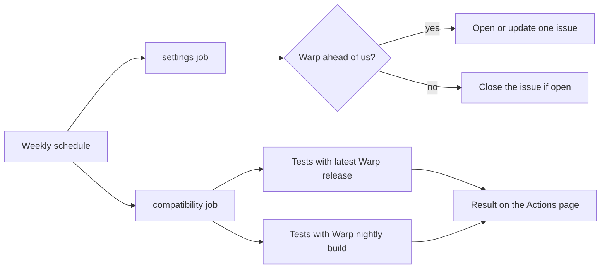

# Staying aligned with Warp

FEBio-Warp is built on [Warp](https://github.com/NVIDIA/warp) and is meant to stay compatible with it over the long term. This page describes what the repository follows, what is checked automatically, and how an update is applied. It is a starting point; additions from the Warp team are welcome.

## What is followed

| Area | Followed from Warp | Where it lives here |
| --- | --- | --- |
| Python | Version used for development and CI; oldest supported version | `.python-version`, `requires-python` in `pyproject.toml` |
| Linting and formatting | Ruff, line length, lint rule set | `[tool.ruff]` in `pyproject.toml` |
| Tool versions | Ruff, uv, typos | `.pre-commit-config.yaml`, `.github/workflows/` |
| Environment | uv with a committed lockfile | `uv.lock` |
| Agent instructions | Layout and common rules of `AGENTS.md` | `AGENTS.md` |
| Warp itself | The version the code is tested against | `warp-lang` in `pyproject.toml`, `uv.lock` |

Where this project differs on purpose, the reason is written next to the setting: the ignored lint rules in `pyproject.toml`, and `RULES_NOT_ADOPTED` in `tools/check_warp_alignment.py`.

## What is checked automatically

The workflow `.github/workflows/warp-alignment.yml` runs every Monday and can be started by hand from the Actions tab. It changes nothing in the repository.



- **Settings.** `tools/check_warp_alignment.py` compares the settings above with the latest Warp release. If Warp is ahead, it opens an issue titled "Warp alignment: differences found", or updates the one already open. Settings where this repository is ahead of the release are listed as notes, not differences.
- **Compatibility.** The unit tests run against the newest Warp release and against the Warp nightly build. A failure does not block anything. It is an early signal that a coming Warp release changes something this code relies on.

To run the comparison locally:

```bash
uv run tools/check_warp_alignment.py              # latest Warp release
uv run tools/check_warp_alignment.py --ref main   # Warp's main branch
```

## Applying an update

Updates are made deliberately and in one pass, not automatically, because a new Ruff version or rule can reformat files and a new Warp version can change numerical results.

1. Open a branch from `main`.
2. Change the settings named in the issue. For a new Warp version, change the `warp-lang` requirement.
3. Run `uv lock`, then `uvx pre-commit run --all-files`. Put any reformatting in its own commit.
4. Run the tests. For a new Warp version, also run the FEBio comparisons, on a GPU where one is available, and state in the pull request what was run.
5. If branches are stacked on one another, merge `main` into the lowest one first and work upward, running the checks and tests at each level.

## Using Warp in the code

- Import from the public `warp` namespace, not from `warp._src`.
- Treat a Warp deprecation warning as something to fix before the release that removes the feature. The compatibility job is where these first appear.

## Not set up yet

These are intended for later and are listed so they are not forgotten.

- **GPU runs.** All automated tests run on CPU. A GPU runner is needed for the compatibility job to be meaningful for kernels.
- **A version range for Warp.** The package requires one exact Warp version. A minimum version, with `uv.lock` recording the tested one, would let it install next to newer Warp and Newton releases.
- **Deprecation warnings as test failures** in the compatibility job.
- **Automatic pull requests for new Warp releases** (for example Dependabot).
- **A Newton compatibility test**, once the interface to Newton exists.
