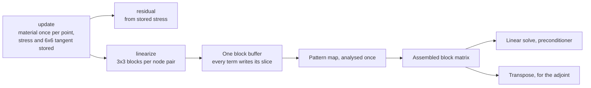

# Assembly: full assembly, and what the exploration showed

Record of a decision, November 24, 2026, written into the repository on November 26. For Steve Maas, Jeff Weiss, Ryan Black and the Warp team.

**What this is.** The reasons FEBio-Warp forms an assembled sparse tangent, with the measurements behind the decision. The structure that carries it out is in the [run path note](run_path.md), which came after and supersedes the implementation outline of the original exploration.

**What is not here.** The comparison script and its test from the exploration are not in the repository. The figures below are from that exploration and were not rerun for this note.

## 1. Decision

FEBio-Warp forms an assembled sparse tangent (full assembly) and solves with it. Partial assembly, in MFEM's sense of storing point data and applying the operator element by element, is not part of the design. The tangent of a term keeps an operator form (`apply`, `apply_transpose`) beside its blocks, so a matrix-free domain could be added later without changing elements or materials.

## 2. Reasons

1. **Preconditioning needs the matrix.** Valve and device problems are poorly conditioned: thin leaflets, fiber anisotropy, near-incompressibility, stiff contact potentials. A direct solve, an approximate inverse or algebraic multigrid all take an assembled matrix.
2. **Break-even.** On CPU, full assembly cost about 60 ms more to set up than partial assembly and saved about 5 ms per product, so the two break even near a dozen products per tangent. Krylov solves on these problems need more products than that; the run path later measured 470 to 990 on a shell patch.
3. **Low order.** The first elements are first order. The gains from partial assembly come mainly from sum factorization at higher order.
4. **Memory.** By estimate, not measurement: for trilinear hexahedra the assembled matrix holds about 243 values per node in 3x3 block form, and partial assembly holds 216 to 336 values per element for stress and tangent at eight points, plus geometry. On a hexahedral mesh nodes and elements are about equal in number.
5. **Verification.** FEBio's references include iteration counts. An assembled tangent and a comparable linear solve make Newton's behavior easier to match and let the tangent be compared directly.
6. **Contact.** Contact changes the sparsity during a step. An assembled path handles that in one place ([contact_in_run.md](contact_in_run.md)).

## 3. What the exploration measured

The same tangent was formed or applied five ways on a trilinear hexahedral grid in double precision. All five agreed to 1e-15.

CPU, two cores, 4,096 hexahedra (32,768 integration points, 14,739 degrees of freedom). Timings varied by about 20 percent between runs. No GPU run was made.

| Route | HGO | Neo-Hookean |
| --- | --- | --- |
| A. `warp.fem`, form calls the tangent action | about 650 ms | about 450 ms |
| B. `warp.fem`, stress and 6x6 tangent stored once per point | 210 to 260 ms | 210 to 230 ms |
| C. Dedicated hexahedron kernel, then sparse build | 55 to 70 ms | 50 to 60 ms |
| D. Matrix-free product through `warp.fem`, stored point data | 40 to 50 ms each | 40 to 50 ms each |
| E. Dedicated partial assembly: setup | 7 ms | 4 ms |
| E. Dedicated partial assembly: one product | 6.6 ms | 5.2 ms |
| Product with the assembled matrix | 1.4 ms | 1.4 to 1.8 ms |

## 4. Lessons carried into the run path

| Lesson | Where it is now |
| --- | --- |
| Evaluate the material once per integration point and store stress and the 6x6 tangent | `update` of a domain |
| A dedicated kernel was about four times faster than `warp.fem` at assembly on CPU | Both exist for hex8 and agree to 1e-12. Which to keep is open (run path, section 5) |
| Setting up point data is cheap next to forming the matrix | The split between `update` and `linearize` |
| The assembled product is four to five times faster than the element-by-element product | The linear solve works on the assembled matrix |
| Reusing the sparsity map in `warp.fem` made no difference on CPU | The run path uses a pattern map for its own block buffer; its effect has not been timed |

## 5. Limits

- CPU only, one mesh size, one element type, no boundary conditions, no solve, no preconditioner.
- The dedicated kernels were written for the comparison.
- Shells, beams and contact were not covered.

## 6. What would reopen partial assembly

A GPU run in which assembly dominates the Newton step, together with a diagonally preconditioned Krylov solve that converges in a few dozen iterations on a leaflet problem with contact. The measurements proposed in [linear_solve.md](linear_solve.md) would show whether either holds.
