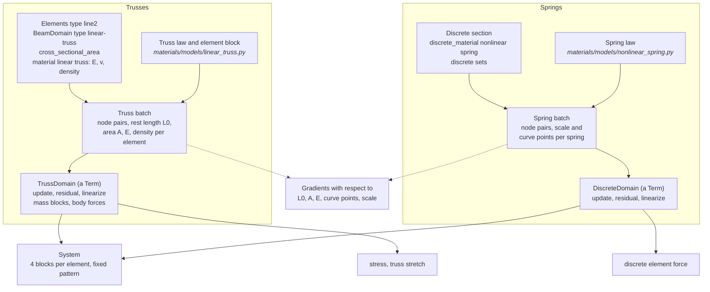

# Chordae: trusses first, then springs

First template for discussion, November 26, 2026 (v0.2). Design only: there is no code for the domains described here. Nothing here is settled. Part of the set introduced in [remaining_areas.md](remaining_areas.md).

**Scope.** The two ways chordae are modeled in FEBio valve simulations, as two-node line elements:

- **Trusses.** Current practice in the lab's valve models (Mangine, Laurence et al., "Effect of Parametric Variation of Chordae Tendineae Structure on Simulated Atrioventricular Valve Closure", arXiv 2411.09599): branched chord networks of `linear truss` elements. This is the priority.
- **Springs.** The open mitral input in the FEBio model repository (file 3572) uses `nonlinear spring` sets in the `Discrete` section. This closes open item 5 of the [integration note](integration.md).

Both are needed. The truss comes first in the element work, ahead of any other new element, because the valve path is quad4 shells (which exist) plus chordae.

## 1. Summary

- **A truss domain is the first new element to build.** It is small, FEBio's formulation is fully specified in two source files, and the FEBio test suite has three problems for it, one of which also covers dynamics and mass damping.
- **The law already exists.** The material layer of pull request 2 has `linear truss` and the force and stiffness of one element, tested against FEBio's formulas and against finite differences. The domain (mass, dynamics, body forces, assembly) does not exist.
- **FEBio's truss tangent is the exact derivative of its force**, so the adjoint can use it as is. A truss is also smooth in the stretch, where the spring curve has a corner. For gradients with respect to chord parameters the truss is the better-behaved element.
- **FEBio's `linear truss` carries compression.** A chord network that goes slack then has members with negative stress. This bears on the tangent and on the linear solver, and is the main decision point of this note.
- **Rest length, cross-sectional area and modulus per element are proposed as differentiable arrays.** The paper found cross-sectional area the most influential chord parameter, and neochord length is a surgical design variable.
- **Springs follow the same pattern** with one kernel for all eight sets of the open mitral input.

## 2. From the input to a term

The reader of pull request 5 already reads the three suite truss inputs. Its coverage report lists `BeamDomain linear-truss, line2` as not yet supported, which is the entry this note would remove.

## 3. What the paper does

Read from the full text (arXiv 2411.09599; published version DOI 10.1007/s10439-026-04310-7).

| Item | In the paper |
| --- | --- |
| Chordae | Linear truss elements in FEBio, described as newly implemented. Modulus 150 MPa. Cross-sectional area 1.0 mm^2 (mitral) and 0.44 mm^2 (tricuspid) |
| Geometry | Branched primary and secondary chords generated by the `ValveFEMExport` module of SlicerHeart, from papillary muscle tips to insertion regions. The baseline mitral valve has 114 insertion points |
| Leaflets | quad4 shells, thickness 0.396 mm, isotropic Lee-Sacks |
| Boundary conditions | Annulus and papillary tips fixed |
| Load | Pressure rising linearly over 0.005 s |
| Contact | Potential-based |
| Analysis | Dynamic, generalized-alpha, mass damping on leaflets and chords, automatic time stepping with a largest step of 1e-4 s |
| Findings that bear on design | Moving from non-branched springs to trusses changed the predicted closure. Cross-sectional area had the most influence of the five chord parameters varied |
| Stated limitation | A linear chord material was used; an Ogden model would represent chord tissue better |

So the truss path needs, beyond the element itself: mass and mass damping on trusses, and interior junction nodes that belong only to trusses.

## 4. What FEBio does

From `FEBioMech/FELinearTrussDomain.cpp`, `FETrussMaterial.cpp`, `FEElasticTrussDomain.cpp`, `FEDiscreteElasticDomain.cpp`, `FENonlinearSpring.cpp`, `FESolidDomainFactory.cpp` and `FECore/FEElementTraits.cpp` at `e4df3f8`.

**Trusses**

| Item | FEBio |
| --- | --- |
| Input | `Elements type="line2"` (or `truss2`). In the suite inputs the domain is written `BeamDomain ... type="linear-truss"` with `cross_sectional_area` |
| Default domain | A truss material on a two-node line element selects `linear-truss` |
| Material | `linear truss`: `E`, `v` (default 0.5), `density`. Kirchhoff stress tau = E ln(lambda), lambda = l/L. No cut-off in compression |
| Internal force | tau V / l along the current axis, with V = L A the reference volume |
| Stiffness | (V / l^2)(E - 2 tau) n n^T + (tau V / l^2) I, times alpha_f |
| Mass | Consistent: rho A L / 3 on the diagonal, rho A L / 6 off it |
| Dynamics, body forces | Inertial force and body forces (so `mass damping`) are supported on trusses. Two integration points per element |
| Variable | `displacement` only |
| Reported stress | Cauchy, tau / J along the axis, with J = lambda^(1 - 2 v) |
| Output | `stress`, `truss stretch` |
| `elastic-truss` | A second domain that evaluates any solid material at F = diag(lambda, lambda^-v, lambda^-v). Its stiffness uses k = E with the linear-truss expression commented out. Question 7 of the materials note asks the FEBio team about it |

**Springs**

| Item | FEBio |
| --- | --- |
| Domain | `FEDiscreteElasticDomain`, registered as `discrete`. Two-node elements on the `displacement` variable. It adds no mass |
| Material | `nonlinear spring`: `scale`, `measure` (elongation, strain or stretch), and a `force` function |
| Force | Along the current axis, magnitude `scale` times the function of the measure |
| Stiffness | (E - F/L) e e^T + (F/L) I, with E the slope of the force with respect to length, F the force and L the current length |
| Output | `discrete element force`, the force vector per spring |

In the open mitral input: 100 springs in 8 sets. Every set uses `measure` elongation and a three-point curve with linear interpolation and extrapolation. The curve is zero up to a slack elongation (2, 3, 4 or 12 in the file's length unit) and rises with unit slope after it. `scale` is 30 or 60.

## 5. Proposed

| Topic | Proposal | Why |
| --- | --- | --- |
| Truss domain | `TrussDomain` is a `Term`: `update` computes stretch, stress and the 3x3 element block per element; `residual` scatters to two nodes; `linearize` writes four blocks | The element block is already written and tested in `linear_truss.py`. The solver needs no knowledge of trusses |
| Per-element data | Rest length, area, modulus and density are arrays over elements, filled from the domain and material | FEBio holds area per element already. Arrays cost nothing on the device and are what gradients need |
| Mass | The 2x2 consistent mass per element, as blocks in the same four positions | Follows [dynamics.md](dynamics.md): mass shares the stiffness pattern |
| Mass damping | C times the truss mass blocks times velocity, as for solids and shells | FEBio's truss body force integrates density, shape function and force at two Gauss points, which is exact for the product of two linear shape functions |
| Junction nodes | A node used only by trusses has one entry (`displacement`). A node shared with a leaflet uses the leaflet node's `displacement` entry, the shell's front face | FEBio's truss domain uses the displacement variable |
| Uniaxial law as the plug point | The domain calls a uniaxial law (stress and tangent from stretch) from the material layer | A nonlinear chord law can then be added without touching the domain. Whether that is FEBio's `elastic-truss` route is decision C2 |
| Spring domain | `DiscreteDomain` is a `Term`, batched by curve type; `scale` and curve points are per-spring rows | One kernel serves all eight sets of the open mitral input; the material layer already tests this |
| Reaction forces | Both terms are marked internal | Both FEBio domains are elastic domains, so the solver adds their forces in the internal force pass |

**Alternative considered.** One domain for trusses and springs, with the spring as a truss with a special law. Rejected: FEBio keeps them apart, a truss has mass and area and a spring has neither, and their inputs come from different sections of the file.

## 6. Initial explorations

What exists today, from the materials draft and from the checks made for this note.

| Explored | Result | Where |
| --- | --- | --- |
| Truss force and stiffness as a Warp function | Match FEBio's formulas to 1e-12 on 100 random elements | `tests/test_material_springs.py` |
| Truss stiffness against finite differences of the force | Agree to 1e-7 relative | Same |
| Spring force and stiffness, all chord groups of the mitral input in one kernel | Match FEBio's formulas | Same |
| Gradients of spring force with respect to parameters | Pass | Same |
| FEBio's `elastic-truss` on one element | Slow or failed convergence with full Newton; recorded in question 7 of the materials note | [materials.md](materials.md) |
| The three suite truss inputs through the reader | Read; reported as not yet supported | `python -m warp_febio inspect` |
| A truss in a run | Not explored | |

## 7. Decision points

| ID | Decision | Options | Proposed | For |
| --- | --- | --- | --- | --- |
| C1 | Compression in chords. FEBio's `linear truss` has no tension-only form, so a slack chord carries compressive stress, and its geometric stiffness tau V / l^2 is then negative across the axis | (a) Follow FEBio exactly. (b) Add a tension-only option here. (c) Add it in FEBio first, then follow | (a) for the reference tier, so results match. (c) if the team wants tension-only chords, since material options belong in FEBio | Jeff, Steve, MJ |
| C2 | Nonlinear chord material (the paper names Ogden) | (a) FEBio's `elastic-truss` with a solid material. (b) A uniaxial law on the `linear-truss` structure. (c) Wait | Depends on the answer to question 7 of the materials note. The domain proposed here accepts either | Jeff, Steve |
| C3 | Rest length as a parameter. FEBio takes L from the reference node positions | (a) Geometry only. (b) A per-element rest length array that defaults to the geometric length | (b). Forward results are unchanged; chord and neochord length become design variables without moving nodes | Team; Warp team for the gradient path |
| C4 | Which target comes first for chordae | (a) Springs, to run the open mitral input. (b) Trusses, current practice | Trusses first as an element, on the suite problems. Springs when the open mitral input is the target | MJ |
| C5 | An open valve input with truss chordae | None was identified in the FEBio model repository files read so far | A small generated leaflet patch with a branched truss network, until a model from the paper's workflow can be shared | MJ |

Points of care that are not decisions:

- **The spring curve has a corner at the slack length.** The stiffness jumps there and a gradient with respect to a curve point is one-sided. FEBio has the same corner, so forward behavior should match.
- **With C1 (a), the tangent of a slack network can be indefinite.** Mass and damping in a dynamic step offset it. A preconditioner that requires a positive definite matrix may not accept it ([linear_solve.md](linear_solve.md)).

## 8. Gradients

FEBio has no adjoint, so these points have no FEBio counterpart to follow.

| Point | Statement |
| --- | --- |
| Tangent | FEBio's truss stiffness is the derivative of its force (alpha_f = 1). `linearize(exact=True)` returns the same blocks as the Newton tangent |
| Smoothness | E ln(lambda) is smooth for lambda above zero. No corner, so gradients with respect to E, A and L are defined everywhere |
| Parameters | E, A and rest length L per element; `scale` and curve points per spring. Each is a device array listed by `parameters()` |
| First demonstration | The gradient of a closure measure with respect to chord cross-sectional area, the parameter the paper found most influential, checked against finite differences of FEBio-Warp itself |
| Not differentiable | The topology of the network (number of branches, insertion points). Those stay parameters of the geometry tool |

## 9. Verification

FEBio test suite first (commit `986005f`), then small inputs for what the suite lacks.

| Input | Source | What it exercises |
| --- | --- | --- |
| `bt01` | Suite | 59 trusses, static, nodal load |
| `dy16` | Suite | 4 trusses, dynamic, nodal force |
| `dy17` | Suite | 4 trusses, dynamic, body force and mass damping. The only suite problem with mass damping |
| `di01`, `di02`, `di03` | Suite | Linear springs on hex8 blocks |
| `di04` | Suite | Nonlinear springs on 256 hex8 |
| `ch_chord_slack_tension` | `references/small_problems` | One nonlinear spring taken from slack into tension, with the curve shape of the mitral input |
| A quad4 leaflet patch with a small branched truss network, pressure and mass damping | To add | Trusses and shells sharing nodes; junction nodes; chords going slack |

The suite inputs need three small load terms the run path does not have: `nodal_load`, `nodal_force` and the constant `body force`. `bt01` and `dy16` use BFGS with `max_ups` 10, so displacements and stresses can be compared but not iteration counts until quasi-Newton exists.

## 10. Reserved

- Other spring materials (`linear spring` is needed for `di01` to `di03`; `tension-only linear spring`, `experimental spring`).
- Springs and trusses attached to rigid bodies. Both FEBio domains also carry rigid rotation.
- Chord rupture and other failure criteria.

## 11. Depends on

The `Term` contract of the run path, the uniaxial family of the material layer (pull request 2), and [dynamics.md](dynamics.md) for mass and mass damping.
