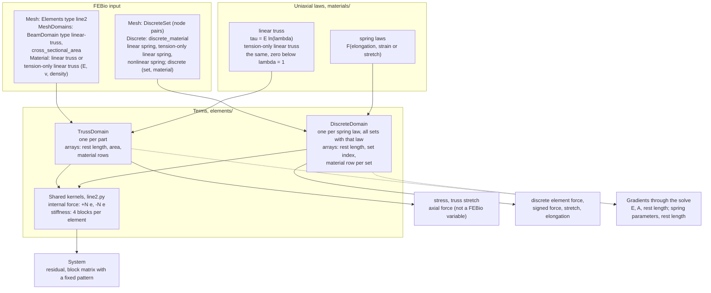
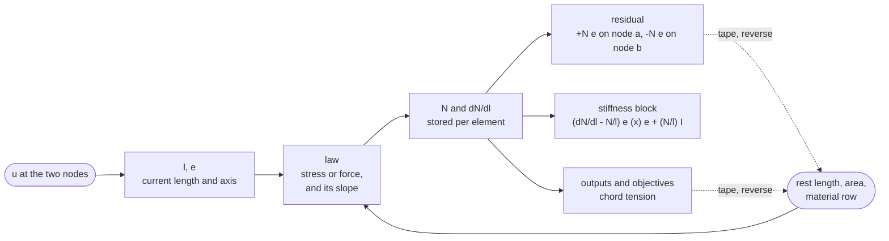

# Chordae: truss and spring elements

Draft for discussion, November 27, 2026 (v0.3). For Steve Maas, Jeff Weiss, Ryan Black and the Warp team. Nothing here is settled. Part of the set introduced in [remaining_areas.md](remaining_areas.md).

**What changed from v0.2.** That version was design only. This one comes with a first implementation of both elements for static steps, compared with FEBio, with gradients of chord tension through the solve, and with a first look at what FEBio FINESSE asks of these elements (section 9). The decision points keep their IDs (C1 to C5) and five are added (C6 to C10). C1 was decided on November 27: both a regular and a tension-only truss are offered. Dynamics (mass, inertia, mass damping on trusses) is still design only and waits for [dynamics.md](dynamics.md).

**Scope.** The two ways chordae are modeled in FEBio valve simulations, as two-node elements:

- **Trusses.** Current practice in the lab's valve models (Mangine, Laurence et al., "Effect of Parametric Variation of Chordae Tendineae Structure on Simulated Atrioventricular Valve Closure", arXiv 2411.09599): branched chord networks of `linear truss` elements.
- **Springs.** The open mitral input in the FEBio model repository (file 3572) uses `nonlinear spring` sets in the `Discrete` section. This closes open item 5 of the [integration note](integration.md).

**The rule followed.** FEBio decides the inputs, the formulations and the outputs. The internals are arranged for Warp: flat arrays over elements, one kernel per call, a fixed block pattern, and every parameter a device array that carries a gradient. Gradients through the solve have no FEBio counterpart, so those choices are FEBio-Warp's own and are marked as such.

## 1. Summary

- **Both elements run in the static run path and agree with FEBio.** Four small inputs agree with FEBio's log data to 4e-12 or better, and three FEBio test suite problems (`bt01`, `di01`, `di02`) reproduce the suite's stored step counts, iteration counts and solution norms (section 6).
- **One mechanics, two domains.** A truss and a spring are both a two-node element with an axial force N(l). FEBio's two stiffness expressions are the same block, (dN/dl - N/l) e (x) e + (N/l) I, and it is the exact derivative of the force. The two FEBio domains are kept apart as terms and share the force and stiffness kernels.
- **Chord tension is a first-class quantity.** Each domain stores the axial force N per element and can evaluate it as a kernel output, so a tension can be an objective. FEBio writes the spring force but has no output for the axial force of a truss (decision C8).
- **Gradients of chord tension through the solve work and are checked.** With respect to modulus, area and rest length per truss, to stiffness, slack length, curve points and rest length per spring, and to every other parameter of the system (leaflet material, load), against central differences, on blocks and on a quad4 shell patch held by truss chords.
- **Rest length is a parameter array** that defaults to the geometric length, for trusses and for springs. Chord and neochord length become design variables without moving nodes (decision C3).
- **Two truss laws.** FEBio's `linear truss` carries compression: in a FEBio run with the load reversed on a small chord network, each chord carries 2.3 to 2.8 N in compression. Decided November 27 (C1): both are offered, FEBio's `linear truss` as it is, and a `tension-only linear truss` that is the same law with nothing in compression. The second is not a FEBio material, and the coverage report says so.
- **FEBio's `tension-only linear spring` is the closed form of the chord curve** in the valve inputs. The two give the same force and stiffness, and the closed form has the slack length and the stiffness as its parameters, which is the more direct set for gradients.
- **With FINESSE in view, the chords can be the unknowns.** FINESSE has the loaded shape from an image and no chordae, so it emulates them with a force on the free edge. With chords in the model and gradients through the solve, a small example recovers four chord rest lengths, and so the chord tensions, from a target shape in 11 evaluations (section 9). What FINESSE itself needs that is not here is in the same section.
- **Two things found on the way that reach beyond chordae**: the single value stored per problem in the FEBio test suite is the L2 norm of the solution vector, which makes it a usable reference; and the first tangent of the suite's truss problem is singular (section 6).

## 2. From the input to a term

One iteration of one element, the same for both domains:

## 3. What the paper does

Read from the full text (arXiv 2411.09599; published version DOI 10.1007/s10439-026-04310-7).

| Item | In the paper |
| --- | --- |
| Chordae | Linear truss elements in FEBio, described as newly implemented. Modulus 150 MPa. Cross-sectional area 1.0 mm^2 (mitral) and 0.44 mm^2 (tricuspid) |
| Geometry | Branched primary and secondary chords generated by the `ValveFEMExport` module of SlicerHeart, from papillary muscle tips to insertion regions. The baseline mitral valve has 114 insertion points |
| Leaflets | quad4 shells, thickness 0.396 mm, isotropic Lee-Sacks |
| Boundary conditions | Annulus and papillary tips fixed |
| Load | Pressure rising linearly over 0.005 s |
| Contact | Potential-based |
| Analysis | Dynamic, generalized-alpha, mass damping on leaflets and chords, automatic time stepping with a largest step of 1e-4 s |
| Findings that bear on design | Moving from non-branched springs to trusses changed the predicted closure. Cross-sectional area had the most influence of the five chord parameters varied |
| Stated limitation | A linear chord material was used; an Ogden model would represent chord tissue better |

So the truss path needs, beyond the element itself: mass and mass damping on trusses, and interior junction nodes that belong only to trusses.

## 4. What FEBio does

From `FEBioMech/FELinearTrussDomain.cpp`, `FETrussMaterial.cpp`, `FEElasticTrussDomain.cpp`, `FEDiscreteElasticDomain.cpp`, `FESpringMaterial.cpp`, `FENonlinearSpring.cpp`, `FESolidDomainFactory.cpp`, `FEBioMechPlot.cpp`, `FEBioMechModule.cpp` and `FEBioXML/FEBioDiscreteSection.cpp` at `e4df3f8`.

**Trusses**

| Item | FEBio |
| --- | --- |
| Input | `Elements type="line2"` (or `truss2`). In the suite inputs the domain is written `BeamDomain ... type="linear-truss"` with `cross_sectional_area` |
| Default domain | A truss material on a two-node line element selects `linear-truss` |
| Material | `linear truss`: `E`, `v` (default 0.5), `density`. Kirchhoff stress tau = E ln(lambda), lambda = l/L. No cut-off in compression |
| Internal force | N = tau V / l along the current axis, with V = L A the reference volume |
| Stiffness | (V / l^2)(E - 2 tau) e (x) e + (tau V / l^2) I, times alpha_f |
| Mass | Consistent: rho A L / 3 on the diagonal, rho A L / 6 off it |
| Dynamics, body forces | Inertial force and body forces (so `mass damping`) are supported on trusses. With alpha_f below 1 the length is taken at interpolated node positions |
| Variable | `displacement` only |
| Reported stress | Cauchy, tau / J along the axis, with J = lambda^(1 - 2 v) |
| Output | `stress`, `truss stretch`. No variable for the axial force |
| `elastic-truss` | A second domain that evaluates any solid material at F = diag(lambda, lambda^-v, lambda^-v). Its stiffness uses k = E with the linear-truss expression commented out. Question 7 of the materials note asks the FEBio team about it |

**Springs**

| Item | FEBio |
| --- | --- |
| Domain | `FEDiscreteElasticDomain`, registered as `discrete`. Two-node elements on the `displacement` variable. It adds no mass |
| Input | A `DiscreteSet` of node pairs in the mesh; in `Discrete`, `discrete_material` entries and `discrete` entries that pair a set with a material by the material's position in the file |
| `linear spring` | F = E dl, with dl = L - L0 |
| `tension-only linear spring` | F = E (dl - `slack_length`) at or beyond the slack length, zero below it |
| `nonlinear spring` | F = `scale` times a function of the `measure` (elongation, strain or stretch) |
| Stiffness | (E - F/L) e (x) e + (F/L) I, with E the slope of the force with respect to length. A spring of zero current length uses F = 0, L = 1, e = (1, 1, 1) |
| Output | Plot: `discrete element force` (the vector), `signed force`, `stretch`, `elongation`, `percent elongation`, `direction`, `length`, `strain energy`. Log: `discrete element force` (signed scalar), `elongation`, `stretch` |
| Other discrete materials | `experimental spring`, `discrete composite`, `Hill`, `torsion spring` |

In the open mitral input: 100 springs in 8 sets. Every set uses `measure` elongation and a three-point curve with linear interpolation and extrapolation. The curve is zero up to a slack elongation (2, 3, 4 or 12 in the file's length unit) and rises with unit slope after it. `scale` is 30 or 60. That is the law of `tension-only linear spring` with E = `scale` and `slack_length` = the knot.

**The two are one case.** With N the axial force and l the current length:

| | N | dN/dl | Stiffness block (dN/dl - N/l) e (x) e + (N/l) I |
| --- | --- | --- | --- |
| Truss | tau V / l | V / l^2 (E_t - tau) | V / l^2 (E_t - 2 tau) e (x) e + (tau V / l^2) I, FEBio's expression |
| Spring | F | E | (E - F/l) e (x) e + (F/l) I, FEBio's expression |

So both FEBio tangents are exact derivatives of their forces (with alpha_f = 1), and both elements can share the force and stiffness kernels.

## 5. Design

| Topic | Design | Follows FEBio | Chosen for Warp |
| --- | --- | --- | --- |
| Domains | `TrussDomain` (one per part) and `DiscreteDomain` are terms: `update`, `residual`, `linearize`, `parameters` | Two separate domains, with FEBio's type names | Shared kernels for force and stiffness (`elements/line2.py`). The solver knows nothing about either |
| Law | The domain calls a uniaxial law from the material layer: stress and slope from the logarithmic stretch (truss), or force and slope from FEBio's deformation measure (spring) | `linear truss`, the three spring materials | The law is a function compiled into the domain's `update` kernel. Another law plugs in without touching the domain, which is how the tension-only truss was added (decision C2) |
| Tension-only truss | Material type `tension-only linear truss`, with the parameters of `linear truss`: tau = E ln(lambda) for lambda at or above 1, zero below. Active at lambda = 1, so an unstressed chord has stiffness in the first iteration | Not in FEBio. The name and the rule at the slack point follow FEBio's `tension-only linear spring` (extension >= 0 is active) | Exact tangent. The coverage report marks the material as FEBio-Warp only, since FEBio will not read an input that uses it |
| Per-element data | Rest length and area are arrays over elements. Material parameters are rows, with an index per element | FEBio holds area per element and takes the rest length from the reference node positions | Arrays are what gradients need. Rest length defaults to FEBio's value (decision C3) |
| Spring batches | One `DiscreteDomain` per spring law in use, holding every discrete set with that law; one parameter row per set | FEBio makes one domain per `discrete` entry | The eight chord groups of the open mitral input are one launch (decision C7) |
| Names | Spring parameters and outputs are keyed by FEBio's discrete set names: `A1.material`, `A1.rest_length`, and results per set. Truss parameters are keyed by the part name: `Chords.material`, `Chords.area`, `Chords.rest_length` | FEBio's own names for sets and parts | Each set's entry is a view of the domain's array, so values and gradients are shared with the one array the kernel reads. A part and a discrete set with the same name are refused |
| Blocks | Four 3x3 blocks per element at fixed positions | | The block pattern never changes, as for every term |
| Axial force | `update` stores N per element. `axial_force(state)` evaluates it into arrays of its own, for outputs and objectives | Springs: `discrete element signed force` | For trusses this is an added output (decision C8) |
| Junction nodes | A node used only by trusses or springs has one entry (`displacement`). A node shared with a shell uses the shell node's `displacement` entry, the front face | FEBio's domains use the displacement variable. Its shell-solid tie (`FindSSI`) looks at solid domains only | The coverage rule that refused shells sharing nodes with other parts now applies to solids only |
| Failure | A truss of zero length writes a status code and the step is rejected. A spring of zero length uses FEBio's guard | FEBio's truss has no guard for zero length; its springs do | A kernel cannot throw |
| Reaction forces | Both terms are marked internal | Both are elastic domains | |
| Loads added | `nodal_load` and `nodal_force` as one small term, because the suite's truss and spring problems use them | `FENodalDOFLoad`, `FENodalForce` | The scale is a device array with one value per node, so a force per node carries a gradient (section 9). It is also the port decision S9 of [sensitivity.md](sensitivity.md) describes |
| Mass (not in a run yet) | `TrussDomain.mass_blocks()` returns FEBio's consistent mass per element | `ElementMassMatrix` | To be added to the tangent through the same four block positions ([dynamics.md](dynamics.md)) |

**What Warp and Newton have for this, as far as we can tell.**

| Piece | Reading |
| --- | --- |
| `warp.fem` (1.19.0) | Its geometries are grids and triangle, quadrilateral, tetrahedral and hexahedral meshes. We found no line geometry, so both elements are dedicated kernels, as the quad4 shell is |
| Newton | Its model holds springs as flat per-spring arrays (`spring_indices`, `spring_rest_length`, `spring_stiffness`, `spring_damping`). The arrays here have the same shape, so a chord set should map onto them directly. The spring kernel of its semi-implicit solver, the one we read, is linear in l minus the rest length with a damping term, so it carries compression and has no slack |
| Jets | Warp's main branch after 1.19.0 has forward-mode jets (`wp.JetSpace`), which could give a tangent from a force or an energy without writing it by hand. Not in the pinned release and not tried; it bears on decision S10 of [sensitivity.md](sensitivity.md) |

**Alternative considered.** One domain for trusses and springs. Rejected as before: FEBio keeps them apart, a truss has mass and area and a spring has neither, and their inputs come from different sections of the file. Sharing the kernels gets the benefit without merging the domains.

## 6. Initial explorations

In double precision. Everything below was produced on CPU. The version of November 27 before the tension-only truss and the naming by discrete set was then run on a GPU as well (Quadro RTX 8000, `cuda:0`, Warp 1.19.0): the full tier passed on both devices, 173 tests, with the suite problems included, and no source change was needed. The tension-only truss and the naming by set have run on CPU only so far. FEBio is 4.13.0 built from source at `e4df3f8` without MKL (skyline solver), by `tools/build_febio.sh`.

**Against FEBio**

| Case | What it exercises | Compared | Agreement |
| --- | --- | --- | --- |
| `ch_chord_slack_tension` (existing) | One nonlinear spring from slack into tension and back, in a run | Spring force and reaction at 25 times, FEBio log data | Exact to the digits logged |
| `ch_truss_chords` (new) | A hex8 block held by four truss chords from one fixed point, pulled by a nodal load | Displacements, reactions, truss stress, 11 times; iteration counts | 3e-12; 3 per step in both |
| `ch_spring_chords` (new) | The same block on four springs of FEBio's three spring types; three start slack | Displacements, reactions, spring forces; iteration counts | 2e-12; the same counts in both |
| `shell_patch_truss_chords` (new) | Nine quad4 shells, one edge clamped, the opposite edge held by four truss chords. Trusses sharing nodes with shells | Displacements, shell and truss stress; iteration counts | 4e-12; 3 iterations per step in both |
| Suite `bt01` | 59 trusses, static, nodal load | Steps, iterations, solution norm stored in the suite | 10 and 20, as stored; norm to 7e-11 |
| Suite `di01`, `di02` | A linear spring on hex8 blocks | The same three | 10 and 30, as stored; norm to 3e-8 and 4e-9 |
| Suite `di03` | Springs between two cantilever boards, nodal force | Does not converge here | Fails the same way with the springs removed, and converges at 1 percent of the load. The cause is the missing line search, not the springs |
| Suite `di04` | Nonlinear springs | Not run | Its curves use `smooth` interpolation, which the point function here does not have. The coverage report says so |
| Suite `dy16`, `dy17` | Trusses, dynamic | Not run | Need dynamics |

**Element checks**

| Explored | Result | Where |
| --- | --- | --- |
| Truss force, stiffness, stress and stretch against FEBio's expressions, 40 random elements in tension and compression | Agree to 1e-11 | `tests/test_chordae_elements.py` |
| Spring force and stiffness for the three laws, both branches of the tension-only laws | Agree to 1e-11 | Same |
| Stiffness against central differences of the residual, both domains, all laws | Agree to 1e-7 | Same |
| `tension-only linear spring` against the three-point curve | Same force and stiffness to 1e-12 | Same |
| Tension-only truss, 40 random elements | Equals the linear truss where a member is stretched and is zero elsewhere; stiffness agrees with central differences to 1e-7 | Same |
| Tension-only truss in a run, all chords in tension (`ch_truss_chords`) | Equals FEBio's `linear truss` result for the same input to 1e-8 | Same |
| One chord made 30 percent longer on the quad4 patch | As a linear truss it pushes (-0.0024 against tensions of 0.0007 to 0.0058 in the others) and the largest displacement is 0.44; tension-only it carries exactly zero and the largest displacement is 0.30 | Same |

**Gradients through the solve.** The solve is one step on a `wp.Tape` (`solve_on_tape`), and the objective is computed after it by the domain's own kernel, so the tape adds the direct dependence of the tension on the parameters to the dependence through the solution.

| Objective | Parameters | Result |
| --- | --- | --- |
| A weighted sum of chord tensions, truss chords on a block | Every parameter of the system: E, v, area and rest length of each chord, block material, the load on each of four nodes (16 values) | Adjoint against central differences within 1e-5 relative, the test tolerance |
| The same, spring chords on a block | Stiffness, slack length, curve points and rest length of each spring, block material (16 values) | Within 1e-5 relative |
| The same, with two of the four springs slack at the solution | The same 16 values | Within 1e-5 relative; zero for the slack springs' parameters |
| Tension-only truss chords on the quad4 patch, one chord slack at the solution | Modulus, area and rest length of the four chords (10 values) | Within 1e-5 relative; exactly zero for the slack chord's area and rest length |
| Total tension of the 100 chord springs of the mitral input (8 sets, one launch), at a prescribed stretch with 60 chords in tension and 40 slack | The 56 set parameters (scale and curve points) | Tape against central differences within 1e-6 relative |
| Tension of one chord, truss chords on a quad4 shell patch | Area and rest length of the four chords (8 values) | Within 1e-5 relative |
| A displacement of the block held by truss chords | The same 16 values | Within 2e-5 relative |

On the shell patch, the tension of the first chord with respect to the four chord areas is 0.0031, -0.0051, 0.0029 and 0.0004 (force per area, in the units of the input): positive for its own area and negative for the adjacent chord's. This is the demonstration v0.2 proposed, in a static step and on a small patch.

**Chords in compression.** `ch_truss_chords` with its load reversed: FEBio and FEBio-Warp both converge, and each chord carries 2.3 to 2.8 N in compression against the 10 N applied. The tangent stayed positive definite in this case, because the block's own stiffness holds the lower nodes sideways.

**Tension-only chords in a static step.** A structure held only by its chords can lose its support in one Newton iteration. On `ch_truss_chords` with one chord already slack, lengthening a second chord by 1e-4 left the block on two chords in the first iteration and the step failed. The same case with all chords starting at their rest length runs. This is the situation the valve models avoid by running dynamics with mass damping, and it is the reason the tension-only tests with a slack chord use the clamped shell patch.

**Two findings that reach beyond chordae.**

- **The suite's stored value is a usable reference.** The suite runs FEBio with `-task=test`, which logs `solution_norm` (the L2 norm of the solution vector, `FELogSolutionNorm`) for an input with no data records of its own, and stores the last value with the step and iteration counts in `code/linuxGoldStandards.py`. The three problems above reproduce it from release builds without running FEBio here. [remaining_areas.md](remaining_areas.md) and [output.md](output.md) describe this value only as "one value"; this bears on decision O1.
- **The first tangent of `bt01` is singular.** At zero stress the truss has mechanisms: rank 55 of 66 free unknowns. The dense check solve refuses it, conjugate gradients solve it, and the FEBio build used here (skyline solver) stops with a NaN in the solution, while the suite records a normal run for release builds. This bears on decision L4 of [linear_solve.md](linear_solve.md) and on which FEBio build is pinned.

**Cost of the spring kernels.** `nonlinear spring` with the three-point chord curve, random node pairs, milliseconds, best of 7 after a warm-up, on an Intel i9-9940X and a Quadro RTX 8000 (`tools/time_springs.py`). Single runs of the script, not a benchmark.

| Springs | Kernel | CPU | `cuda:0` | Ratio |
| --- | --- | --- | --- | --- |
| 100 | update | 0.088 | 0.038 | 2 |
| 100 | residual | 0.028 | 0.023 | 1.2 |
| 100 | stiffness blocks | 0.042 | 0.033 | 1.3 |
| 10,000 | update | 0.62 | 0.041 | 15 |
| 10,000 | residual | 0.15 | 0.024 | 6 |
| 10,000 | stiffness blocks | 0.54 | 0.056 | 10 |
| 1,000,000 | update | 95.7 | 0.90 | 107 |
| 1,000,000 | residual | 23.9 | 3.1 | 8 |
| 1,000,000 | stiffness blocks | 25.2 | 2.5 | 10 |

- At the size of a valve (100 springs) the device makes no practical difference: every kernel is under 0.1 ms on both.
- The update kernel, which evaluates the law, gains about 100 times at a million springs; residual and stiffness gain about 10.
- `update` as the run path calls it also reads a status code back to the host. On `cuda:0` that adds about 0.05 ms at small counts (0.084 ms in all at 100 springs) and roughly doubles the update at a million (1.6 ms). This is a run path choice shared by every term, and at valve size it is the larger part of the spring update.
- The chord-length example of section 9 gives the same fitted lengths and tensions on both devices to the seven digits printed, in 11 evaluations on each.
- Not measured: trusses, a full assembly, a solve, single precision.

Not explored: any dynamic step with trusses, the two newest pieces on a GPU, the open mitral input, trusses or springs attached to rigid bodies.

## 7. Decision points

| ID | Decision | Options | Proposed | For |
| --- | --- | --- | --- | --- |
| C1 | Compression in chords. FEBio's `linear truss` has no tension-only form, so a slack chord carries compressive stress, and its geometric stiffness is then negative across the axis. Confirmed in a FEBio run (section 6) | (a) Follow FEBio exactly. (b) Add a tension-only option here. (c) Add it in FEBio first, then follow | **Decided November 27 (MJ): both are options.** `linear truss` as FEBio has it, and `tension-only linear truss` here. Still open for Jeff and Steve: whether a tension-only truss belongs in FEBio too, so that such an input can be compared, and whether the name and the rule at lambda = 1 are what they would choose | Jeff, Steve |
| C2 | Nonlinear chord material (the paper names Ogden) | (a) FEBio's `elastic-truss` with a solid material. (b) A uniaxial law on the `linear-truss` structure. (c) Wait | Depends on the answer to question 7 of the materials note. The domain takes either: its law is a plug point, as the tension-only truss shows | Jeff, Steve |
| C3 | Rest length as a parameter. FEBio takes L from the reference node positions | (a) Geometry only. (b) A per-element rest length array that defaults to the geometric length | (b), now implemented for trusses and springs. Forward results are unchanged; chord and neochord length become design variables without moving nodes. Outputs FEBio computes from node positions (`discrete element stretch`, `elongation`) are computed from the array, which is the same unless it is changed | Team; Warp team for the gradient path |
| C4 | Which target comes first for chordae | (a) Springs. (b) Trusses | Both now exist for static steps. Trusses lead in what follows (dynamics, the valve patch) | MJ |
| C5 | An open valve input with truss chordae | None was identified in the FEBio model repository files read so far | Two small inputs stand in for now (a block and a quad4 shell patch on truss chords), until a model from the paper's workflow can be shared | MJ |
| C6 | How fine the parameters are | (a) One material row per part or discrete set, as the input gives it; area and rest length per element. (b) Everything per element | (a) as the default. A gradient with respect to a row is the gradient for that chord group, which is how FEBio names parameters. The domain also takes one row per element when a per-chord modulus is wanted | MJ, Warp team |
| C7 | How springs are grouped | (a) One term per spring law, all sets with that law. (b) One term per `discrete` entry, as FEBio | (a). One launch for the chordae of a valve. Parameters and outputs are keyed by FEBio's discrete set names (decided November 27) | Steve, Warp team |
| C8 | Chord tension of a truss as an output. FEBio writes `stress` and `truss stretch` for trusses and has no axial force variable | (a) An output here named `axial force`. (b) Derive it from the stress when needed (N = s A L / l for v = 0.5). (c) A plot variable in FEBio, then follow | (a) for now, since objectives need it as a kernel output. (c) if the FEBio team sees use for it | Steve, MJ |
| C9 | Gradients at the slack corner. A tension-only law has a jump in stiffness at the slack length, so the gradient with respect to the slack length is one-sided there | (a) FEBio's law as it is. (b) A smoothed law for optimization, which FEBio does not have | (a). The gradients checked here were away from the corner. Revisit if an optimization stalls on chords that sit at their slack length | MJ, Jeff, Warp team |
| C10 | How shape matching is posed, with FINESSE in view (section 9) | (a) FINESSE as it is: a `sliding-elastic` interface with the tension flag pulls the leaflets onto a rigid target surface. (b) The misfit to the target as an objective, minimized over chord and other parameters with adjoint gradients. (c) Both | (c) is where this seems to lead: (a) to reproduce FINESSE and compare with FEBio, (b) for what FEBio cannot do. Neither is built. (a) needs a contact formulation the contact plan lists as reserved | MJ, Jeff, Steve; Warp team for (b) |

Points of care that are not decisions:

- **A slack or unstressed network can make the tangent singular or indefinite.** `bt01` is singular at its first iteration (section 6). A compressed `linear truss` chord adds negative stiffness across its axis, and a slack tension-only chord adds none at all. Mass and damping in a dynamic step offset both. A preconditioner or factorization that needs a positive definite matrix may not accept either ([linear_solve.md](linear_solve.md), decision L4).
- **FEBio's slope of a point curve is a central difference** (`PointCurve::derive`); the spring law here returns the exact slope of the active segment. They agree to about 1e-7 away from a knot. This is recorded in `nonlinear_spring.py`.
- **A spring curve with `smooth` interpolation is refused**, not approximated. The suite's `di04` uses it; the open mitral input does not.

## 8. Gradients

FEBio has no adjoint, so these points have no FEBio counterpart to follow.

| Point | Statement |
| --- | --- |
| Tangent | Both stiffness blocks are the derivative of the force. `linearize(exact=True)` returns the same blocks as the Newton tangent |
| Parameters | Trusses: material rows (E, v), area and rest length per element, under the part name. Springs: one material row and the rest lengths per set, under the set name. All are device arrays listed by `parameters()`, so the existing adjoint and its check cover them with no change |
| Chord tension as an objective | `axial_force(state)` on a tape after `solve_on_tape`. The tension depends on the parameters directly and through the solution; the tape adds the two |
| Smoothness | E ln(lambda) is smooth for lambda above zero. Tension-only springs and the tension-only truss have a corner at the slack point (decision C9) |
| Which parameter set for springs | The closed form (`tension-only linear spring`: E, `slack_length`) and the three-point curve are the same law. For design variables the closed form is the direct one |
| Not differentiable | The topology of the network (number of branches, insertion points). Those stay parameters of the geometry tool |
| Not yet | Gradients over dynamic steps ([sensitivity.md](sensitivity.md)); gradients with respect to node positions, such as a papillary tip; a misfit to a target surface as an objective (section 9) |

## 9. FINESSE: what it asks of these elements

FEBio FINESSE (Laurence, Sabin, Sulentic, Daemer, Maas, Weiss, Jolley, "FEBio FINESSE: An Open-Source Finite Element Simulation Approach to Estimate In Vivo Heart Valve Strains Using Shape Enforcement", Ann Biomed Eng, DOI 10.1007/s10439-024-03637-3, arXiv 2407.09629) estimates leaflet strains by making a simulation match the valve shape seen in an image. Read from the full text.

| Item | In the paper | Here |
| --- | --- | --- |
| Shape enforcement | A `sliding-elastic` interface with the tension flag between the leaflets and the image-derived target, held as a rigid surface. Traction is the penalty times the gap along the leaflet normal; augmented Lagrangian in the synthetic cases, penalty only in vivo | Not available. The contact here is the potential; sliding-elastic and rigid surfaces are reserved (decision C10) |
| Chordae in the synthetic targets | Tension-only springs giving 2000 mN between stretches of 1.01 and 1.03 | Readable as a `nonlinear spring` with `measure` stretch, if that is how the inputs write it. The inputs were not seen, so this is not confirmed |
| Chordae when matching an image | Unknown, since they cannot be reconstructed from 3D echo. Emulated by a force on the free-edge nodes normal to the annulus plane (6.0 N in the synthetic sweep), or by prescribing the free-edge motion | A force on a node set is the `nodal_force` term, now with one differentiable value per node. Prescribed motion exists; its values are not yet differentiable (decision B2 of [constraints.md](constraints.md)) |
| Leaflets | quad4 shells, 0.39 mm, isotropic Lee-Sacks, pressure ramp, dynamic with automatic time stepping | As for the valve path: shells and the material exist, dynamics does not |
| Stated limits and plans | Material properties cannot be inferred; chordae are emulated; the authors plan to explore "functional" chordae structures from FINESSE results | The gradients of section 6 are the tool for both |

**What gradients add.** In FINESSE the chordae are a given (a force of chosen size) and the shape is enforced. With chords in the model and the adjoint, they can be unknowns: find the chord lengths, or the forces on the free edge, for which the loaded shape matches the target, and read off the tensions.

**A first exploration.** `examples/chordae/recover_chord_lengths.py`, on the quad4 patch held by four truss chords:

| Step | Result |
| --- | --- |
| Target shape made with the four rest lengths changed by +3, -2, +5 and -3 percent | The four tensions then differ by a factor of 30 |
| Rest lengths fitted to the target positions from the unchanged lengths, L-BFGS-B with adjoint gradients | Misfit reduced by 25 orders of magnitude in 11 evaluations, each one forward run and one adjoint solve |
| Recovered | Rest lengths to 1e-8 relative, tensions to 1e-6 |

This shows the path works end to end, and no more than that. The target is the model's own result, so the fit can be exact. With a target from an image the misfit is a distance to a surface and does not reach zero, and whether chord lengths or tensions are identifiable from shape on a real valve is an open question (a slack chord, for one, leaves no trace in the shape). The unknowns had to be bounded to within 10 percent, because the forward solve has no line search and fails on the optimizer's first long step.

**What a FINESSE-style run would need beyond this note**, in rough order: dynamics; a misfit to a target surface as a kernel output (closest point on a triangle mesh, for which Warp has mesh queries); a sliding-elastic interface with tension against a rigid surface, to reproduce FINESSE itself; prescribed values as differentiable arrays.

## 10. Verification

FEBio test suite first (commit `986005f`), then small inputs for what the suite lacks.

| Input | Source | What it exercises | State |
| --- | --- | --- | --- |
| `bt01` | Suite | 59 trusses, static, nodal load | Passes against the suite's stored values. Runs in the tests when `FEBIO_TEST_SUITE` points to a checkout |
| `di01`, `di02` | Suite | A linear spring on hex8 blocks | Pass, the same way |
| `di03` | Suite | Springs, nodal force | Waits for a line search |
| `di04` | Suite | Nonlinear springs with `smooth` curves | Waits for that interpolation |
| `dy16`, `dy17` | Suite | Trusses, dynamic; `dy17` has body force and mass damping | Wait for dynamics |
| `ch_chord_slack_tension` | `references/small_problems` | One nonlinear spring from slack into tension | Passes in a run |
| `ch_truss_chords`, `ch_spring_chords` | `references/small_problems`, new | Chord networks on a block: load sharing, three spring types, slack at the start | Pass |
| Tension-only truss | No FEBio counterpart | Checked against the linear truss where both apply, against finite differences, and by its own gradients | Passes. A FEBio comparison needs the material in FEBio (decision C1) |
| `shell_patch_truss_chords` | `references/small_meshes`, new | Trusses sharing nodes with quad4 shells | Passes |
| A quad4 leaflet patch with a branched truss network, pressure and mass damping | To add | Junction nodes; chords going slack; dynamics | Milestone M1 of the [work plan](work_plan.md) |

The suite inputs are not copied into this repository; the suite has no license file, a question already with Steve in the verification note.

## 11. Reserved

- Mass, inertia and body forces on trusses in a run, and alpha_f below 1 (length at interpolated positions), with [dynamics.md](dynamics.md).
- Uniaxial laws with history on these elements (a superelastic strut, say). Such a law is refused for now, not run with its history ignored.
- Other discrete materials (`experimental spring`, `discrete composite`, `Hill`, `torsion spring`), and `smooth` and other curve interpolations.
- Springs and trusses attached to rigid bodies. Both FEBio domains also carry rigid rotation.
- Chord rupture and other failure criteria.
- The plot file and log outputs of springs and of the truss stretch. The values are produced and kept in the results; the writers wait for the [output registry](output.md).

## 12. Depends on

The `Term` contract of the run path, the uniaxial family of the material layer, and [dynamics.md](dynamics.md) for mass and mass damping.
