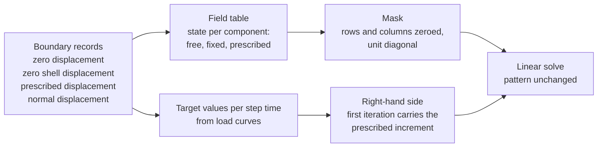

# Constraints: normal displacement, and what masking reserves

First template for discussion, November 26, 2026. Design only: there is no code for this note. Nothing here is settled. Part of the set introduced in [remaining_areas.md](remaining_areas.md).

**Scope.** The one boundary condition the open TPVR input needs that the run path does not have, `normal displacement`, and a statement of how the masking approach would extend to the constraint types that are reserved.

## 1. Summary

- **`normal displacement` is a prescribed displacement with a direction per node.** It fits the existing mask with no change to the matrix or the solver.
- **The directions are fixed when the condition is activated**, from the reference geometry, as FEBio does.
- **Linear constraints and rigid bodies do not fit masking as it is.** Two routes are outlined for later. Which one is a question already put to Steve in the run path note (point 1), and is not repeated.

## 2. How a constrained component is handled

The first three record types exist in the run path. This note adds the fourth.

## 3. What FEBio does

From `FEBioMech/FEPrescribedNormalDisplacement.cpp` and `FECore/FEPrescribedBC.cpp` at `e4df3f8`.

| Item | FEBio |
| --- | --- |
| Class | `FEPrescribedNormalDisplacement`, a prescribed surface condition on the `displacement` variable |
| Parameters | `scale` (may follow a load curve), `surface_hint`, `relative` |
| Normals | With `surface_hint` 0: at activation, for each facet and each of its corners, the cross product of the two edges at that corner in the reference configuration is added to the node. The sums are normalized |
| Value | The node's normal times `scale`, for all three components |
| `relative` | The displacement the node had at activation is added to the value |
| State | All three displacement components of every surface node become prescribed |

In TPVR file 3599 there are two, one on each crimping tube, each with `scale` 22 on its own load curve, `surface_hint` 0 and `relative` 1. The tubes are tri3 shells. The condition names the `displacement` variable only, so the tubes' `shell displacement` components are not prescribed by it.

## 4. Proposed

| Topic | Proposal | Why |
| --- | --- | --- |
| Normals | Computed once on the host when the condition is activated, by FEBio's rule, and stored per node | They do not change during the run. The computation is a short loop over facets |
| Values | The target of a node is its stored normal times the current `scale`, plus the displacement at activation when `relative` is set | The field table already produces target values per step time for prescribed components |
| Mask | The three components are marked prescribed | Nothing else changes: same matrix pattern, same solve |
| `scale` as a parameter | Held in a device array so the target can be differentiated with respect to it | The crimp depth is then available as a design variable. The adjoint already gives the sensitivity to a prescribed displacement |
| `surface_hint` other than 0 | Refused by the coverage report | The open inputs use 0 |

**Alternative considered.** Constrain only the normal component and leave the tangential components free. That is a different condition from FEBio's, which prescribes all three components along a fixed direction.

## 5. Verification

| Input | What it exercises | Status |
| --- | --- | --- |
| A small tube of tri3 or quad4 shells with `normal displacement` on a load curve | The normals, the values and `relative` | To add, with its FEBio reference. The verification note lists suite problem `ma49` for this feature |

## 6. What masking reserves

Masking keeps every unknown in the system and fixes the matrix pattern. Two constraint types need more than a mask.

| Type | FEBio | Needed by | Route A | Route B |
| --- | --- | --- | --- | --- |
| Linear constraints | `FELinearConstraintManager`, which the solver consults when it numbers equations and prepares a step | No open input checked | Eliminate through a sparse transformation u = T q applied to the matrix and residual (`bsr_mm`) | Enforce by penalty or multipliers as a term |
| Rigid bodies and joints | `FERigidSolver`: rigid body unknowns replace the nodes' own | The mitral dilation model | The same transformation, with rigid body unknowns as extra entries of the field table and their own update rule | Stiff penalty ties, which is not what FEBio does |

Route A keeps FEBio's formulation and costs a matrix product per iteration with a pattern that is fixed once the constraints are known. No choice is proposed here.

## 7. Depends on

Masking of constrained components (run path, section 4). Step activation is in [dynamics.md](dynamics.md).
