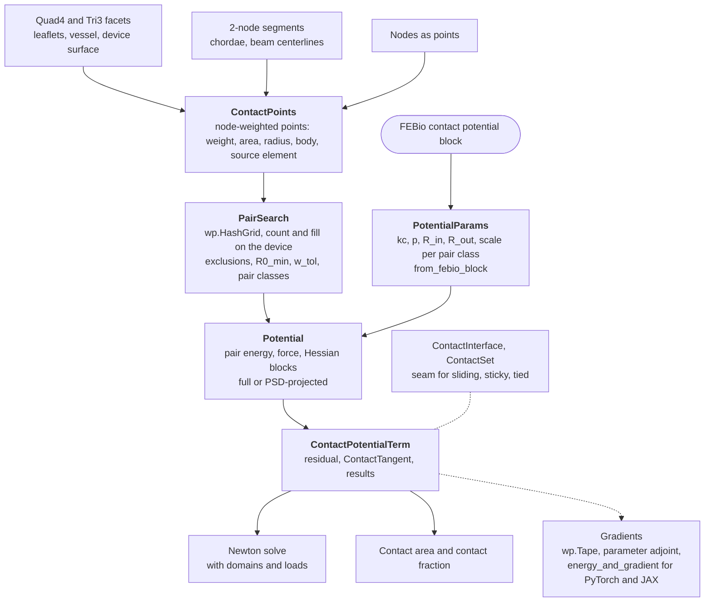
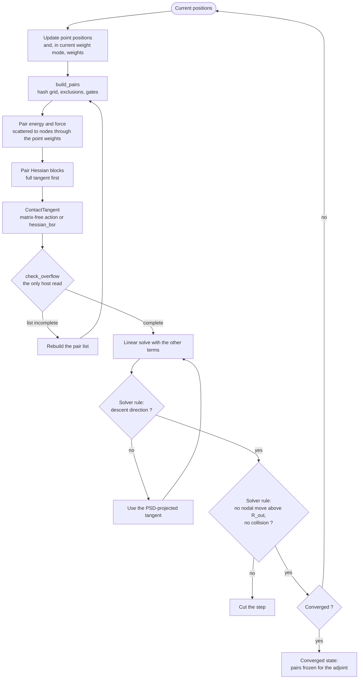

# Contact

Point-based contact for valve leaflets and self-expanding devices: an initial
exploration, built on Kamensky et al. (2018) and FEBio's `FEContactPotential`.
This page is the code map and the list of what is and is not equivalent to FEBio.

**Layout.** This note follows the layout of the design set: a flow diagram, what has been explored, and decision points with options and a proposal ("Initial explorations" and "Decision points" below). The [design overview](https://github.com/JolleyLab/FEBio-Warp-Python/blob/mattjolley/run-path-template/docs/design/overview.md) shows where it sits, [remaining areas](https://github.com/JolleyLab/FEBio-Warp-Python/blob/mattjolley/run-path-template/docs/design/remaining_areas.md) lists every decision by reviewer, and the [work plan](https://github.com/JolleyLab/FEBio-Warp-Python/blob/mattjolley/run-path-template/docs/design/work_plan.md) says what depends on it.

## At a glance

The pieces of the module and how they connect to the rest of FEBio-Warp.



One Newton iteration with contact, and what the adjoint reuses.



## What is implemented

| File | Content |
|---|---|
| `contact/points.py` | `ContactPoints`: node-weighted points with integration weight, area, radius offset, body, source element, and the derivative weights that give current normals and current Jacobians. Builders for Quad4 facets (`quad_facet_points`: FEBio default 2x2 Gauss, `higher-order` 4x4, or a regular sub-lattice), Tri3 facets (`tri_facet_points`: 1, 3 or 7 points), 2-node segments for chordae and beam centerlines (`segment_points`, by spacing or count), nodes as points (`node_points`), and `boundary_triangles` for a Tet4 surface. |
| `contact/search.py` | `PairSearch`: float64 `wp.HashGrid` on the points, count-and-fill pair list with a device-side scan, fixed-capacity buffer with a single host overflow check. Exclusion by body, reference distance (`R0_min`), same element (FEBio default) or shared node (`exclude_neighbors`), and `w_tol`. Pair classes from an `[n_bodies, n_bodies]` table. |
| `contact/potential.py` | The Kamensky volume potential as FEBio implements it (`FEContactPotential`): `PotentialParams` (per-class `kc`, `p`, `R_in`, `R_out`, pair multiplicity `scale`), nondimensional force law, pair energy/force kernel, pair Hessian blocks (full or PSD-projected), matrix-free tangent action chained through the point weights, device BSR assembly (`hessian_bsr`, warp.sparse), host triplets and dense for tests, minimum effective distance for the `r_min` guard, reference or current (FEBio) integration weights, Wu 2022 contact area and Zelonis 2026 contact fraction. `from_febio_block` translates a FEBio `contact potential` block, FEBio names unchanged. |
| `contact/enforcement.py` | `ContactPotentialTerm`: the potential behind `contracts.PhysicsTerm` with the residual sign convention (internal + contact - external), a `ContactTangent` operator (apply, apply_transpose, assemble), results, and `energy_and_gradient` as the building block for PyTorch and JAX custom ops. |
| `contact/interface.py` | `ContactInterface` protocol and `ContactInterfaceBase`, the FEBio-style seam for further laws (sliding with friction, sticky, tied); `ContactSet` drives several interfaces as one. |
| `tests/test_contact_potential.py` | Law continuity; force against finite differences of the energy and tangent action against finite differences of the force, in the blend region, in the stiff core, and with radius offsets; assembled symmetry; PSD projection; tape gradient in both weight modes; parameter adjoint against finite differences; exclusion rules; guards for coincident and overlapping points; pair classes; current weights; pair multiplicity; BSR against the matrix-free action; FEBio block translation; FEBio's contact diagnostic check; metrics. FP64. Run on CPU so far; `WARP_FEBIO_TEST_DEVICE=cuda:0` runs the same checks on a GPU, and one graph-capture test runs only there. |
| `examples/contact/point_spacing.py` | The lattice sums behind the point-spacing rule. |

FEBio's own test suite (`FEBioTest/` on the develop branch) is the reference
for further checks. `FebioDiagnosticTests` applies the check of
`FEContactDiagnostic.cpp` (its two-hex geometry, its two surfaces, contact
stiffness against a finite-difference derivative of the contact residual, pass
below 1e-3 percent) to the contact potential; FEBio's diagnostic itself
exercises a sliding interface. The tangent diagnostics there are the model for
element and material checks as those components arrive.

## Conventions

* Distances are evaluated as `|x_j - x_i| - radius_i - radius_j`. With zero radii
  the law is FEBio's. A wire on its centerline with `radius = r_w` is a capsule;
  for a FEBio-equivalent run set the radius to zero and put `r_w` into `R_in`,
  which is what FEBio's edge-to-surface contact potential requires.
* `weight` is the reference-facet Jacobian times the rule weight (area) for
  surfaces and segment length times rule weight for lines. `weight_mode="current"`
  switches to current Jacobians as FEBio does (`UpdateSurface`); FEBio does not
  differentiate the weights and neither does this module in that mode, so the
  force is then not the exact energy gradient. The tape and finite-difference
  tests apply to the reference mode. `kc` is unscaled, as in FEBio, so it
  carries the units that make `weight_i * weight_j * kc / r^p` a force.
* Inside the kernels distances are `s = r / R_out`, so one set of coefficients
  serves models in millimetres and in metres (the package convention is SI).
* Pair selection and pair evaluation are separate steps. `build_pairs` (or
  `update_pairs` on the term) is called once per Newton iteration in a forward
  solve and once at the converged state for a frozen-pairing adjoint.
* Nothing between `build_pairs(sync=False)` and `check_overflow()` touches the
  host. Pair search, energy, force and pair Hessian blocks are meant to be
  captured in a CUDA graph (`test_newton_body_is_graph_capturable`, GPU only);
  `hessian_bsr` has not yet been exercised under capture. If `check_overflow`
  returns True the list was incomplete and must be rebuilt.

## FEBio equivalence: what the source says

Taken from `FEBioMech/FEContactPotential.cpp` and
`FEEdgeToSurfaceContactPotential.cpp` on the develop branch, not from the papers.

* Contact points are facet Gauss points (2x2 per quad, 3 per triangle by default;
  16 and 7 with `integration_rule="higher-order"`); the edge-to-surface variant
  uses nodal integration on 2-node line elements (FE_LINE2NI: a point at each
  node, weight 1). Weights are current Jacobian times rule weight on each side.
  `kc` is unscaled. The grid cell size is at least `R_out`; pairs are activated
  per element pair; the tangent is the full pair Hessian.
* By default only an element against itself is skipped; `exclude_neighbors`
  extends that to element pairs that share a node. `R0_min` (reference distance)
  and `w_tol` (cosine between the pair direction and the primary point's current
  facet normal) are element-pair activation gates: one Gauss-point pair that
  passes activates the whole element pair, which is then summed without
  rechecking. `check_intersections` runs an edge-facet test and cuts the step.
* **Where this module differs.** `R0_min` and `w_tol` are applied per point
  pair, not per element pair, and `w_tol` passes if either point's normal
  passes. FEBio's edge-to-surface variant declares `w_tol` but does not use it;
  here it acts through the surface point's normal. `check_intersections` is not
  implemented. A facet-level match with FEBio at `w_tol > 0` should therefore
  not be expected yet; an element-pair activation mode is the next step for
  the reference tier.
* **Pair multiplicity (for Steve's review).** `Update` activates element pairs
  from every primary element, and `LoadVector`/`ElementForce` and
  `StiffnessMatrix`/`ElementStiffness` add each activated pair to both
  elements. When one surface is both primary and secondary (the open
  mitral input uses `ContactLeaflet` for both), the pair (A, B) appears to be
  activated from A and again from B, so every self-contact pair would enter
  twice relative to the unordered sum here. `PotentialParams(scale=2)`
  reproduces that; `from_febio_block(..., scale=2)` is the switch. Whether
  this reading is right, and if so whether it is intended, is a question for
  the FEBio team.

## Initial explorations

A summary of "What is implemented", in the form used across the design notes.

| Explored | Result |
| --- | --- |
| The potential as FEBio implements it: law, pair energy and force, pair Hessian | Force matches finite differences of the energy and the tangent action matches finite differences of the force |
| Pair search on the device with exclusion rules and gates | Implemented with `wp.HashGrid` in double precision |
| The tangent as an action and as an assembled block matrix | Agree |
| Gradients on the tape, and the parameter term an equilibrium adjoint needs | Match finite differences, with pairs held fixed |
| FEBio's contact diagnostic check applied to the potential | Passes |
| A FEBio `contact potential` block through `from_febio_block` | Translated with FEBio's names |
| Contact inside a run with domains, loads and a solver | Not explored; designed in the [contact in a run note](https://github.com/JolleyLab/FEBio-Warp-Python/blob/mattjolley/run-path-template/docs/design/contact_in_run.md) |
| A comparison with a FEBio run | Not yet; the first is suite problem `co62` |
| Any GPU run | One graph capture test is written for GPU; no GPU result is recorded in this note |

## Decision points

Each row points to where the detail is. IDs follow the scheme of the design set (N for the contact law; K is used for contact in a run).

| ID | Decision | Options | Proposed | For | Detail |
| --- | --- | --- | --- | --- | --- |
| N1 | Pair multiplicity in self-contact | FEBio appears to add each self-contact pair twice. (a) The unordered sum, `scale` 1. (b) `scale` 2, as FEBio appears to | Match FEBio once the reading is confirmed | Steve | "FEBio equivalence" above |
| N2 | How `kc` is specified with more than one pair class | (a) A wire radius absorbed into `R_in`, as FEBio's edge-to-surface potential. (b) A radius offset per point with common `R_in` and `R_out`. And `kc` as an input, or derived from a target force and gap | Not settled | Steve, the group | "Open question for review" below |
| N3 | Integration weights | (a) Current weights, as FEBio, where the force is not the gradient of the energy. (b) Reference weights, where energy, force and tangent are exact derivatives of one another | (a) for comparison with FEBio; (b), the default here, where exact derivatives matter. Which one a FEBio block selects is to settle | Steve, Warp team | "What differentiates" below |
| N4 | The `w_tol` and `R0_min` gates | Per element pair, as FEBio, or per point pair, as here | See decision K3 in the [contact in a run note](https://github.com/JolleyLab/FEBio-Warp-Python/blob/mattjolley/run-path-template/docs/design/contact_in_run.md#7-decision-points) | Steve | |
| N5 | Residual sign | FEBio's, or the one documented here | See decision K1 in the same note | Steve | |
| N6 | The tangent Newton uses | (a) The full pair Hessian. (b) The projected one | (a) first, (b) as the fallback | Steve | "Rules the solver must apply" below |
| N7 | Precision | Double throughout, or single for queries and later for kernels | Double for now; see decision T11 in the [materials note](https://github.com/JolleyLab/FEBio-Warp-Python/blob/mattjolley/run-path-template/docs/design/materials.md) | Warp team | "Not yet implemented" below |

For gradients: the pair list and the gates are selected in a separate step and never differentiated. `kc` per class receives gradients; `R_in`, `R_out`, `p` and the radius offsets are fixed model data.

In the [work plan](https://github.com/JolleyLab/FEBio-Warp-Python/blob/mattjolley/run-path-template/docs/design/work_plan.md) contact in a run is package W5, verified first on the FEBio test suite problem `co62`.

## Open question for review (Steve Maas and all)

How `kc` should be specified with more than one pair class. With the force and
its slope continuous at `R_in`, the force at the core boundary is
`p kc (R_out - R_in) / (2 R_in^(p+1))`: at fixed `kc` the stiffness scales as
`R_in^-5` for `p = 4`. Absorbing a wire radius into `R_in` (what FEBio's
edge-to-surface potential requires) makes wire-to-wire about 14 times softer
than wire-to-tissue at the same `kc` in the example below; the weight products differ by class
(area by area, length by area, length by length), so `kc` has different units
per class; and in SI the `R_in^5` factor makes hand-picked values unreadable.
The per-point radius offset keeps `R_in` and `R_out` common standoff
parameters, and `kc` can be calibrated per class from a target force at a
target gap through `2 pi g phi(g)` (the same closed form for a point over a
plane, a wire over a plane and a wire crossing a wire). Neither is settled.
In numbers (p = 4, kc = 1, mm):

| Pair class and convention | R_in | R_out | Force at R_in | kc for the leaflet stiffness |
|---|---|---|---|---|
| Leaflet against leaflet (Wu 2022) | 0.20 | 0.50 | 1,875 | 1.0 |
| Wire against tissue, radius absorbed into R_in (r_w = 0.19, standoff 0.08) | 0.27 | 0.60 | 460 | 4.1 |
| Wire against wire, radius absorbed into R_in | 0.46 | 0.80 | 33 | 57 |
| Wire against tissue, capsule offset 0.19 | 0.20 | 0.50 | 1,875 | 1.0 |
| Wire against wire, capsule offset 0.38 | 0.20 | 0.50 | 1,875 | 1.0 |

Which convention the reference tier should match, whether FEBio's
edge-to-surface potential should gain a radius term, and whether `kc` should
remain an input or be derived from a target force and gap per class, is for
the group to decide.

## Rules the solver must apply

Derived on small test problems and confirmed by the tests and the example:

* Contact points at most `R_out / 2` apart on both sides, densified independently
  of the mechanics quadrature (`rule="lattice"` or `n_per_edge=4`).
* No nodal move larger than `R_out` in one step; a collision check that cuts
  the step. The `min_distance` guard against `r_min` is available.
* Full tangent first (`project=False`); the projected tangent is the fallback
  when the full one fails to give a descent direction.
* Self-contact exclusion by body and topology (`exclusion="neighbors"`) plus
  the reference distance, never the reference distance alone. FEBio's own
  default is weaker: only an element against itself is skipped
  (`exclusion="element"`), and `w_tol` is what keeps neighboring facets from
  repelling each other; `from_febio_block` reproduces that.

## How this lines up with FEBio, MFEM and the FEBio-MFEM framework

* FEBio: the `ContactInterface` protocol mirrors `FEContactInterface` (update
  the pairing, add to the residual and the stiffness, augment, commit) and the
  parameter names are FEBio's, so a `.feb` contact block maps one to one. This
  is how Ryan Black's FEBio-MFEM framework (github.com/JolleyLab/FEBioMFEMiFSI)
  is organized: FEBio's object model (`FESolver`, `FESurfaceLoad`, domains)
  over MFEM numerics. It is cited here for that organization of the mechanics,
  not for anything fluid.
* MFEM: `ContactPotentialTerm` has the shape of a `NonlinearForm` (energy,
  residual as `Mult`, `linearize` as `GetGradient`), and `ContactTangent` is an
  `Operator` with `Mult` and `MultTranspose`, matrix-free by default, assembled
  on request (`assemble` returns a BSR matrix for preconditioners or a direct
  solve). Partial assembly in the MFEM sense is not attempted.
* Warp: selection (`HashGrid`, pair list) is separate from evaluation so the
  evaluation differentiates cleanly on `wp.Tape`; everything in the Newton body
  is graph-capturable; the tangent is available as an action and as a
  `warp.sparse` BSR matrix.

## What differentiates, and what does not

The contract the rest of FEBio-Warp (adjoints, PyTorch, JAX) can rely on
(tests: `PairKernelTests`, `CoreBranchTests`, `DifferentiabilityTests`):

* In reference-weight mode (the default), energy, nodal force and tangent
  action are exact derivatives of one another with respect to the nodal
  positions. In `weight_mode="current"` the integration weights are held fixed
  in both the residual and the backward pass, as FEBio holds them in its
  residual: the tape gradient still equals `residual()`, but the force is then
  not the gradient of the energy.
* The contact stiffness table (`kcs`, hence `kc` per class) receives gradients
  on the tape. `ContactPotentialTerm.residual_parameter_vjp(state, lam)` returns
  `lam^T dR/dkc` per class, the term an equilibrium adjoint needs after solving
  `K^T lam = dJ/dx`; verified against finite differences.
* Not differentiated, by design: the pair list (piecewise constant in the
  positions; selection is a separate step), `R_in`, `R_out`, `p` and the radius
  offsets (they enter through `c1`, `c2` and the nondimensional law and are
  treated as fixed model data), and the integration weights in current mode.
  Making the radii or `R_in`, `R_out` differentiable would be a contained
  change (they are arrays and scalars in the same kernels) if a fit ever needs
  them.
* Second derivatives with respect to positions come from the analytic pair
  Hessian (`linearize`), not from differentiating the tape twice.

## Coupling to PyTorch and JAX

`ContactPotentialTerm.energy_and_gradient(state)` records the energy on a tape
and returns the device gradient, which a `torch.autograd.Function` or
`jax.custom_vjp` can wrap through `wp.to_torch`, `wp.to_jax` and `wp.from_jax`
without copies. Second derivatives come from the analytic pair Hessian
(`linearize().apply` for a Hessian-vector product, `assemble()` for the
matrix), not from a tape of a tape, which Warp does not provide; the frameworks
consume the action as a linear operator for Gauss-Newton, Newton or adjoint
solves. The pair list is selected separately and never differentiated; with
`w_tol = 0` the energy is C2 in the positions, because the potential and its
first two derivatives vanish at `R_out`.

## Not yet implemented

* Element-pair activation for `w_tol` and `R0_min`, and `check_intersections`,
  from `FEContactPotential` (reference tier only).
* `SlidingContact` (penalty and augmented Lagrangian with Coulomb friction,
  `wp.Mesh` closest-point queries), `StickyContact` and `TiedContact`, behind
  `ContactInterface`.
* FP32 kernels: the module is FP64; the nondimensional law is the preparation
  for an FP32 variant once the linear solve is validated against FP64.

## Run

```bash
python -m unittest discover -s tests -v
python examples/contact/point_spacing.py
```

## References

* Kamensky D, Xu F, Lee C-H, Yan J, Bazilevs Y, Hsu M-C. A contact formulation based on a volumetric potential: Application to isogeometric simulations of atrioventricular valves. Comput Methods Appl Mech Eng 2018;330:522-546. doi:10.1016/j.cma.2017.11.007
* Wu W, Ching S, Maas SA, Lasso A, Sabin P, Weiss JA, Jolley MA. A computational framework for atrioventricular valve modeling using open-source software. J Biomech Eng 2022;144(10):101012. doi:10.1115/1.4054485
* Wu W, Ching S, Sabin P, Laurence DW, Maas SA, Lasso A, Weiss JA, Jolley MA. The effects of leaflet material properties on the simulated function of regurgitant mitral valves. J Mech Behav Biomed Mater 2023;142:105858. doi:10.1016/j.jmbbm.2023.105858
* Aslan S, Mangine NR, Laurence DW, Sabin PM, Wu W, Herz C, Unger JS, Maas SA, Gillespie MJ, Weiss JA, Jolley MA. Simulation of transcatheter therapies for atrioventricular valve regurgitation in an open-source finite element simulation framework. Ann Biomed Eng 2026. doi:10.1007/s10439-025-03959-w
* Zelonis CN, Maheshwari J, Wu W, Maas SA, Aslan S, et al. Integrated open-source framework for simulation of transcatheter pulmonary valves in native right ventricular outflow tracts. arXiv:2507.06337 (2026). doi:10.48550/arXiv.2507.06337
* Maheshwari J, Wu W, Zelonis CN, Maas SA, Sunderland K, et al. Effect of right ventricular outflow tract material properties on simulated transcatheter pulmonary placement. J Mech Behav Biomed Mater 2026. doi:10.1016/j.jmbbm.2026.107642
* Maas SA, Ellis BJ, Ateshian GA, Weiss JA. FEBio: Finite elements for biomechanics. J Biomech Eng 2012;134(1):011005. doi:10.1115/1.4005694
