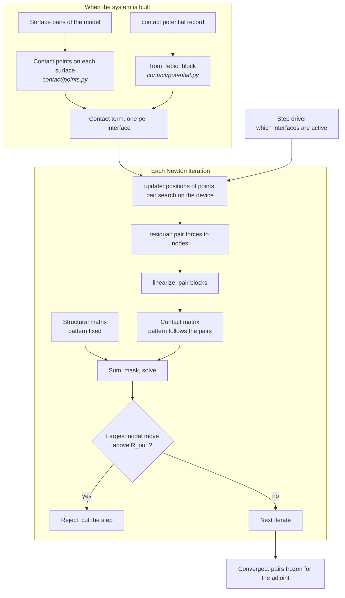

# Contact in the run

Template for discussion, November 28, 2026 (v0.4). Nothing here is settled.

**What changed from v0.3.** The open mitral input now runs through leaflet closure to the end, and agrees with the FEBio results stored for it over the whole of FEBio's run. Two things made the difference, both a matter of following FEBio: its line search ([linear_solve.md](linear_solve.md)), and its default for excluding neighboring elements from contact, which the reader here had the wrong way round. What was tried on the way, what it showed, and the plan from here, piece by piece, are in section 6. The design of sections 2 to 5 is as it was.

**Results** (double precision; FEBio results stored before this code existed):

| Case | What it exercises | Agreement with FEBio |
| --- | --- | --- |
| `bk_contact_potential_patch` | Two hex8 blocks with surface meshes that do not match, pressed together, static, 20 steps | Reaction force and stress to 4e-13 |
| `sh_self_contact_fold` | A quad4 shell surface folded onto itself, static, 30 steps, with the contact settings of the open mitral input (`kc` 2, `R_out` 0.5, `w_tol` 0.6) | Reaction force to 4e-11, displacements to 6e-12 |
| Suite `co62` | The FEBio test suite's contact potential problem | FEBio's 20 steps and 85 iterations exactly, solution norm to 7e-8 |
| The open mitral input (`P2Prolapse_Mitral.feb`, FEBio model repository project 134): 7,200 quad4 shells, 100 chord springs, pressure, mass damping, dynamic (`rhoi` 0), leaflet self-contact | Closure of a valve, end to end | Runs to the end (time 0.02; 286 steps, 1252 Newton iterations, 8 minutes on a Quadro RTX 8000 with the `cudss` solve). Against the stored FEBio 4.9.0 run, which itself ends in an error at time 0.0135: contact starts at the same time (0.00304); the contact area at FEBio's last time is 90.2 against FEBio's 89.6; the first principal stress of every element of the six leaflet regions, at FEBio's 394 output times, differs by 0.5 percent in the median (root mean square over the elements, relative to the root mean square stress), and by more only in the first steps, where the stress is small. `examples/valve/mitral_closure.py` repeats the run and the comparison |

FEBio ran the mitral input with BFGS at `dtol` 1e-3 and a material tangent scaled by `tangent_scale` 10; this code runs full Newton with the exact tangent. The step sizes therefore differ, and the comparison interpolates this run in time. Agreement to half a percent is at the level those differences allow, and is not a statement about round-off.

Two details of the template that follow FEBio: the initial accelerations of a dynamic step are solved with the mass alone, without the contact stiffness, and contact forces are not counted in the nodal reaction forces. FEBio's contact area (the area of the contact points with a nonzero force) is kept in the results per state.

**Scope.** How the contact potential of pull request 1 ([contact.md](contact.md)) joins a run: where its points come from, how it sits among the terms, where its tangent goes, and when it is switched on. The law, the search and the gradients are in the contact note and are not restated. This closes open items 1 and 2 of the [integration note](integration.md).

## 1. Summary

- **Four connections are missing, and no new mechanics.** Points from the model's surfaces, the interface as a term, its blocks in a matrix of their own, and activation by step.
- **One change is asked of the contact draft**: its residual sign becomes FEBio's, as in every other term.
- **The structural pattern never changes.** The contact pattern changes with the pairs and is confined to a second matrix.
- **Two rules of the contact draft become rules of the Newton step**: no nodal move larger than `R_out`, and the projected tangent as a fallback.
- **Both application inputs set `w_tol` above zero.** The contact draft applies that gate per point pair and FEBio applies it per element pair, so its element-pair mode is needed before an application can be compared with FEBio.

## 2. Where contact sits in one iteration

## 3. What FEBio does

From `FEBioMech/FEContactPotential.cpp`, `FESolidSolver2.cpp`, `FECore/FEModel.cpp` and `FEAnalysis.cpp` at `e4df3f8`.

| Item | FEBio |
| --- | --- |
| Ownership | The interface owns its two surfaces, its search grid and its law |
| Update | `FEContactPotential::Update` recomputes the surface points, rebuilds the grid with a cell size from `R_out`, and rebuilds the list of active element pairs |
| Force and stiffness | `ContactForces` and `ContactStiffness` in the solver loop over active interfaces after the domains and loads |
| Matrix profile | `BuildMatrixProfile` adds the active pairs to the global matrix profile |
| Activation | A contact interface declared inside a step is activated when the step starts and deactivated when it ends (`FEAnalysis::Activate`, `Deactivate`). One declared outside the steps is active throughout |
| Outputs | Per integration point: the smallest pair distance (reported as the gap), the traction and its magnitude (the pressure). The contact area sums the points whose traction is not zero |

What the application inputs ask of it:

| | Mitral closure | TPVR (file 3599) |
| --- | --- | --- |
| Interfaces | 1, a surface against itself | 3; the third is declared in step 2 |
| `kc`, `p` | 2, 4 | 150, 350 and 100; 4 |
| `R_in`, `R_out` | 0.2, 0.5 | 0.5, 1.5 |
| `w_tol` | 0.6 | 0.3 |
| `exclude_neighbors` | not set | 1 |
| `check_intersections` | not set | 0 |

## 4. Proposed

| Connection | Proposal | Why |
| --- | --- | --- |
| Points | Built from the model's `SurfacePair` records when the system is built, with `contact/points.py` | The contact draft already has points for quad and tri facets and tet4 surfaces. Only the route from a named surface is missing |
| Entries | A contact point moves with the `displacement` entries of its facet's nodes | The field table gives a shell node two entries. Contact forces go to the first. To confirm against FEBio's surface position for shells on `sh_self_contact_fold` |
| Term | The interface implements `Term`. `update` runs the pair search, once per iterate | The solver then treats contact like a domain or a load |
| Sign | FEBio's: the contact force is added to the residual as an external force | One convention for all terms (run path, point 3 for review) |
| Tangent | Contact blocks go into their own block matrix (`hessian_bsr` of the draft), which is added to the structural matrix before the solve | The structural pattern map stays valid for the whole run. Only the contact matrix is rebuilt when pairs change |
| Step rules | `solve_step` rejects an iterate whose largest nodal move exceeds `R_out` of any active interface, and falls back to the projected contact tangent when the full one does not give a descent direction | Both are stated in the contact note as rules the solver must apply |
| Activation | The step driver holds the list of active interfaces, switched at step boundaries as FEBio does | TPVR declares its third interface in step 2, its last step |
| Gates | Element-pair activation for `w_tol` and `R0_min`, as FEBio does it, for the reference tier | The contact note says a facet-level match with FEBio should not be expected at `w_tol` above zero until this exists. Both applications use it |

**Alternative considered for the tangent.** One global matrix whose pattern is rebuilt whenever pairs change. It is simpler to describe and is what FEBio does. It discards the pattern map on every change of pairs, which on the device means a new sort of all blocks each time.

**A second alternative, for iterative solvers only.** Do not form the sum. Give the solver the two matrices as one operator. A preconditioner built from the structural matrix alone may then be reused across iterations. This is worth measuring and is noted in [linear_solve.md](linear_solve.md).

## 5. What Warp provides

| Piece | Use |
| --- | --- |
| `wp.HashGrid` | The pair search, already in the contact draft |
| `bsr_set_from_triplets` | The contact matrix from the pair blocks |
| `bsr_axpy` | The sum of the structural and contact matrices |
| `warp.optim.linear.aslinearoperator` | The two matrices as one operator, for the second alternative |

## 6. Initial explorations

| Explored | Result | Where |
| --- | --- | --- |
| The potential, pair search, tangent and gradients on small problems | Implemented and tested in the contact draft | Pull request 1, [contact.md](contact.md) |
| A FEBio `contact potential` record from the reader to contact parameters | Works on `bk_contact_potential_patch` | `tests/test_contact_from_model.py` |
| Contact parameters of the two application inputs | Section 3 | The input files |
| Contact inside a Newton step with domains and loads | Built as a first template; the small cases and suite `co62` agree with FEBio (results at the top of this note) | `contact/in_run.py`, `tests/test_contact_in_run.py`, `tests/test_febio_suite.py` |

### What closure of the mitral valve needed

The first template stopped converging on the open mitral input at time 0.005 of 0.02, as the leaflets met. The ingredients were then tried one at a time, each run limited to five to ten minutes on a Quadro RTX 8000 with the `cudss` solve. "Old exclusion" is the reader's wrong default (only an element against itself excluded).

| Run | Reached | Note |
| --- | --- | --- |
| Template as first written (full Newton, old exclusion) | 0.0050, stopped | Step cut to its minimum |
| Projected (positive semi-definite) contact tangent alone | 0.0048, stopped | No help by itself |
| FEBio's default exclusion of neighboring elements alone | 0.0071, stopped | The translation error mattered |
| FEBio's line search alone (old exclusion) | 0.0084 at the time limit | Still advancing |
| Line search and a step scaled so no node moves more than half of `R_out` in an iterate (old exclusion) | 0.0107 at the time limit | Still advancing; fewer step cuts |
| **Line search and FEBio's exclusion** | **0.02, the end** | 285 steps, 1259 iterations, 7 minutes. The line search shortened 585 of 2266 Newton steps |
| The same with the step also scaled to a tenth of `R_out` | 0.02, the end | 290 steps, 1924 iterations: more iterations, fewer step cuts (72 against 171) |
| The same without the normal test (`w_tol` 0) | 0.02, the end | 248 steps, 869 iterations, 3 minutes; but see below |

So the valve closes with what FEBio itself uses: its line search and its exclusion rule. The projected tangent, a step limit, and `tangent_scale` were not needed for this input, and are kept as options for harder ones (plan below). The stored FEBio 4.9.0 run of the same input ends in an error termination at time 0.0135, and FEBio 4.13.0 does not read the input as written (it rejects `<laugon>PENALTY</laugon>`); a run of FEBio 4.13.0 on a copy with that line written as `0` is kept outside the repository to see how far a current build gets.

### The normal test and a smooth alternative

`w_tol` is the piece of the contact law that is not smooth: it switches a pair on or off by the angle between the pair direction and the surface normal. For gradients through closure a law without such a switch is wanted (decision K4). Three variants of the mitral run, compared with FEBio the same way:

| Variant | Contact starts (FEBio: 0.00304) | Contact area at FEBio's last time (FEBio: 89.6) | Stress difference, median | Steps, iterations, time |
| --- | --- | --- | --- | --- |
| `w_tol` 0.6, as the input | 0.00304 | 90.2 | 0.49 percent | 286, 1252, 7.8 min |
| `w_tol` 0, nothing in its place | 0 | 264 | 0.55 percent | 248, 869, 3.0 min |
| `w_tol` 0 and a reference-distance exclusion `R0_min` of 0.5 | 0.0001 | 201 | 0.5 percent | 249, 855, 2.9 min |
| The same with `R0_min` of 0.75, 1.0 or 1.5 | 0.00304 | 74.6, 73.8, 73.8 | 0.5 percent | 247, 856, 2.3 min |

Without any test, elements near each other on the same leaflet repel in the plane of the leaflet from the first step, because the mesh spacing (median edge 0.51) is about `R_out` (0.5): the stresses are barely affected, and the contact area is meaningless. Excluding pairs by their distance in the reference configuration, which is what the original formulation does for self-contact (Kamensky et al. 2018, their `R_self`; FEBio's `R0_min`), removes that without a switch that depends on the solution: contact then starts when FEBio's does, the stresses agree as well as with `w_tol`, and the run takes a third of the time, since the line search hardly has to act. The exclusion distance has a clear threshold on this mesh: at 0.5 (equal to `R_out`) in-plane pairs remain, and from 0.75 to 1.5 the result does not change. Its contact area is 17 percent lower than with `w_tol`, here and in FEBio, and the active pairs of the `w_tol` run at full closure, sorted by the distance between their two points in the reference configuration, say why:

| Reference distance | Active pairs | Contact area of the points they touch |
| --- | --- | --- |
| Below 0.75: nearby points of one leaflet | 268 | 17.5 |
| 0.75 to 3 | 6 | 0.3 |
| Above 3: points of opposing leaflets | 3,146 | 72.9 |

With the normal test, 268 pairs between nearby points of the same leaflet are active at closure, presumably where the leaflet is creased, and the contact area counts the 17.5 they touch. That is 19 percent of the reported contact area (90.7 here, 89.6 in FEBio) and is not coaptation. The exclusion by reference distance removes exactly those pairs: what remains, 72.9, is the contact area of the smooth variant (73.8), and no pair is active between distances 1 and 3, so the threshold is not delicate on this model. Two consequences. For gradients, the smooth variant loses nothing that belongs to closure (decision K6). And as a measure of coaptation, the contact area that the model reports with `w_tol` is too large by about a fifth on this valve, which is a question for the FEBio team and for anyone who compares contact areas (question 5 of [deviations.md](deviations.md)).

### The plan from here, piece by piece

Each row is one package of work with its own tests and note entry, in this order. Nothing later is started before the one above it is settled.

| # | Piece | Package | What it is | Checked against |
| --- | --- | --- | --- | --- |
| 1 | Line search | `solvers/nonlinear` | FEBio's, as written. Done | Suite `sh56`, `sh58`, `di03`, `sh06` |
| 2 | Exclusion default, contact outputs | `contact` | FEBio's default; contact area, pairs and energy in the results. Done | Suite `co62`; the mitral contact area |
| 3 | The mitral closure as a kept comparison | `examples`, verification | `examples/valve/mitral_closure.py`. Done; a test in the full tier on a GPU would need the `cudss` solve to be affordable | FEBio's stored stresses and contact area |
| 4 | Element-pair `w_tol` with FEBio's ordered activation | `contact` | FEBio activates a whole element pair when one point pair passes, tested from the primary side only. Needed for a facet-level match with FEBio; not needed for the agreement above | `sh_self_contact_fold`, the mitral contact area |
| 5 | The smooth tier | `contact` | No normal test; exclusion by neighbors and reference distance; reference weights so that an energy exists and the tangent is its exact second derivative. A different, documented model, chosen by a setting | The mitral run against the `w_tol` run; energy conservation and symmetry of the tangent |
| 6 | Contact in the adjoint | `sensitivity`, `contact` | Pairs frozen at the converged state; the contact tangent in the adjoint matrix. With piece 5 the frozen-pair adjoint is exact, since pairs enter and leave at zero force and zero stiffness | Central differences on `sh_self_contact_fold` and on a leaflet patch |
| 7 | Objectives for coaptation | `contact`, output | Smooth measures in place of the step-function contact area: contact energy or total contact force, a soft contact area by traction, a minimum over regions by a smooth minimum, and a distance-based leak term that has a gradient before contact starts | Limits against FEBio's contact area; gradients against central differences |
| 8 | Robustness options | `solvers/nonlinear`, `contact` | The step scaled to a fraction of `R_out` when pairs are close (Kamensky's limiter); the projected contact tangent when the direction is not a descent direction; `tangent_scale`; BFGS for FEBio's iteration path | A harder closure than this input; FEBio's iteration counts |
| 9 | The linear solve with a changing pattern | `solvers/linear` | cuDSS with a pattern of candidate pairs analysed once per time step, in place of an analysis at every change of the pairs; the symmetric factorization where the tangent is symmetric; the transpose solve for piece 6 | Time per step on the mitral run |
| 10 | Contact points finer than the mechanics rule | `contact` | Where elements are larger than `R_out` (this mesh: edges up to 1.24), points can pass between points of the other surface | A convergence study on the fold case |

## 7. Decision points

| ID | Decision | Options | Proposed | For |
| --- | --- | --- | --- | --- |
| K1 | Residual sign of the contact term | (a) FEBio's, as every other term. (b) The sign the contact draft documents | (a). Already point 3 for review in the run path note | Steve |
| K2 | Where contact blocks go | (a) Their own matrix, summed with the structural one. (b) One matrix, pattern rebuilt when pairs change. (c) Two matrices as one operator | (a) to start; measure (c) | Warp team, Ryan |
| K3 | The `w_tol` and `R0_min` gates | (a) Per element pair, as FEBio. (b) Per point pair, as the contact draft | (a) for the reference tier, since both applications set `w_tol` above zero. (b) may remain the faster tier. Evidence since: with the per-point-pair form the mitral run agrees with FEBio to half a percent in stress and one percent in closed contact area, so (a) is needed for a facet-level match and not for closure (piece 4 of the plan) | Steve |
| K4 | Contact and gradients | The pair list and the gates are not differentiable. Gradients hold the pairs fixed at each converged state | As the contact note states. It records that the energy is twice continuously differentiable in the positions at `w_tol` 0; above zero the gate adds switches | Warp team, Steve |
| K5 | Line search | (a) Add it with contact. (b) Rely on the `R_out` step limit and step cuts | (a), done: FEBio's line search is in the Newton step ([linear_solve.md](linear_solve.md)). With it and FEBio's exclusion rule the open mitral input closes; without it the run stalls at time 0.005 | Steve |
| K6 | The self-contact exclusion for the smooth tier | (a) FEBio's normal test `w_tol`, a switch that depends on the solution. (b) Exclusion by neighbors and by reference distance only (`R0_min`, Kamensky's `R_self`), which does not depend on the solution. (c) A smooth weight on the normal in place of the switch | (b) for the tier used for gradients, (a) for comparisons with FEBio. On the mitral input (b) with `R0_min` from 0.75 to 1.5 starts contact when FEBio does and matches its stresses, with a contact area 17 percent lower, which is the self-interaction of creased leaflets that the normal test lets through and not coaptation (section 6); the distance needs a rule tied to the mesh spacing and `R_out` (here 1.5 times `R_out` was enough and `R_out` was not) | Jeff, Steve, Warp team |
| K7 | Contact weights | (a) Current-area weights that are not differentiated, as FEBio (then the tangent is not the derivative of the force, and no energy exists). (b) Reference weights, as the original formulation (then there is an energy and the tangent is its second derivative) | (a) for the reference tier, (b) for the smooth tier. To ask the FEBio team whether the follower character of (a) is intended | Steve, Jeff |
| K8 | The step limit | (a) Reject a step in which a node moves more than `R_out`, as now. (b) Scale the increment so that no node moves more than a fraction of `R_out` when pairs are close, as the original formulation does | Keep (a) as the guard. Try (b) with a fraction of 0.1 to 0.25 on a harder closure: on this input it traded step cuts for iterations and was not needed | Steve |
| K9 | The reference for valve closure | The stored FEBio 4.9.0 run of the open mitral input ends in an error at time 0.0135, and FEBio 4.13.0 rejects the input as written | Ask the FEBio team whether a current build completes it, and for a closure input with a completed run. Until then the comparison covers times up to 0.0135 | Steve, MJ |

## 8. Verification

FEBio test suite first (commit `986005f`), then small inputs for what the suite lacks.

| Input | Source | What it exercises |
| --- | --- | --- |
| `co62` | Suite | Two hex8 elements, `contact potential`, `w_tol` 0, `max_ups` 0. The only suite problem with this contact type |
| `bk_contact_potential_patch` | `references/small_problems` | Two hex8 blocks pressed together, `w_tol` 0 |
| `bk_ring_in_tube` | `references/small_problems` | A ring against a tube, `w_tol` 0, with a prescribed deformation and a material parameter on a load curve |
| `sh_self_contact_fold` | `references/small_problems` | 54 quad4 shells folded onto themselves, `w_tol` 0.6. Needs element-pair activation to be compared at facet level |
| A two-step input that adds an interface in step 2 | To add | Activation |

`co62` and the first two small inputs can be compared with FEBio as soon as contact is a term. They are static and use only elements the run path has. The suite has no contact potential problem with shells, self-contact or more than one interface, which is why the small inputs stay.

## 9. Gradients

Unchanged from the contact note: the pair list is frozen at the converged state and the potential is differentiated through it. The contact term supplies its parameter derivative (`kc`) to the adjoint as any term does. Gradients through a change of pairs are reserved.

## 10. Reserved

- `sticky` and tied contact, which the dilation model uses.
- Sliding contact with friction for devices.
- `check_intersections`.
- The pair search captured in a CUDA graph. The contact note records that `hessian_bsr` has not been exercised under capture.

## 11. Depends on

The residual sign and the `Term` contract of the run path. The two questions the contact note poses to Steve (pair multiplicity in self-contact, and how `kc` is specified across pair classes) stay with that note and are not repeated here.
