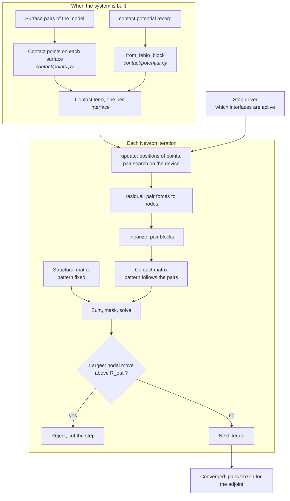

# Contact in the run

First template for discussion, November 26, 2026. Design only: there is no code for this note. Nothing here is settled. Part of the set introduced in [remaining_areas.md](remaining_areas.md).

**Scope.** How the contact potential of pull request 1 ([contact.md](contact.md)) joins a run: where its points come from, how it sits among the terms, where its tangent goes, and when it is switched on. The law, the search and the gradients are in the contact note and are not restated. This closes open items 1 and 2 of the [integration note](integration.md).

## 1. Summary

- **Four connections are missing, and no new mechanics.** Points from the model's surfaces, the interface as a term, its blocks in a matrix of their own, and activation by step.
- **One change is asked of the contact draft**: its residual sign becomes FEBio's, as in every other term.
- **The structural pattern never changes.** The contact pattern changes with the pairs and is confined to a second matrix.
- **Two rules of the contact draft become rules of the Newton step**: no nodal move larger than `R_out`, and the projected tangent as a fallback.
- **Both application inputs set `w_tol` above zero.** The contact draft applies that gate per point pair and FEBio applies it per element pair, so its element-pair mode is needed before an application can be compared with FEBio.

## 2. Where contact sits in one iteration

## 3. What FEBio does

From `FEBioMech/FEContactPotential.cpp`, `FESolidSolver2.cpp`, `FECore/FEModel.cpp` and `FEAnalysis.cpp` at `e4df3f8`.

| Item | FEBio |
| --- | --- |
| Ownership | The interface owns its two surfaces, its search grid and its law |
| Update | `FEContactPotential::Update` recomputes the surface points, rebuilds the grid with a cell size from `R_out`, and rebuilds the list of active element pairs |
| Force and stiffness | `ContactForces` and `ContactStiffness` in the solver loop over active interfaces after the domains and loads |
| Matrix profile | `BuildMatrixProfile` adds the active pairs to the global matrix profile |
| Activation | A contact interface declared inside a step is activated when the step starts and deactivated when it ends (`FEAnalysis::Activate`, `Deactivate`). One declared outside the steps is active throughout |
| Outputs | Per integration point: the smallest pair distance (reported as the gap), the traction and its magnitude (the pressure). The contact area sums the points whose traction is not zero |

What the application inputs ask of it:

| | Mitral closure | TPVR (file 3599) |
| --- | --- | --- |
| Interfaces | 1, a surface against itself | 3; the third is declared in step 2 |
| `kc`, `p` | 2, 4 | 150, 350 and 100; 4 |
| `R_in`, `R_out` | 0.2, 0.5 | 0.5, 1.5 |
| `w_tol` | 0.6 | 0.3 |
| `exclude_neighbors` | not set | 1 |
| `check_intersections` | not set | 0 |

## 4. Proposed

| Connection | Proposal | Why |
| --- | --- | --- |
| Points | Built from the model's `SurfacePair` records when the system is built, with `contact/points.py` | The contact draft already has points for quad and tri facets and tet4 surfaces. Only the route from a named surface is missing |
| Entries | A contact point moves with the `displacement` entries of its facet's nodes | The field table gives a shell node two entries. Contact forces go to the first. To confirm against FEBio's surface position for shells on `sh_self_contact_fold` |
| Term | The interface implements `Term`. `update` runs the pair search, once per iterate | The solver then treats contact like a domain or a load |
| Sign | FEBio's: the contact force is added to the residual as an external force | One convention for all terms (run path, point 3 for review) |
| Tangent | Contact blocks go into their own block matrix (`hessian_bsr` of the draft), which is added to the structural matrix before the solve | The structural pattern map stays valid for the whole run. Only the contact matrix is rebuilt when pairs change |
| Step rules | `solve_step` rejects an iterate whose largest nodal move exceeds `R_out` of any active interface, and falls back to the projected contact tangent when the full one does not give a descent direction | Both are stated in the contact note as rules the solver must apply |
| Activation | The step driver holds the list of active interfaces, switched at step boundaries as FEBio does | TPVR declares its third interface in step 2, its last step |
| Gates | Element-pair activation for `w_tol` and `R0_min`, as FEBio does it, for the reference tier | The contact note says a facet-level match with FEBio should not be expected at `w_tol` above zero until this exists. Both applications use it |

**Alternative considered for the tangent.** One global matrix whose pattern is rebuilt whenever pairs change. It is simpler to describe and is what FEBio does. It discards the pattern map on every change of pairs, which on the device means a new sort of all blocks each time.

**A second alternative, for iterative solvers only.** Do not form the sum. Give the solver the two matrices as one operator. A preconditioner built from the structural matrix alone may then be reused across iterations. This is worth measuring and is noted in [linear_solve.md](linear_solve.md).

## 5. What Warp provides

| Piece | Use |
| --- | --- |
| `wp.HashGrid` | The pair search, already in the contact draft |
| `bsr_set_from_triplets` | The contact matrix from the pair blocks |
| `bsr_axpy` | The sum of the structural and contact matrices |
| `warp.optim.linear.aslinearoperator` | The two matrices as one operator, for the second alternative |

## 6. Verification

| Input | What it exercises | Status |
| --- | --- | --- |
| `bk_contact_potential_patch.feb` | Two hex8 blocks pressed together, `w_tol` 0 | Input and FEBio reference stored |
| `bk_ring_in_tube.feb` | A ring against a tube, `w_tol` 0, with a prescribed deformation and a material parameter on a load curve | Stored |
| `sh_self_contact_fold.feb` | 54 quad4 shells folded onto themselves, `w_tol` 0.6 | Stored. Needs element-pair activation to be compared at facet level |
| A two-step input that adds an interface in step 2 | Activation | To add, with [dynamics.md](dynamics.md) |

The first two can be compared with FEBio as soon as contact is a term. They are static and use only elements the run path has.

## 7. Gradients

Unchanged from the contact note: the pair list is frozen at the converged state and the potential is differentiated through it. The contact term supplies its parameter derivative (`kc`) to the adjoint as any term does. Gradients through a change of pairs are reserved.

## 8. Reserved

- `sticky` and tied contact, which the dilation model uses.
- Sliding contact with friction for devices.
- `check_intersections`.
- The pair search captured in a CUDA graph. The contact note records that `hessian_bsr` has not been exercised under capture.

## 9. Depends on

The residual sign and the `Term` contract of the run path. The two questions the contact note poses to Steve (pair multiplicity in self-contact, and how `kc` is specified across pair classes) stay with that note and are not repeated here.
