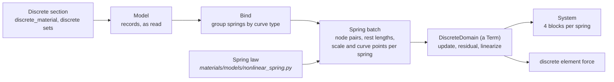

# Chordae: discrete springs

First template for discussion, November 26, 2026. Design only: there is no code for the domain described here. Nothing here is settled. Part of the set introduced in [remaining_areas.md](remaining_areas.md).

**Scope.** FEBio's `Discrete` section with the `nonlinear spring` material, which is how the open mitral input models chordae. It closes open item 5 of the [integration note](integration.md). Trusses are noted as the next step and not designed.

## 1. Summary

- **The law exists; the domain does not.** The material layer of pull request 2 has the spring force and stiffness as Warp functions, tested against the formulas in FEBio's source and on the curves of the mitral input (`tests/test_material_springs.py`). Nothing yet reads the `Discrete` section or adds springs to a run.
- **A spring set is a term**, like a solid domain: two nodes per element, four 3x3 blocks, a fixed pattern.
- **One kernel serves every spring set in the mitral input**, because all eight share the curve type. The material layer already tests this. Scale and curve points are per-spring data.
- **The curve points are differentiable parameters.** The slack length of a chord is then a design variable.

## 2. From the input to a term

## 3. What FEBio does

From `FEBioMech/FEDiscreteElasticDomain.cpp` and `FENonlinearSpring.cpp` at `e4df3f8`.

| Item | FEBio |
| --- | --- |
| Domain | `FEDiscreteElasticDomain`, registered as `discrete`. Two-node elements on the `displacement` variable |
| Material | `nonlinear spring`: `scale`, `measure` (elongation, strain or stretch), and a `force` function |
| Force | Along the current axis, magnitude `scale` times the function of the measure |
| Stiffness | (E - F/L) e e^T + (F/L) I, with E the slope of the force with respect to length, F the force and L the current length |
| Zero length | In the stiffness, the force is set to zero and a fixed direction is used, to avoid dividing by zero |
| Output | `discrete element force`, the force vector per spring |

In the mitral input: 100 springs in 8 sets. Every set uses `measure` elongation and a three-point curve with linear interpolation and extrapolation. The curve is zero up to a slack elongation (2, 3, 4 or 12 in the file's length unit) and rises with unit slope after it. `scale` is 30 or 60.

## 4. Proposed

| Topic | Proposal | Why |
| --- | --- | --- |
| Batching | One batch per curve type (number of points, `measure`, interpolation, extension). Sets that share a type share a kernel; their `scale` and points are rows of a per-spring array | A kernel has one code path. The mitral input then needs one launch for all 100 springs |
| Contract | `DiscreteDomain` is a `Term`: `update` evaluates force and stiffness per spring, `residual` scatters to the two nodes, `linearize` writes four blocks | The solver needs no knowledge of springs |
| Entries | The `displacement` entry of each node | FEBio's discrete domain uses the displacement variable. On a shell node that is the front face |
| Parameters | `scale` and the curve points are device arrays, listed by `parameters()` | They follow load curves and carry gradients like material parameters |
| Reaction forces | The term is marked internal | FEBio's discrete domain is an elastic domain, so the solver adds its forces in the internal force pass |
| Output | `discrete element force` from the stored per-spring force | Requested by the mitral input |

**Alternative considered.** Springs as extra contributions inside the shell domain. Rejected: springs connect nodes of different parts, and FEBio keeps them as their own domain.

## 5. Points of care

- **The curve has a corner at the slack length.** The stiffness jumps from zero to its full value there. Newton can alternate across the corner for a spring that is nearly taut. FEBio has the same corner, so the behavior should match; it is something to watch in the first runs, not a reason to smooth the curve.
- **The gradient with respect to a curve point is one-sided at the corner.** For optimization of chord length a smoothed curve may be preferable. That is a modeling choice for the user and not a change to the reference behavior.
- **A slack spring contributes nothing.** With many slack springs the tangent has zero blocks in a fixed pattern, which the pattern map handles as is.

## 6. Verification

| Input | What it exercises | Status |
| --- | --- | --- |
| `ch_chord_slack_tension.feb` | One spring between two hex8 blocks, taken from slack into tension | Input and FEBio reference stored. The run needs this domain |
| Gradient check | Adjoint against finite differences for `scale` and a curve point, away from the corner | `check_parameter_gradients` covers it once the term lists its parameters |

## 7. Reserved

- **Trusses.** A two-node element with a cross-section and a uniaxial material. The material layer has `linear_truss`. FEBio's truss domain is separate from the discrete domain. Mid-term.
- **Other spring materials** (`linear spring`, `tension-only linear spring`, `experimental spring`). They would be further curve types of the same batch.
- **Springs attached to rigid bodies.** FEBio's discrete domain also carries rigid rotation; reserved with rigid bodies.

## 8. Depends on

The `Term` contract of the run path, and the uniaxial family of the material layer (pull request 2).
