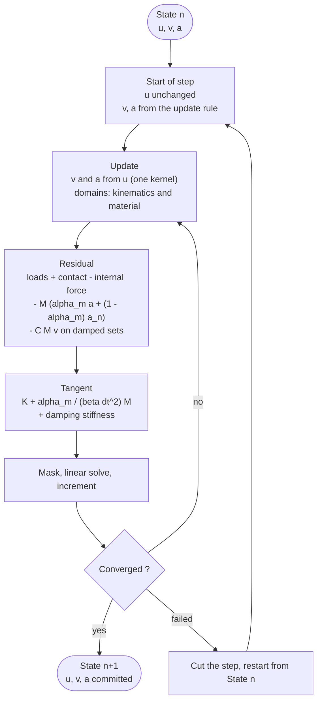

# Dynamics, mass damping and steps

First template for discussion, November 26, 2026 (v0.2). Design only: there is no code for this note. Nothing here is settled. Part of the set introduced in [remaining_areas.md](remaining_areas.md).

**Scope.** Implicit dynamic analysis as FEBio's solid solver does it: mass, time integration, the `mass damping` load, and several steps with features switched on by step. Both application inputs need all of it.

## 1. Summary

- **FEBio's scheme is followed exactly**: the same parameters, the same update of velocity and acceleration, the same scaling of the mass matrix.
- **State grows by two arrays.** Velocity and acceleration sit beside the displacement, one 3-vector per entry of the field table. A step is still a function from one State to the next.
- **Mass costs no new matrix pattern.** A domain's mass blocks couple the same node pairs as its stiffness blocks. They are computed once and added into the slice the domain already owns.
- **Mass damping becomes one block product.** Its force is C times the mass blocks of its element set times the velocity.
- **Mass damping is a third approximate tangent.** FEBio's stiffness for it is not the derivative of its force. Newton follows FEBio; the adjoint asks for the exact form.
- **The FEBio test suite covers most of this**: one-element dynamic solids and shells, two-step problems, and trusses with mass damping. It has no simple problem at the time integration setting both applications use, so one small input should be added.

## 2. One dynamic step

## 3. What FEBio does

From `FEBioMech/FESolidSolver2.cpp`, `FEElasticSolidDomain.cpp`, `FEElasticShellDomain.cpp` and `FEMassDamping.cpp` at `e4df3f8`.

| Item | FEBio |
| --- | --- |
| Parameters | `rhoi`, `alpha`, `beta`, `gamma` on the solver. Default `rhoi` is -2, which means: use `alpha`, `beta`, `gamma` as given (defaults 1, 0.25, 0.5) |
| `rhoi` in [0, 1] | alpha_f = 1/(1 + rhoi), alpha_m = (2 - rhoi)/(1 + rhoi), beta = (1 + alpha_m - alpha_f)^2 / 4, gamma = 1/2 + alpha_m - alpha_f |
| Acceleration | a = (x - x_n)/(beta dt^2) - v_n/(beta dt) + (1 - 1/(2 beta)) a_n |
| Velocity | v = v_n + ((1 - gamma) a_n + gamma a) dt |
| Shell | The same two formulas for `shell displacement` and its rates |
| Start of a step | Displacement kept; a and v from the formulas with x = x_n |
| Inertial force | Consistent mass with the reference density, on alpha_m a + (1 - alpha_m) a_n |
| Mass in the stiffness | The mass matrix scaled by alpha_m / (beta dt^2) |
| Where stress is evaluated | At the deformation alpha_f F + (1 - alpha_f) F_n |
| `mass damping` | A body force C v per unit mass on an element set. Its stiffness is C/dt per unit mass |
| Steps | Each `FEAnalysis` activates its own boundary conditions, loads and contact on top of the global ones when it starts, and deactivates them when it ends |

Two consequences for the first targets.

- Both application inputs set `rhoi` to 0, so alpha_f = 1, alpha_m = 2, beta = 1, gamma = 1.5. With alpha_f = 1 the stress is evaluated at the end of the step, as in a static step. The interpolated deformation (alpha_f below 1) is not needed by either input. Four small suite problems set `rhoi` to 1, which gives alpha_f = alpha_m = 1/2, so it is needed to use them (decision D3).
- FEBio's damping stiffness C/dt differs from the derivative of the damping force, which is C gamma/(beta dt): 1.5 C/dt at `rhoi` 0, and 2 C/dt at the defaults.

## 4. Proposed

| Topic | Proposal | Why |
| --- | --- | --- |
| State | `State` holds `u`, `v`, `a`, each one 3-vector per entry | Same layout as the unknowns; the update of v and a is one kernel over entries with no host round trip |
| Mass | Each domain computes its consistent mass blocks once when the system is built, in the (row, column) order of its stiffness blocks | The pattern is unchanged and the mass is constant. Adding it to the tangent is one scaled add into the domain's slice of the block buffer |
| Inertial force | The mass blocks applied to alpha_m a + (1 - alpha_m) a_n | One block product, the same kernel the tangent product already uses |
| Mass damping | A term on its element set: force C M_set v; Newton tangent (C/dt) M_set as FEBio; exact tangent C gamma/(beta dt) M_set | FEBio integrates density times shape function times C v, with v interpolated from the nodes, which is C M v. No new element code. To be confirmed on `bk_mass_damping` |
| Time integration | A small settings object read from the solver record, giving alpha_f, alpha_m, beta, gamma by FEBio's rules | One place for the rules above |
| Steps | `run` loops over the model's steps. Each step has a list of active terms and boundary condition records; the field table's masks are rebuilt between steps, the matrix pattern is not | Masking was chosen so that a change of boundary conditions renumbers nothing |
| Time step controller | Unchanged from the run path; a rejected attempt restarts from State n | State n is kept until the new state converges |

**Alternative considered.** Lumped mass on the diagonal. It would be cheaper and would improve the conditioning of the matrix, but FEBio uses consistent mass, so results would not match the reference. It could be offered later as an option of the faster tier.

## 5. What Warp provides

| Piece | Use |
| --- | --- |
| The block buffer and pattern map of the run path (`bsr_set_from_triplets` with a map, then `bsr_set_from_mapped_values`) | Mass enters the tangent through the same map |
| `bsr_mv` | Inertial and damping forces as block products |
| Kernels over entries | The v and a update, differentiable by the tape as written |

## 6. Initial explorations

Nothing in this note has been run. What has been established:

| Explored | Result | Where |
| --- | --- | --- |
| FEBio's parameter rules, kinematic update, mass scaling and damping stiffness | Read from source and written out in section 3 | `FESolidSolver2.cpp`, `FEMassDamping.cpp` at `e4df3f8` |
| Time integration settings of the two application inputs | Both `rhoi` 0 | The input files |
| Time integration settings across the suite | Of 44 dynamic problems in the solid module, 25 use the default parameters; `rhoi` is 1 in eight, four of them one-element problems; `rhoi` is 0 in four, all with rigid bodies | Suite at `986005f` |
| Static steps with FEBio's time stepper | Same step sequence as FEBio | Run path note |

## 7. Decision points

| ID | Decision | Options | Proposed | For |
| --- | --- | --- | --- | --- |
| D1 | Mass | (a) Consistent, as FEBio. (b) Lumped | (a) for the reference tier. (b) as an option of the faster tier later | Steve; Warp team for (b) |
| D2 | Where velocity and acceleration live | (a) In `State`, as arrays per entry. (b) On nodes of the model, as FEBio | (a). It is what lets a step be replayed for the adjoint | Steve, Warp team |
| D3 | Stress at an interpolated deformation (alpha_f below 1) | (a) Build it now, to use suite problems `dy10`, `dy11`, `dy13`, `dy14`. (b) Reserve it; start with suite problems at default parameters | (b) first, then (a). The applications do not need it; the suite does | Steve |
| D4 | The damping tangent | (a) FEBio's C/dt for Newton and the exact form for the adjoint. (b) The exact form for both | (a). Newton then reproduces FEBio's iteration counts | Steve, Jeff |
| D5 | Step sizes in the adjoint | The time step controller's choices are treated as fixed when differentiating | As stated | Warp team |

## 8. Verification

FEBio test suite first (commit `986005f`), then small inputs for what the suite lacks.

| Input | Source | What it exercises | Time integration |
| --- | --- | --- | --- |
| `dy01` | Suite | One hex8, neo-Hookean, constant body force | Default |
| `dy07` | Suite | 40 hex8, prescribed displacement | Default |
| `sh32` | Suite | One quad4 shell, constant body force | Default |
| `sh34`, `sh58` | Suite | 40 quad4 shells, body force or nodal force | Default |
| `dy16`, `dy17` | Suite | Trusses; `dy17` has mass damping ([chordae.md](chordae.md)) | Default |
| `ms01`, `ms02`, `ms03`, `ms05` | Suite | Two steps, one static and one dynamic | Default |
| `dy10`, `dy11`, `dy13`, `dy14` | Suite | One hex8 or one quad4 shell | `rhoi` 1 (needs D3) |
| `bk_mass_damping`, `sh_lee_sacks_pressure` | `references/small_problems` | Mass damping on a solid and on Lee-Sacks shells with pressure. The suite has mass damping only on trusses | Default |
| A copy of `bk_mass_damping` with `rhoi` 0 | To add | The setting both application inputs use. No simple suite problem has it | `rhoi` 0 |
| A two-step input that switches a load or contact on in step 2 | To add | Activation by step, which `ms` problems exercise only through the analysis type | |

The suite problems above need three small load terms the run path does not have: the constant `body force`, `nodal_load` and `nodal_force`. Suite inputs with `max_ups` 0 can be compared on iteration counts; those with `max_ups` 10 (BFGS) on results only, until quasi-Newton exists.

## 9. Gradients

A step solves R_n(u_n; u_{n-1}, v_{n-1}, a_{n-1}, p) = 0. The reverse sweep is in [sensitivity.md](sensitivity.md). Two points belong here.

- The v and a update is a kernel, so the tape gives its derivatives with respect to the previous state without extra code.
- `linearize(exact=True)` must return C gamma/(beta dt) M for mass damping and the true pressure and material tangents, with the same mass term as the forward solve.
- FEBio has no counterpart to check a gradient against. The check is finite differences of FEBio-Warp itself on a one-element dynamic case over a few steps ([sensitivity.md](sensitivity.md)).

## 10. Reserved

- alpha_f below 1 (stress at an interpolated deformation), until decision D3. The domains would take alpha_f as an input to `update`.
- Rigid body inertia, for the dilation model.
- Initial velocity conditions. Neither application input has an `Initial` section.

## 11. Depends on

Numbering by (node, variable), and the `Term` contract. Both are points for review in the run path note.
