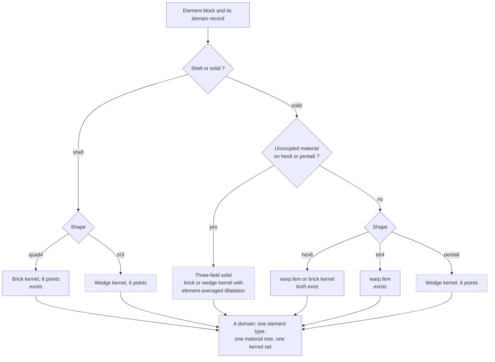

# Elements: tri3 shell, penta6 and the three-field solid

First template for discussion, November 26, 2026. Design only: there is no code for this note. Nothing here is settled. Part of the set introduced in [remaining_areas.md](remaining_areas.md).

**Scope.** The element types the open TPVR input needs beyond what the run path template has, and how they are selected. It addresses open items 3 and 4 of the [integration note](integration.md). Beams and rigid parts are kept as design shells.

## 1. Summary

- **The mitral input needs no new element.** It is quad4 shells, which the run path has.
- **The TPVR input needs three**: tri3 shells (the two crimping tubes), penta6 (part of the vessel wall) and the three-field solid on hex8 and penta6 (uncoupled HGO).
- **One wedge kernel could serve penta6 and the tri3 shell**, as one brick kernel already serves hex8 and the quad4 shell. FEBio gives the two the same six integration points and weights.
- **The three-field solid adds no unknowns and no matrix pattern.** Its pressure and dilatation are per-element values.
- **Selection follows FEBio's factory**, including its defaults.

## 2. Selection

## 3. What FEBio does

From `FEBioMech/FESolidDomainFactory.cpp`, `FEBioXML/FEModelBuilder.cpp`, `FECore/FEElementTraits.cpp` and `FEBioMech/FE3FieldElasticSolidDomain` at `e4df3f8`.

| Item | FEBio |
| --- | --- |
| Shell elements | `quad4` defaults to 8 integration points (2x2 in the surface, 2 through the thickness); `tri3` defaults to 6 (3 in the surface, 2 through the thickness) |
| penta6 | 6 integration points at the same surface coordinates (1/6, 1/6), (2/3, 1/6), (1/6, 2/3), the same two levels, and the same weight 1/6 as the tri3 shell |
| Three-field by default | On for hex8, penta6 and pyra5; off for tet4. A domain can override it with `three_field` |
| When it applies | Only when the material is an uncoupled material. `Holzapfel-Gasser-Ogden` is one |
| Three-field element data | Per element: the average dilatation and the average pressure, plus an augmented Lagrangian multiplier that is off by default |
| Shell options in the inputs | `shell_normal_nodal` and per-element `shell thickness` (mitral); `shell_thickness` on the domain (TPVR) |

In TPVR file 3599 the vessel is hex8 and penta6 with `Holzapfel-Gasser-Ogden`. Its `SolidDomain` records give no type, so FEBio's defaults apply and both run as `three-field-solid`. The device is tet4 with `isotropic elastic`, which is a plain `elastic-solid`.

## 4. Proposed

| Topic | Proposal | Why |
| --- | --- | --- |
| Wedge kernel | One six-node kernel with FEBio's six points, used for penta6 solids and, with the back face built from the directors, for tri3 shells | The run path does the same with eight nodes for hex8 and quad4 shells and matches FEBio to 4e-12. It halves the element code. To confirm on single elements |
| Why not `warp.fem` for penta6 | A dedicated kernel | `warp.fem` in Warp 1.19.0 has tetrahedral and hexahedral meshes and grids, and no wedge mesh |
| Three-field solid | Two passes inside `update`: first the element's average dilatation, then stress at each point from the deviatoric response at the point and the pressure from the average | A kernel over elements can compute the average and a kernel over points can read it. No host step |
| Three-field tangent | The extra volumetric term couples nodes of the same element only | The block pattern of the domain is unchanged, so the pattern map of the run path holds |
| Material interface | The uncoupled model supplies its deviatoric stress and tangent and its volumetric function separately | The uncoupled HGO of the material layer is already written as this split and agrees with FEBio at a point. It needs to expose the two parts to the domain |
| Per-element axes | The domain reads `mat_axis` element data into a per-element device array when it is built | Open item 3. The binding reads axes given on the material today |
| Selection | `select_domain` mirrors `FESolidDomainFactory`, with FEBio's defaults for `three_field` | The same input then picks the same formulation as FEBio |

**Alternative considered for the vessel.** Run HGO coupled (`HGO unconstrained`) on standard elements and skip the three-field element. This is simpler and Jeff's guidance was coupled models first. It would not reproduce the open TPVR input, which names the uncoupled model. Whether the faster tier should use the coupled model is question 8 to Jeff in the materials note and is not repeated here.

## 5. What Warp provides

| Piece | Use |
| --- | --- |
| `warp.fem` tetrahedral and hexahedral meshes | tet4 and hex8 solids, in use |
| Kernels over elements and points | The wedge and three-field kernels; the tape differentiates them as written |
| `warp.fem` shells | None in 1.19.0. Question 13 of the materials note asks the Warp team; the proposal here does not wait on it |

## 6. Verification

| Input | What it exercises | Status |
| --- | --- | --- |
| `bk_hgo_three_field.feb` | 8 hex8, `three-field-solid`, uncoupled HGO | Input and FEBio reference stored |
| One penta6 element | The wedge kernel as a solid | To add |
| One tri3 shell element | The wedge kernel as a shell | To add |
| A small penta6 block with uncoupled HGO | Three-field on wedges | To add |
| Residual and tangent of the wedge kernel against finite differences | The tangent | With the kernel |

## 7. Design shells

Kept in view so nothing above closes them off. No implementation is proposed.

| Element | FEBio | What it would need here |
| --- | --- | --- |
| Beam | `linear-beam` domain with a beam material on section resultants | A `rotation` variable in the field table with an update through the exponential map, which the field table's per-variable update rule allows |
| Rigid part | `rigid-solid`, `rigid-shell` | Rigid body unknowns and a rule tying nodes to them. See [constraints.md](constraints.md) |
| Truss | `linear-truss`, `elastic-truss` | A two-node domain on the uniaxial family. See [discrete.md](discrete.md) |

## 8. Depends on

The choice between `warp.fem` and dedicated kernels (run path, section 5), and the material layer of pull request 2 for the uncoupled split and per-element axes.
