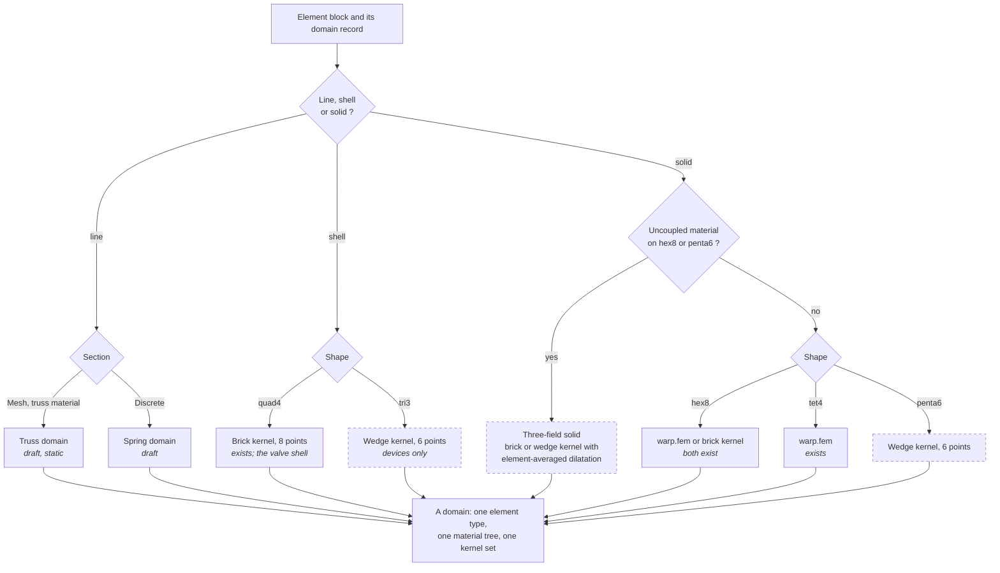

# Elements: what each path needs, and in what order

First template for discussion, November 26, 2026 (v0.2). Design only: there is no code for this note. Nothing here is settled. Part of the set introduced in [remaining_areas.md](remaining_areas.md).

**Scope.** The element types the first targets need beyond the run path template, how they are selected, and the order to build them. It addresses open items 3 and 4 of the [integration note](integration.md). Beams and rigid parts are kept as design shells.

## 1. Summary

- **Valve path: quad4 shells and trusses.** All of the lab's valve models in FEBio use quad4 shells, and the valve work stays on them. The quad4 shell exists in the run path. Chordae are trusses in current practice and springs in the open mitral input. The truss is therefore the first new element, and it is described in [trusses_and_springs.md](trusses_and_springs.md).
- **Device path: what the TPVR input uses.** tri3 shells (the two crimping tubes), penta6 (part of the vessel wall) and the three-field solid on hex8 and penta6 (uncoupled HGO). tet4 for the device exists through `warp.fem`. These come after the valve path.
- **One wedge kernel could serve penta6 and the tri3 shell**, as one brick kernel already serves hex8 and the quad4 shell. FEBio gives the two the same six integration points and weights.
- **The three-field solid adds no unknowns and no matrix pattern.** Its pressure and dilatation are per-element values.
- **Selection follows FEBio's factory**, including its defaults.

## 2. Order of work

| Order | Element | Path | State | Note |
| --- | --- | --- | --- | --- |
| 0 | quad4 shell (`elastic-shell`) | Valve | Template in the run path, matches FEBio on single elements and small patches | Section 4 |
| 1 | Two-node truss (`linear-truss`), with FEBio's `linear truss` or a tension-only law | Valve | Draft domain for static steps, matches FEBio on small inputs and on suite `bt01`; mass and dynamics not yet | [trusses_and_springs.md](trusses_and_springs.md) |
| 2 | Two-node spring (`discrete`) | Valve (open mitral input) | Draft domain with FEBio's three spring laws, matches FEBio on small inputs and on suite `di01`, `di02` | [trusses_and_springs.md](trusses_and_springs.md) |
| 3 | tet4, hex8 solids | Device | Template in the run path through `warp.fem` | Run path note |
| 4 | Three-field solid on hex8 | Device (vessel) | Uncoupled HGO exists at a material point; no element | Section 5 |
| 5 | penta6 solid and three-field penta6 | Device (vessel) | None | Section 5 |
| 6 | tri3 shell | Device (crimping tubes) | None | Section 5 |
| Later | Beam, rigid parts | Devices as beams; dilation model | Design shells | Section 8 |

## 3. Selection

## 4. The valve shell

The open mitral input declares `ShellDomain ... type="elastic-shell"` on quad4 elements with `shell_normal_nodal` 1 and a thickness per element. That is what the run path's brick kernel implements: eight nodes built from the front face and the directors, FEBio's eight integration points, two variables per node (`displacement`, `shell displacement`).

| Item | State |
| --- | --- |
| Single quad4 shell against FEBio | 2e-12 (run path note) |
| Curved patch of 9 shells against FEBio | 4e-12 |
| Pressure on the front and back face | Template, with an exact tangent on request |
| Nodal normals, thickness from element data | Read by the template |
| Mass and inertia | Consistent mass for hex8, quad4 shell and truss, as one number per stiffness block ([dynamics.md](dynamics.md)). Not for tet4, which runs through warp.fem |
| Trusses and springs sharing leaflet nodes | Draft, static: a quad4 patch held by truss chords matches FEBio to 4e-12 ([trusses_and_springs.md](trusses_and_springs.md)) |
| The linear solve at application size | Open; in [linear_solve.md](linear_solve.md) |

FEBio also has two other quad shell domains, `elastic-shell-eas` and `elastic-shell-ans`, selected by the element types `q4eas` and `q4ans` or the control setting `shell_formulation`. The open mitral input does not use them. They are decision E1.

## 5. What FEBio does for the device elements

From `FEBioMech/FESolidDomainFactory.cpp`, `FEBioXML/FEModelBuilder.cpp`, `FECore/FEElementTraits.cpp` and `FEBioMech/FE3FieldElasticSolidDomain` at `e4df3f8`.

| Item | FEBio |
| --- | --- |
| Shell elements | `quad4` defaults to 8 integration points (2x2 in the surface, 2 through the thickness); `tri3` defaults to 6 (3 in the surface, 2 through the thickness) |
| penta6 | 6 integration points at the same surface coordinates (1/6, 1/6), (2/3, 1/6), (1/6, 2/3), the same two levels, and the same weight 1/6 as the tri3 shell |
| Three-field by default | On for hex8, penta6 and pyra5; off for tet4. A domain can override it with `three_field` |
| When it applies | Only when the material is an uncoupled material. `Holzapfel-Gasser-Ogden` is one |
| Three-field element data | Per element: the average dilatation and the average pressure, plus an augmented Lagrangian multiplier that is off by default |

In TPVR file 3599 the vessel is hex8 and penta6 with `Holzapfel-Gasser-Ogden`. Its `SolidDomain` records give no type, so FEBio's defaults apply and both run as `three-field-solid`. The device is tet4 with `isotropic elastic`, a plain `elastic-solid`. The tubes are tri3 shells with `neo-Hookean`.

## 6. Proposed for the device elements

| Topic | Proposal | Why |
| --- | --- | --- |
| Wedge kernel | One six-node kernel with FEBio's six points, used for penta6 solids and, with the back face built from the directors, for tri3 shells | The run path does the same with eight nodes for hex8 and quad4 shells. To confirm on single elements |
| Why not `warp.fem` for penta6 | A dedicated kernel | `warp.fem` in Warp 1.19.0 has tetrahedral and hexahedral meshes and grids, and no wedge mesh |
| Three-field solid | Two passes inside `update`: first the element's average dilatation, then stress at each point from the deviatoric response at the point and the pressure from the average | A kernel over elements computes the average and a kernel over points reads it. No host step |
| Three-field tangent | The extra volumetric term couples nodes of the same element only | The block pattern of the domain is unchanged |
| Material interface | The uncoupled model supplies its deviatoric stress and tangent and its volumetric function separately | The uncoupled HGO of the material layer is written as this split and agrees with FEBio at a point |
| Per-element axes | The domain reads `mat_axis` element data into a per-element device array when it is built | Open item 3 |
| Selection | `select_domain` mirrors `FESolidDomainFactory`, with FEBio's defaults for `three_field` | The same input then picks the same formulation as FEBio |

## 7. Decision points

| ID | Decision | Options | Proposed | For |
| --- | --- | --- | --- | --- |
| E1 | Quad shell formulation for valves | (a) `elastic-shell` only, as the open input uses. (b) Also plan for `elastic-shell-eas` or `-ans` | (a) now. The kernel structure does not close off (b) | Steve, Jeff, MJ |
| E2 | Where shells live | (a) Dedicated kernels here. (b) A shell element in `warp.fem` | (a), without waiting. Question 13 of the materials note asks the Warp team about (b) | Warp team |
| E3 | The vessel wall | (a) Uncoupled HGO on a three-field element, as the open TPVR input. (b) Coupled HGO on standard elements for the faster tier | (a) for the reference tier. (b) is question 8 to Jeff in the materials note | Jeff |
| E4 | One wedge kernel for penta6 and tri3 shell | (a) Shared. (b) Separate | (a), if single elements match FEBio | Steve |
| E5 | Three-field tangent for the adjoint | Whether FEBio's three-field stiffness is the exact derivative of its force has not been checked | Check on `bk_hgo_three_field` against finite differences before the element is used in a gradient | Whoever builds it |

For gradients: every element here is a kernel over elements or points, so the tape differentiates `update` and `residual` as written. The check each new element owes is its tangent against finite differences of its own residual, which decides whether `linearize(exact=True)` can reuse the Newton tangent.

## 8. Verification

FEBio test suite first (commit `986005f`), then small inputs for what the suite lacks.

| Element | Suite problems | Gap, covered by a small input |
| --- | --- | --- |
| quad4 shell | `sh52` (one element, prescribed), `sh54` (one element, pressure), `sh02`, `sh06`, `sh05`, `sh56` (20 to 180 elements, nodal force or pressure), `dy13`, `dy14` (one element, dynamic) | Lee-Sacks on shells: the suite has no problem with that material. `sh_lee_sacks_pressure` |
| Truss, spring | See [trusses_and_springs.md](trusses_and_springs.md) | |
| Three-field solid | `ma34` (uncoupled HGO, but with a rigid body) | `bk_hgo_three_field` |
| penta6 | `sh25` (mixed with hex8 and quad4, and a rigid wall) | One penta6 element; a small three-field penta6 block. To add |
| tri3 shell | `sh65` (23,268 elements, bearing load) | One tri3 shell element. To add |
| tet4 | Among problems with neo-Hookean or isotropic elastic alone and no rigid bodies, only `te02` and `te03`, which use `ut4-solid`, a different formulation | `tet4_block` |

## 9. Design shells

Kept in view so nothing above closes them off. No implementation is proposed.

| Element | FEBio | What it would need here |
| --- | --- | --- |
| Beam | `linear-beam` domain with a beam material on section resultants | A `rotation` variable in the field table with an update through the exponential map, which the field table's per-variable update rule allows |
| Rigid part | `rigid-solid`, `rigid-shell` | Rigid body unknowns and a rule tying nodes to them. See [constraints.md](constraints.md) |

## 10. Depends on

The choice between `warp.fem` and dedicated kernels (run path, section 5), and the material layer of pull request 2 for the uncoupled split and per-element axes.
