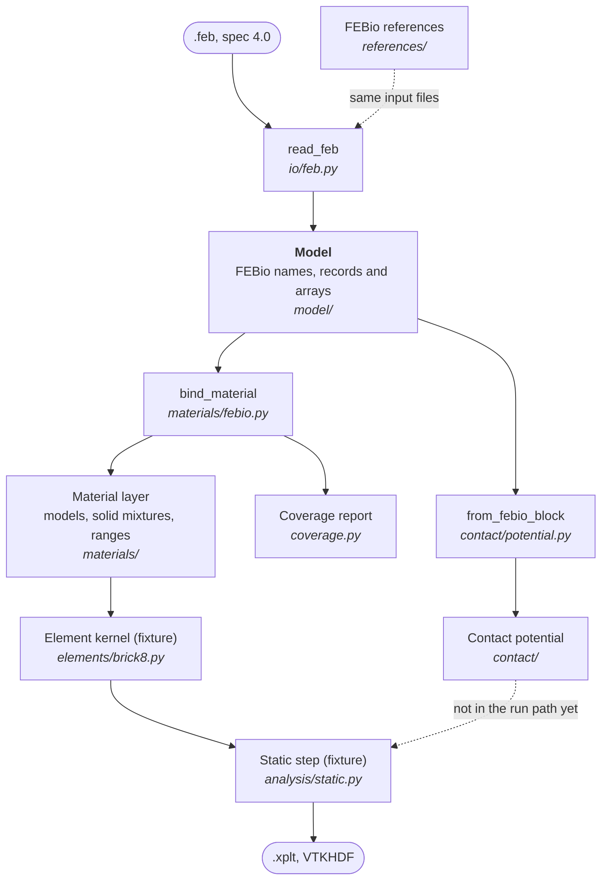

# How the drafts fit together

Draft for discussion, November 25, 2026. For Steve Maas, Jeff Weiss, Ryan Black and the Warp team.

The central model and input and output ([model.md](model.md), pull request 5), the material layer ([materials.md](materials.md), pull request 2), contact ([contact.md](contact.md), pull request 1) and the verification inputs ([verification.md](verification.md), pull request 4) were drafted separately. Branch `mattjolley/integration-base` merges the four and makes them agree where they meet. Each pull request is still reviewed on its own. This note covers only what the combined branch adds, which is small, and what it leaves open.

## The path through the code

## What disagreed, and what it is now

| Where the drafts met | Before | Now |
| --- | --- | --- |
| A FEBio material in the model, and the material layer | Compile had a stand-in neo-Hookean and a `backend` switch. | One function, `bind_material` in `materials/febio.py`, is used by compile and the coverage report. The stand-in and the switch are removed. |
| Solid mixtures | In the material layer only; compile looked up flat types. | `<material type="solid mixture">` with `<solid>` children is composed by the binding. Children are named `solid[0]`, `solid[1]`, the form FEBio uses in its plot filters (`FEBioMechPlot.cpp`). |
| A parameter on a load curve | Two implementations of FEBio's curve (the model's load controller and the material layer's schedule); compile reported `lc` on a material parameter as not supported. | The binding hands the model's load controller to the material. The step updates the parameter array at the time being solved. |
| Failure codes from kernels | The element and the material layer numbered a negative Jacobian and a non-finite result differently. | One set, in `materials/status.py`. |
| The contact potential block | `from_febio_block` took a dict. | It takes the model's contact record as `read_feb` stores it, or a dict. |
| Units | The contact note and a leftover constants file said the package works in SI. | The package computes in the units of the input file, as FEBio does. The comparisons with FEBio depend on that. |
| Notes and status tables | Notes in two places; the README still described input and output as building on pyfebio. | Notes are in `docs/design/`; the README table links each draft. |

The element and the static step on this branch are still the test fixture of pull request 5. They were changed only to take the bound material.

## Found on the way

- **`tangent_scale` on isotropic Lee-Sacks.** The mitral reference input sets `tangent_scale` to 10. In `FEIsotropicLeeSacks::Tangent` it multiplies `c0` in the tangent only, so the tangent is deliberately not the derivative of the stress. The material layer has no such parameter, and the coverage report names it as what that material is missing. How a scaled tangent should sit beside the differentiated one is a design point for the material layer.

## Left open

These belong to the next design, elements and assembly, and were not decided here.

1. **Sign of the residual.** The contact term follows `contracts.py` (internal + contact - external). The fixture follows FEBio (`FESolidSolver2`: R = external - internal). One convention has to be chosen when loads, contact and domains share an interface.
2. **Contact in a run.** Contact points are not yet built from the model's surfaces, and the contact term is not assembled with the domains.
3. **Per-element material axes.** The open device inputs give them as mesh data. The binding reads `mat_axis` given as two vectors on the material; element data is still carried as records.
4. **Uncoupled materials.** Uncoupled HGO is in the material layer and agrees with FEBio at a material point. It needs a multi-field element to run; the binding accepts it and the coverage report says so.
5. **Chordae.** The spring and truss laws are in the material layer. The `Discrete` section of an input is not bound to them, and there is no spring element.
6. **A mixture's own `mat_axis`.** FEBio applies it on top of the children's. The binding reports it as not supported.
7. **FEBio's defaults.** A parameter missing from the input is still refused (question 2 in [model.md](model.md)).
8. **Two readings of the material-point inputs.** The material-point test of pull request 4 parses its inputs itself. The binding tests repeat its coupled cases through the reader. The two can become one when pull request 4 is rebased on the reader.

## How it was checked

CPU only, Warp 1.19.0, on Python 3.11 and 3.13. 113 tests run: 111 pass and 2 skip (both need a GPU). Without VTK installed, as in the test workflow, the two VTK adapter tests skip as well.

- The comparisons of pull request 5 with FEBio (single hex8, single quad4 shell, 8-element block, 9-element shell patch, displacement and stress to 1e-10) pass with materials taken from the material layer through the binding.
- The nine coupled material-point cases of pull request 4 agree with their stored FEBio references to 1e-10, in stress and tangent, when the input is read with `read_feb`, bound with `bind_material`, and evaluated through the one-pass function an element calls. They include isotropic elastic, which has no one-pass function of its own, and HGO with material axes away from the global frame.
- A modulus on a load curve: for the stored FEBio run of `bk_modulus_load_curve.feb`, the bound material evaluated at FEBio's logged deformation and time gives FEBio's logged stress to 2e-10 at every step, across the change in modulus. The run itself needs a pressure load, which is not implemented, so this is a material-point check and not a solve.
- A two-component solid mixture built from a record equals the sum of its components to 1e-14.

Not checked: any GPU run; any FEBio run made in this session (the references are the stored ones); a solve with a time-dependent parameter or with a mixture.
