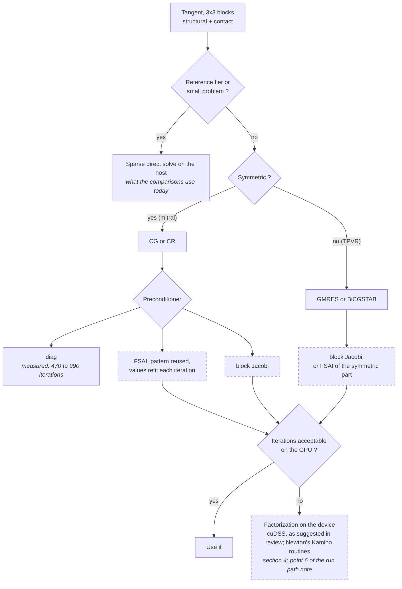

# Linear solve, nonlinear strategy and the first GPU runs

Template for discussion, November 27, 2026 (v0.3). Nothing here is settled.

**What changed from v0.2.** That version was design only. A first set of measurements on a GPU is now in section 6 ("First measurements"), with two direct solves added behind the existing call: a sparse LU on the host (`sparse`) and cuDSS on the device (`cudss`, optional). The rest of the note is as it was and has not yet been revised against these numbers. Part of the set introduced in [remaining_areas.md](remaining_areas.md).

**Scope.** What the linear solve must become for shell models of application size, how the quasi-Newton and line search settings of the inputs attach, and what the first GPU measurements should answer. This is the area where a diagram is least sufficient: the choices depend on measurements that have not been made.

## 1. Summary

- **This is the main technical risk on the path to the valve application.** The run path measured 470 to 990 conjugate gradient iterations per solve on a static shell patch of 1,863 quad4 elements.
- **Warp 1.19.0 has more than has been tried.** A factorized sparse approximate inverse preconditioner (`FSAI`) and three block-Jacobi variants are in `warp.optim.linear`. The solve wrapper of the run path passes `diag` only, which on a block matrix is scalar Jacobi (the diagonal entries of each block). The run path note calls it block-diagonal; the 3x3 block variants have not been tried.
- **The two applications are different problems.** The mitral input asks for a symmetric solve; the TPVR input asks for a non-symmetric one.
- **Dynamics should help, by an amount not yet known.** The mass term on the diagonal grows as 1/dt^2.
- **The adjoint may need a non-symmetric solve even when Newton's matrix is symmetric.** On a surface with free edges, such as a leaflet, the exact pressure tangent differs from FEBio's symmetrized form, so it is not expected to be symmetric there, and the adjoint must use it. To confirm by measurement.
- **Slack truss chordae can make the tangent indefinite**, which a preconditioner for positive definite matrices may not accept.
- **Proposal: one solver interface with a setup, a refit and a solve, and a ladder of methods behind it**, chosen by measurement.
- **A direct solver on the device is available outside Warp: cuDSS.** It was suggested in review. As we read its documentation, its transpose solve reuses the factors, which appears to be what the adjoint needs. Not tried (section 4).
- **A possible order of work, open to correction.** Keep the host direct solve for comparisons with FEBio. Measure Warp's `FSAI` and block Jacobi on suite problem `sh11`. Try cuDSS on the same case on a GPU, with the transpose solve. Then choose, with the Warp team's advice (section 8).

## 2. Choosing a method

## 3. The problems to solve

| | Mitral closure | TPVR (file 3599) |
| --- | --- | --- |
| Nodes | 7,442 (leaflet shell nodes and spring end points) | 65,011 |
| Unknowns before constraints | Up to about 44,650 (two 3-vectors per shell node) | At least 195,000 (one 3-vector per node, two on the tube nodes) |
| `symmetric_stiffness` on the solver | symmetric | non-symmetric |
| Quasi-Newton | BFGS, `max_ups` 10 | Broyden with `max_ups` 0, which reforms the stiffness every iteration. The paper describes it as full Newton |
| Line search | `lstol` 0.9, `lsiter` 5 | `lstol` 0.9 |
| `max_refs` | 15 | 50 |
| Time step | 1e-4 | 0.05, then 0.01 |
| What makes it hard | Thin shells; self-contact; a tangent scaled by `tangent_scale` | Stiff device against soft vessel; near-incompressible vessel; three contact interfaces |

FEBio solves these with a sparse direct solver. The verification note records that the TPVR and dilation models need a FEBio build with Pardiso, because FEBio's fallback solver does not support a non-symmetric stiffness.

## 4. What Warp 1.19.0 provides

Read from the installed package.

| Piece | What it is | Tried here |
| --- | --- | --- |
| `cg`, `cr` | Conjugate gradient and conjugate residual | `cg`, yes |
| `bicgstab`, `gmres` | For non-symmetric matrices | Yes, on small cases |
| `preconditioner(A, "diag")` | Scalar Jacobi. On a block matrix it inverts the diagonal entries of each diagonal block | Yes |
| `preconditioner(A, "block_jacobi_direct")`, `"block_jacobi_sequential"`, `"block_jacobi_tile"` | Block Jacobi: each diagonal block inverted or factorized whole | No |
| `FSAI`, or `preconditioner(A, "fsai")` | Adaptive factorized sparse approximate inverse of a symmetric positive definite block matrix, built row by row on the device. For `cg` and `cr`. `reuse_pattern` keeps the factor's supports and `update` refits the values; `defer_pattern` lets the first update run inside a captured CUDA graph | No |
| `aslinearoperator` | A sum of matrices as one operator | No |
| A sparse factorization | None in `warp.optim.linear` | |

`FSAI` fits the structure of the run path. The structural pattern is fixed, so the supports can be chosen once and refit as the values change, which is the same idea as the pattern map used for assembly.

Its documented preconditions are a symmetric positive definite matrix with both triangles stored. The Newton matrix of the mitral input is symmetric when FEBio's symmetrized pressure stiffness is used. Whether it stays positive definite through closure is not known. Three things work against it: contact, a scaled material tangent, and truss chordae in compression, whose geometric stiffness is negative across the axis ([trusses_and_springs.md](trusses_and_springs.md), decision C1). The mass term works for it.

### A direct solver on the device: cuDSS

Raised in review, and not tried here. cuDSS is NVIDIA's sparse direct solver for the GPU. It is a separate library from Warp, and Warp 1.19.0 does not call it; Python bindings are in `nvmath-python`. What follows is our reading of its documentation, not a result, and the people who suggested it know it far better than we do. Corrections are welcome.

| Point | What the documentation says | What it means here |
| --- | --- | --- |
| Phases | Analysis once per sparsity pattern, then factorization or refactorization, then solve | Fits `setup(pattern)`, `refit(values)`, `solve(b)` in section 5. The pattern is fixed in the run path, so analysis is done once |
| Transpose solve | `CUDSS_CONFIG_SOLVE_MODE` set to `CUDSS_SOLVE_MODE_TRANSPOSE` solves A^T x = b from the existing factors (added in cuDSS 1.0.0) | As we understand it, the adjoint solve of decision L5 would become two substitutions, with no second factorization |
| Where transpose is not supported | With a Schur complement, with the COLAMD reorderings, with non-uniform batches, and for Hermitian matrix types | None of these appears to be in the proposed path. To confirm for the reordering actually used |
| Solve sub-phases | Forward and backward substitution can be run separately | Not needed for the adjoint. Which combinations with the transpose mode are supported was not checked here, and the reviewer was not certain all are |

One point on which guidance would help. The adjoint needs the transpose of the exact tangent, and Newton may factor FEBio's tangent, which differs from it in the known cases (symmetrized pressure, `tangent_scale`, `mass damping`; [sensitivity.md](sensitivity.md), section 4). Where they are the same, Newton's last factorization serves the adjoint directly. Where they differ, we see two options: factorize the exact tangent once at the converged state, or use Newton's factors as the preconditioner of a Krylov solve with the exact transpose. There may be a better one.

## 5. Proposed

| Topic | Proposal | Why |
| --- | --- | --- |
| Interface | `setup(pattern)`, `refit(values)`, `solve(b)` behind one name per method | Separates what is done once per pattern from what is done per iteration. A direct factorization and `FSAI` both have that split |
| Symmetry | The method is chosen from the solver's `symmetric_stiffness` setting, which today is read and ignored | FEBio uses the setting to choose matrix storage. Here it would choose between CG and GMRES |
| Contact | Start with the summed matrix. Measure the preconditioner built from the structural matrix alone against one built from the sum | The first is reusable across pair changes; the second is more accurate |
| Reference tier | Keep the host direct solve for comparisons with FEBio | Removes the linear solver from the list of reasons a result differs |
| Precision | Double throughout for now | The materials note showed single precision is not adequate for stiff parts at small strain. A single-precision preconditioner (`factor_dtype`) is an option `FSAI` offers |

**Quasi-Newton and line search.** Both attach inside `solve_step` and change nothing outside it.

| Setting | FEBio | Here | Proposal |
| --- | --- | --- | --- |
| `qn_method` BFGS, Broyden | Keeps the factored matrix and applies quasi-Newton updates for up to `max_ups` iterations, then reforms | Full Newton, tangent reformed every iteration | Implement after the linear solve is settled. With an iterative solver, reusing a matrix saves assembly but not the solve, so the benefit is smaller than in FEBio |
| `lstol`, `lsmin`, `lsiter`, `ls_check_jacobians` | Line search on the increment | FEBio's line search, as written in `FELineSearch::DoLineSearch` (`solvers/nonlinear/newton.py`, `line_search`), on by default with FEBio's defaults | Built November 28. One `update` and `residual` per trial. Suite `sh56` and `sh58` take FEBio's iteration counts exactly with it, and `di03` and `sh06` run only with it |

Until then, results agree with FEBio's but step sequences under the automatic time stepper can differ, as the run path note recorded.

## 6. Initial explorations

| Explored | Result | Where |
| --- | --- | --- |
| CG with the `diag` preconditioner on a static shell patch of 1,863 quad4 elements | 470 to 990 iterations per solve. The patch came from the pilot phase; new measurements use the suite's `sh11` | Run path note |
| CG, BiCGSTAB and GMRES on four small inputs | Agree with the direct solve to 4e-11 | Run path note |
| Full Newton against FEBio's BFGS on a two-material case | Same solution to 2e-9, different iteration counts | Run path note |
| What Warp 1.19.0 offers beyond what was used | `FSAI`, three block-Jacobi variants (section 4) | The installed package |
| Newton's Kamino factorizations | Located, not tried | Run path note |
| cuDSS, with its transpose solve | Read from the documentation, not tried | Section 4 |
| Any preconditioner other than `diag`; any dynamic solve | Not explored | |
| A GPU run | The reference cases run on a GPU with the same results (run path, section 8); CG was 5 to 8 times faster there on these very small models. The measurements of section 6 are not done | |

### First measurements

November 27, 2026, on a Quadro RTX 8000 (`cuda:0`), Warp 1.19.0, double precision. Single runs; whole-run wall times, which include assembly and the Newton loop. cuDSS 0.8.0 through nvmath-python 1.0.1, installed in a separate environment (it is not a dependency of this package).

| Model | Unknowns | Dense host solve (`direct`) | Warp CG, diagonal preconditioner (`cg`) | Sparse LU on the host (`sparse`) | cuDSS (`cudss`) |
| --- | --- | --- | --- | --- | --- |
| Static patch, 1863 quad4 shells on four chord springs, 53 solves | 11,604 | 4.5 min | 20 s, 565 iterations per solve on average | 21 s | 1.9 s |
| The same patch, dynamic, 50 solves | 11,604 | not run | 18 s, 567 iterations per solve | not run | 1.7 s |
| The open mitral input with its contact removed, dynamic, 200 steps, 800 solves | 44,646 | not run | 380 s | not run | 24 s |

- The four methods give the same result: displacements of the static patch agree to 3e-13 between `cg`, `sparse` and `cudss`.
- The mass term of a dynamic step did not lower the CG iteration count on the patch at these step sizes.
- For reference, FEBio 4.13.0 (the provisional build without MKL, skyline solver) took 89 s on the static patch on this machine's CPU. That is not a comparison of codes: a release build with Pardiso would be much faster.
- On a thin plate of hex8 elements standing in for a shell, cuDSS needed 0.9 s once for the analysis and 0.1 to 0.2 s per factorization at 150,000 unknowns, where CG with the diagonal preconditioner took 20,000 iterations and Warp's `FSAI` 6,500. On a compact solid of a million unknowns the factorization took 42 to 82 s and 26 to 37 GiB, where CG took 2.2 s. So, as far as these runs show, a direct solve suits shell-like models and Krylov methods suit large solids.
- cuDSS with the `GENERAL` type solved an indefinite matrix and a singular one (six rigid modes, reported as six pivots) without an error; with the `SPD` type it returned NaN on an indefinite matrix without raising. The template therefore uses `GENERAL` and checks the result.
- The transpose solve from the same factors exists in cuDSS 1.0.0 and is not exposed by nvmath-python 1.0.1; through a small wrapper it took 6 ms at 108,000 unknowns. Not in the template. Max Rietmann (NVIDIA) pointed us to this solve mode ([`cudssSolveMode_t`](https://docs.nvidia.com/cuda/cudss/latest/types.html#c.cudssSolveMode_t)) as the one commonly used for automatic differentiation, and passed on from the cuDSS developers that finer-grained support for it could be considered for their API if this work needs it. So the adjoint solve of decision L5 has a route on released software, and what we would ask for, if anything, should come out of the measurements.
- Warp 1.19, its 1.20 release branch and its main branch have no sparse direct solver or algebraic multigrid, as far as we could tell.

`direct` uses the dense solve up to 3,000 unknowns and the sparse LU beyond, where SciPy is installed. A solve that fails numerically is a failed step, which the time stepper cuts; a method that is not installed is reported as such and not retried.

The line search is now built, as FEBio's. Before it, suite `sh58` (shells, dynamic, full Newton in FEBio) followed FEBio's step sizes and iteration counts for 14 steps and left its path where FEBio's line search first shortens a step, ending 2 percent away; with it, `sh58` takes FEBio's 105 steps and 435 iterations and ends within 3e-7 ([dynamics.md](dynamics.md), section 6). On a GPU the count is 432: over 105 steps the threshold decisions of the line search are sensitive to the order in which sums are rounded. With it, and with FEBio's default for neighbor exclusion in contact, the open mitral input runs to the end in a first experiment ([contact_in_run.md](contact_in_run.md)). BFGS (decision L6) remains: without it the iteration counts of inputs that ask for it differ from FEBio's, and with them the automatic step sizes.

How `cudss` is wired, in `solvers/linear/cudss.py`: the BSR pattern is converted once on the device into scalar CSR index arrays and a gather map; each solve gathers the new values, factors and solves; the analysis is reused while the pattern stays. The Warp arrays are viewed by CuPy without a copy.

## 7. Decision points

| ID | Decision | Options | Proposed | For |
| --- | --- | --- | --- | --- |
| L1 | Order of work | (a) Measure `FSAI` and block Jacobi first. (b) Ask the Warp team about a direct solver first | (a), with cuDSS tried alongside (measurement 7) since it was suggested in review. Point 6 of the run path note is then asked with data | MJ, then Warp team |
| L2 | Iterative or direct at application size | (a) Preconditioned Krylov. (b) A factorization on the device: cuDSS (section 4), or Newton's Kamino routines. (c) A host direct solver as a stopgap | Decide from the measurements below and the Warp team's advice. For (b) we would start with cuDSS, as suggested | Warp team, Ryan |
| L3 | Symmetry | (a) Follow the solver's `symmetric_stiffness` setting. (b) Always general | (a) for Newton. The adjoint solve is general in either case (L5) | Steve |
| L4 | Indefinite tangents | (a) Rely on mass and damping. (b) Use methods that do not need a positive definite matrix. (c) A tension-only chord (decision C1) | Measure on a leaflet patch with slack trusses | Steve, Warp team |
| L5 | The adjoint solve | It uses the transpose of the exact tangent. With a follower pressure on a surface with free edges that matrix is not expected to be symmetric, even where Newton's is | With an iterative solver: GMRES or BiCGSTAB, with the preconditioner built from Newton's matrix. With cuDSS: its transpose solve on the factors of the exact tangent, or Newton's factors as the preconditioner where the two tangents differ (section 4). To measure | Warp team |
| L6 | Quasi-Newton | (a) Implement BFGS as FEBio. (b) Stay with full Newton | (a) later. The open mitral input uses BFGS with 10 updates, so its step sequence cannot be matched without it; the TPVR input and 167 suite problems run full Newton. Its saving is smaller with an iterative solver | Steve |

## 8. Measurements to make

Recommended as the first code after these notes. Each is small. Cases from the FEBio test suite are used where one fits.

| # | Question | Case | Measure |
| --- | --- | --- | --- |
| 1 | Does `FSAI` or block Jacobi change the iteration count on thin shells ? | Suite `sh11` (2,048 quad4 shells, isotropic elastic, static, nodal force) | Iterations and time per solve, CPU, against `diag` and the host direct solve |
| 2 | How much does dynamics help ? | The same as a dynamic step at dt 1e-4 with the leaflet density | The same |
| 3 | Does it hold on the GPU ? | The same two cases on a GPU | Time per Newton iteration, split into update, assembly, solve |
| 4 | What does contact do to it ? | `sh_self_contact_fold` once contact is a term | Iterations with and without contact blocks in the preconditioner |
| 5 | What do slack trusses do to it ? | A quad4 patch with a branched truss network ([trusses_and_springs.md](trusses_and_springs.md)) | Whether CG with `FSAI` still converges; the smallest eigenvalue on a small case |
| 6 | What does the adjoint solve cost ? | The pressure gradient case of the run path at patch size | Iterations of the transpose solve against the forward solve |
| 7 | How does a factorization on the device compare ? | `sh11` and the pressure gradient case with cuDSS on a GPU | Time for analysis, factorization and solve against the best iterative result; the transpose solve reusing the factors |

A rough expectation for question 2, not a result: at dt 1e-4 with `rhoi` 0 the mass term is scaled by alpha_m/(beta dt^2) = 2e8, against a leaflet density of 1.04e-6 in the input's units. Whether that dominates the bending stiffness of a 0.4 thick shell at this mesh size is what the measurement would show.

## 9. Reserved

- Algebraic multigrid. Warp has none; an external library would be a new dependency.
- Arc-length control (`arc_length` is 0 in both inputs).
- Partial assembly. Decided against on November 24; see [assembly.md](assembly.md) for what would reopen it.

## 10. Depends on

3x3 blocks and the fixed structural pattern (run path, section 4), and the own-matrix proposal for contact in [contact_in_run.md](contact_in_run.md).
