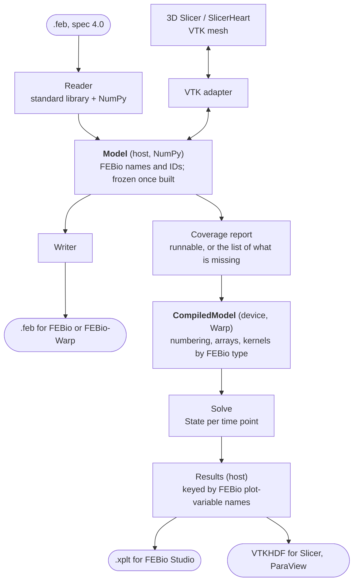

# Central model and FEBio input and output

Draft for discussion, November 25, 2026. For Steve Maas, Ryan Black, Jeff Weiss, the Warp team and the FEBio-Warp team. The code described here is a local draft on branch `io-model-draft`; nothing is merged.

## 1. Summary

This follows Steve's two suggestions on the I/O proposal: make the central model an explicit part of the first work, and start from a small end-to-end example (one element, one material, prescribed nodal displacements).

- **A FEBio input runs end to end.** A spec 4.0 `.feb` is read into a model, solved in Warp, and written as `.xplt`. On single-element and small multi-element inputs the results agree with FEBio to the 12 digits FEBio prints.
- **The reader and writers are our own**, as Steve recommended: a custom `.feb` reader and writer and a native XPLT reader and writer that follow what FEBio exports today.
- **A coverage report decides what runs.** A file that needs a feature FEBio-Warp lacks is refused with the list of what is missing.
- **Input is needed on five points**, listed in section 8: three for Steve, two for Ryan.

## 2. Big picture

| Object | Lives on | Holds | FEBio counterpart |
| --- | --- | --- | --- |
| `Model` | Host, NumPy | Mesh, materials, domains, boundary conditions, loads, load controllers, steps, output requests | `FEModel`, `FEMesh` |
| `CompiledModel` | Device, Warp | Degree-of-freedom numbering, device arrays, the kernel for each domain, the coverage report | `FEModel::Init`, domains |
| `State` | Device, Warp | Time and the solution vector | Node and material-point data |
| `Results` | Host | Output states, keyed by FEBio plot-variable names | What `FEBioPlotFile` reads from the model |

Data moves host to device once, at compile, and device to host at output steps. The reader fills the `Model`, the solver reads it through compile, and the writers take a `Model` and a `Results`. No component reaches into another's arrays.

## 3. The model

**True to FEBio.** Section structure, type strings and parameter names are those of the input file. Node and element IDs are kept and written back, so results line up item for item with FEBio's.

**Different, for Warp.**

- The mesh is flat arrays with zero-based indices in place of per-element objects.
- The solution state is separate from the model. Newton uses the same split (`Model` and `State`), and reverse-mode differentiation needs it.
- Materials are bound to a kernel when the model is compiled, since a Warp kernel cannot dispatch on type at run time.

**Mesh as arrays, everything else as records.** Nodes, element blocks, node sets, element sets and surfaces are arrays. Every other feature (a material, a boundary condition, a step's control settings) is kept as a `Record`: a small tree with the tag, attributes, value and children exactly as in the file. A record loses nothing, so a feature that is not yet interpreted is still carried, written back unchanged, and listed by the coverage report. Whether features should become typed classes is question 1.

## 4. Input and output

| Piece | Follows | Depends on |
| --- | --- | --- |
| `.feb` reader and writer | FEBio spec 4.0; section order of FEBio Studio's exporter | Standard library, NumPy |
| `.xplt` reader and writer | `FEBioPlotFile`, version 0x0035, single precision | Standard library, NumPy |
| VTKHDF writer | VTKHDF 2.0, one file with all steps, double precision | h5py |
| VTK adapter | `vtkUnstructuredGrid` both ways | VTK |

The first two import in Slicer's Python with nothing to install. The VTK adapter turns a model or a result into a VTK grid, and a VTK mesh into a model that the writer saves as a `.feb`.

## 5. Coverage

`python -m warp_febio inspect model.feb` looks up every feature by its FEBio name before any device array is made. Each is reported as implemented, no effect here, not written (an output request), or not yet supported. One entry of the last kind stops the run.

Implemented in this draft:

| Area | FEBio names |
| --- | --- |
| Domains | `elastic-solid` with hex8; `elastic-shell` with quad4, with thickness from the domain or from element data |
| Materials | `neo-Hookean`, from a self-contained function or from the material layer of draft PR #2 |
| Boundary conditions | `zero displacement`, `zero shell displacement`, `prescribed displacement`, `prescribed shell displacement` |
| Load curves | `LINEAR`, `STEP`, `SMOOTH`, with `CONSTANT` extension |
| Analysis | Static, one step; fixed steps or FEBio's automatic time stepper with must points |
| Newton | FEBio's convergence tests (`dtol`, `etol`, `rtol`, `min_residual`, `max_refs`); prescribed increments handled as FEBio does |
| Output | Plot variables `displacement` and `stress` |

Not implemented, and reported: BFGS updates and line search (full Newton steps are taken), dynamics, more than one step, loads, contact, springs, rigid bodies, shells attached to solid elements, and every other element type and material.

**One kernel for hex8 and the quad4 shell.** FEBio's `elastic-shell` interpolates linearly through the thickness between a back face, which carries the `sx, sy, sz` degrees of freedom, and a front face, which carries `x, y, z` (`FESSIShellDomain::CoBaseVectors`). Its shell gradients are those of an eight-node brick, and `FEShellQuad4G8` uses the same eight points in the same order as `FEHex8G8`. The draft therefore evaluates the shell with the hex8 kernel and a different node and degree-of-freedom map. The shell results in section 6 confirm it.

## 6. What was checked

CPU only. FEBio is 4.13.0 built from source at `552138d` with GCC and without MKL (skyline solver), a provisional build.

**FEBio-Warp against FEBio, same input.** Largest difference over all output states, relative to the largest value.

| Input | Size | Displacement | Stress | Compared through |
| --- | --- | --- | --- | --- |
| One hex8 (this draft) | 8 unknowns | 2e-13 | 1e-12 | FEBio log data, 12 digits |
| One quad4 shell (this draft) | 8 unknowns | 2e-13 | 2e-12 | Log data |
| 2 x 2 x 2 hex8 block (this draft) | 27 nodes | 2e-12 | 2e-12 | Log data |
| 3 x 3 curved shell patch (this draft) | 16 nodes | 2e-12 | 4e-12 | Log data |
| Suite `sh52` (one shell) | 4 nodes | equal | equal | Plot file, single precision |
| Suite `mi06` | 242 nodes | equal | zero in both | Plot file |
| Suite `mi24` (v = 0.49) | 662 nodes | equal | equal | Plot file |
| Suite `oi06`, `mi25`, `oi10` | 24 to 125 nodes | 6e-7 to 4e-6 | 3e-6 to 1e-5 | Plot file |
| The same three with `dtol` 1e-9 and `max_ups` 0 | | equal | equal | Plot file |

"Equal" means equal to single-precision rounding. The three suite inputs that differ at 1e-6 use FEBio's default tolerances and BFGS; with tight tolerances and full Newton in FEBio the difference disappears, so it is the convergence tolerance and not the formulation. The single-element results are the same with the PR #2 material layer as the material source.

**Files.**

- The five FEBio 4.9 plot files in the repository, read and written again, are identical byte for byte.
- A FEBio-Warp plot file matches FEBio's for the same input in every non-float field, and in size apart from the software name.
- All 538 model inputs of the FEBio test suite, the six open TPVR inputs and the two open mitral inputs read; a write and re-read gives an equal model for all of them. A 65,011-node TPVR input reads in 1.4 s.
- FEBio ran inputs written by our writer, and inputs built from VTK meshes, with log output identical to the originals.
- VTKHDF files read back in double precision with VTK's `vtkHDFReader`, every step.

**Linear solvers in Warp.** With `warp.optim.linear` (`cg`, `bicgstab`, `gmres`, diagonal preconditioner) in place of a host solve, the comparisons above give the same agreement. On CPU they are slow for these problems: `mi24` took 92 s with `cg` and 134 s with `bicgstab`, against 6 s with a dense host solve. This is a first test of what Warp provides, not a solver choice; see question 4.

## 7. Suite survey: what does not run

Of the 538 suite inputs, 6 run in this draft and were compared above; 2 more ran before the shell-on-solid check was added and are now refused (below). By module: 374 solid, 50 fluid-FSI, 42 fluid, 35 biphasic, 21 multiphasic, 9 fluid-solutes, 7 solute. The fluid and mixture modules are read and carried but reported as not supported.

For the 374 solid inputs, the features most often missing (an input can appear in more than one row):

| Missing feature | Occurrences |
| --- | --- |
| Rigid bodies (`rigid body` material, rigid constraints) | 96 |
| Dynamic analysis | 44 |
| `solid mixture` and `uncoupled solid mixture` | 52 |
| Sliding contact (three formulations) | 58 |
| `pressure` and other surface and nodal loads | 74 |
| quad8 shells, hex20 solids | 39 |
| More than one step | 13 |

139 solid inputs are one feature away from running. The largest single blockers are solid mixtures (34), reactive viscoelastic and plastic materials (17), sliding-elastic contact (8) and pressure (8).

The open application inputs need, beyond the above: `contact potential`, `mass damping`, `isotropic Lee-Sacks` and nonlinear springs (valve); tet4, penta6 and tri3 elements, `Holzapfel-Gasser-Ogden`, `isotropic elastic`, material axes as element data, `normal displacement` and two steps (TPVR).

## 8. Input needed

Each point was checked against the FEBio source, a FEBio run, or the Warp source before being written, and what was found is stated with it.

**For Steve**

1. **Records or typed features in the model.** The draft keeps non-mesh features as generic records with FEBio's names, and interprets them at compile. This kept the reader small and lossless: all 538 suite inputs round-trip. FEBio instead builds a typed object per feature. Would you keep records as the stored form and type features only where compile needs them, or type them in the model from the start?
2. **One kernel for hex8 and the quad4 shell.** Section 5 gives the source reading, and the results agree to 1e-12. Is that identity one we can rely on for `elastic-shell`, and would you keep the shared kernel or separate the shell now? The open valve inputs use `elastic-shell`; EAS and ANS shells would need their own.
3. **Step sizes and iteration counts.** FEBio's time step controller sets the next step from the solver's iteration count. FEBio defaults to BFGS updates; this draft takes full Newton steps, so counts can differ. In the six suite inputs compared, both codes produced the same output times. Is matching FEBio's step sequence a goal, which would mean implementing BFGS and the line search as FEBio does, or is comparing at must points enough?

**For Ryan**

4. **Linear solver.** Read from the installed Warp 1.19.0: `warp.optim.linear` has `cg`, `cr`, `bicgstab`, `gmres`, a `preconditioner` function and an `FSAI` class; we used the diagonal preconditioner and did not try the others. Timings are in section 6. What would you use here: a sparse direct solver on the GPU, or an iterative solver with a stronger preconditioner, and which one?
5. **Where assembly ends and the solver begins.** The draft's element kernel writes element forces and stiffness; they are scattered into a residual vector and a `warp.sparse` BSR matrix, with constrained rows and columns replaced by the identity. Is that the interface you want between the elements and the assembly work, or should constraints be applied elsewhere?

**Reported, no reply needed**

- FEBio 4.13.0 plot files from our build carry uninitialized bytes after the terminator of 64-byte name fields and in facet padding, so two runs of one input are not byte-identical. The FEBio 4.9 files in the repository have zeros there. We compare parsed content.
- The log file `format` attribute prints values at 6 digits; without it FEBio prints 12.
- When a shell part has both a domain `shell_thickness` and thickness element data, FEBio uses the element data (found by running the three cases).
- Two FEBio runs of the same 1,863-shell input gave identical displacements and stresses differing by 2e-9, consistent with Steve's note on parallel execution.

## 9. Not checked

- Nothing was opened in FEBio Studio or in 3D Slicer.
- No GPU run, and no reverse-mode gradient through the element kernel.
- The automatic time stepper ran on the suite inputs, where both codes wrote the same output times. Retries after a failed step and must points were written from the source and not exercised.
- `STEP` load curve behavior at interior point times was read from the source, not run.
- FEBio references are from a source build, not a release.

## 10. Next steps

1. Decisions on section 8.
2. Typed arrays for per-element material axes, which the TPVR inputs carry.
3. The pressure load, which alone blocks 8 suite inputs and is needed by the valve.
4. Loading and saving through a SlicerHeart module, in a Slicer session.
5. A GPU run of the tests.
