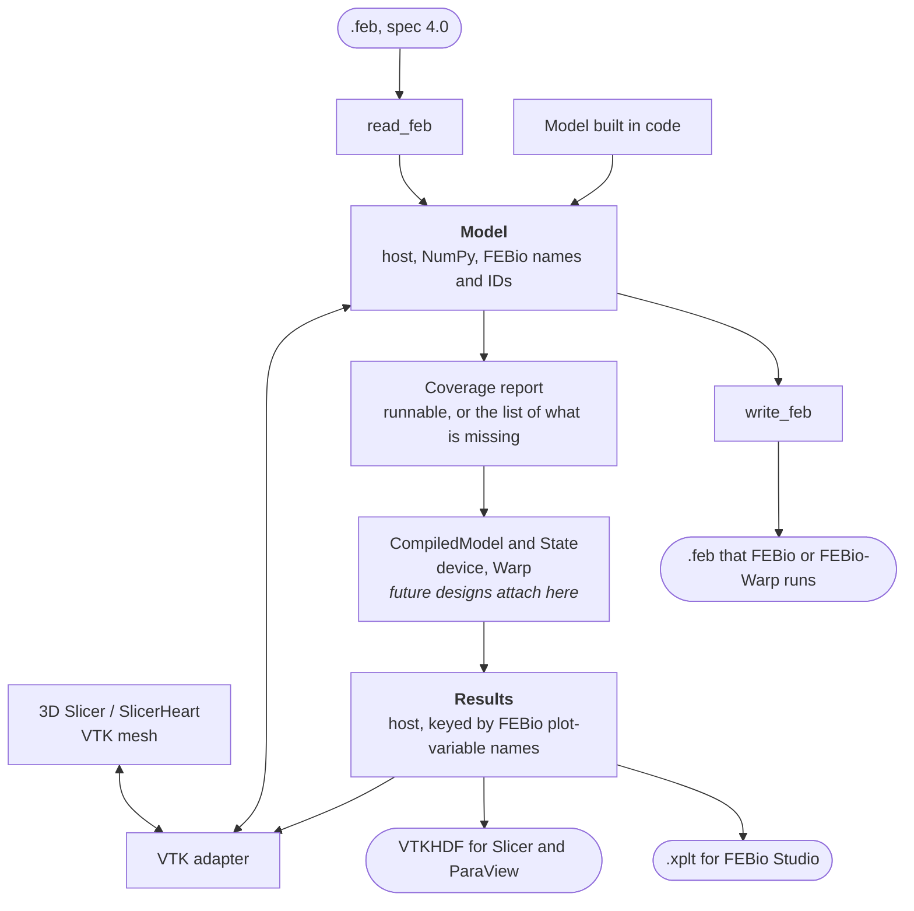

# Central model and FEBio input and output

Draft v0.2 for discussion, November 25, 2026. For Steve Maas, Ryan Black, Jeff Weiss, the Warp team and the FEBio-Warp team. The code is a local draft on branch `io-model-draft`; nothing is merged.

Scope: the model object and the files that go in and out of it. Elements, assembly, solvers, time stepping, contact and materials are separate designs that are still to be made. A minimal version of some of them exists in the draft only so the model could be exercised end to end, as Steve suggested; section 7 says what that was.

## 1. Summary

- **One model object in the middle.** A host-side `Model` holds what a FEBio input means, with FEBio's names and IDs. The reader fills it, compile reads it, the writers take results back out through it. Nothing else passes data between these parts.
- **FEBio's files are the fixed standard.** A spec 4.0 `.feb` is read as written and written back so FEBio runs it. Results are written as `.xplt` in the layout FEBio writes today.
- **Our own reader and writers,** as Steve recommended: no third-party library in the path, and only the standard library and NumPy for `.feb` and `.xplt`, so they load in 3D Slicer.
- **Nothing is dropped.** A feature the code does not yet interpret is carried, written back unchanged, and listed by a coverage report that decides whether a model can run.
- **Input is needed on seven points** in section 6: three for Steve, two for Ryan, two for the Warp team.

## 2. Big picture



| Object | Lives on | Holds | FEBio counterpart |
| --- | --- | --- | --- |
| `Model` | Host, NumPy | Everything the input file defines | `FEModel`, `FEMesh` |
| `CompiledModel` | Device, Warp | Numbering and device arrays built from a `Model` | `FEModel::Init`, domains |
| `State` | Device, Warp | The solution at one time | Node and material-point data |
| `Results` | Host, NumPy | Output states, by FEBio plot-variable name | What `FEBioPlotFile` writes |

Data moves host to device once, when a `Model` is compiled, and device to host at output steps.

## 3. The model

### What it holds

| Part | Stored as | From `.feb` section |
| --- | --- | --- |
| Nodes | `(N, 3)` float64 coordinates and the FEBio node IDs; the `Nodes` blocks by name | `Mesh/Nodes` |
| Element blocks | Per part: element type string, `(E, k)` int32 zero-based connectivity, FEBio element IDs | `Mesh/Elements` |
| Node sets, element sets | Index or ID arrays by name | `Mesh/NodeSet`, `Mesh/ElementSet` |
| Surfaces | Facets as node-index arrays with their type and ID | `Mesh/Surface` |
| Other mesh items | Records (see below): edges, surface pairs, discrete sets | `Mesh/Edge`, `SurfacePair`, `DiscreteSet` |
| Materials | ID, name, type string, and a record of parameters | `Material` |
| Domains | Part, material, kind (solid, shell, beam), and a record of settings | `MeshDomains` |
| Mesh data | Arrays where the rows are regular (shell thickness); records otherwise | `MeshData` |
| Boundary conditions, loads, contact | Records | `Boundary`, `Loads`, `Contact` |
| Load controllers | ID, type, points as an `(n, 2)` array, and FEBio's interpolation | `LoadData` |
| Steps | Control settings as a record, and the features each step adds | `Control`, `Step` |
| Output requests | Record | `Output` |
| Anything else | Records, in file order | `Globals`, `Initial`, `Rigid`, `Constraints`, `Discrete`, ... |

### Three rules

- **IDs round-trip.** Arrays use zero-based contiguous indices. The file's node and element IDs are kept beside them and used again on output.
- **FEBio's vocabulary.** Type strings (`neo-Hookean`, `zero displacement`, `elastic-shell`) and parameter tags (`E`, `v`, `shell_thickness`) are kept exactly. Code looks features up by these names.
- **Unknown is reported, never dropped.** A section the reader cannot place is recorded as an issue and blocks a run.

### Mesh as arrays, everything else as records

The mesh is bulk data and becomes arrays. Every other feature is kept as a `Record`: a small tree with the tag, attributes, value and children exactly as in the file, with numbers parsed.

```python
Record(tag="material", attrs={"id": "1", "name": "Valve", "type": "isotropic Lee-Sacks"},
       children=[Record("density", value=1e-9), Record("c0", value=...), ...])
```

A record loses nothing, which is what lets every input in section 7 read and write back equal, including features and modules FEBio-Warp will not implement for a long time. The cost is that a record is not validated when it is read: a misspelled parameter is caught later, by the coverage report. Whether features should be typed classes in the model is question 1.

### Where FEBio-Warp differs from FEBio, and why

| FEBio | Here | Reason |
| --- | --- | --- |
| Objects per node, element, material point | Flat arrays | Warp kernels operate on arrays |
| The model carries the current solution | `State` is separate from `Model` | Several states per model: output history, and reverse-mode differentiation. Newton makes the same split |
| The model changes as it runs | `Model` is frozen once built; time-dependent values are evaluated from it | One source of truth on the host; see question 2 |
| Parameters default in constructors | A parameter missing from the file is refused for materials | No table of FEBio defaults exists here yet; see question 3 |

### How the parts use it

```python
from warp_febio.io import read_feb, write_feb, write_xplt

model = read_feb("valve.feb")                        # reader fills the model

model.mesh.nodes                                     # (N, 3) float64
model.mesh.block("Part3").connectivity               # (E, 4) int32, zero-based
model.mesh.node_set_indices("@surface:Pressure1")    # FEBio's set references resolve here
model.material("Valve").value("c0")                  # by FEBio tag
model.load_controller(1).value(0.5)                  # FEBio's interpolation
model.plot_variables()                               # what the file asks to be written

write_feb(model, "valve_copy.feb")                   # a file FEBio runs
write_xplt(model, results, "valve.xplt")             # results, through the model's IDs and sets
```

The model layer imports only NumPy, so it is the attachment point for Slicer, for tests, and later for other platforms, without Warp or a GPU.

## 4. Input and output

| Piece | Follows | Depends on |
| --- | --- | --- |
| `.feb` reader | FEBio spec 4.0 only | Standard library, NumPy |
| `.feb` writer | Spec 4.0, section order of FEBio Studio's exporter | Standard library, NumPy |
| `.xplt` reader and writer | `FEBioPlotFile`, plot version 0x0035, single precision | Standard library, NumPy |
| VTKHDF writer | VTKHDF 2.0, one file for all steps, double precision | h5py |
| VTK adapter | `vtkUnstructuredGrid` to and from the model | VTK |

- **Reader.** Mesh blocks are converted in bulk, not row by row. Older spec versions are refused with a message; FEBio Studio converts them.
- **XPLT.** There is no written specification, so the writer follows `FEBioPlotFile.cpp` and was checked against files FEBio wrote. Mesh, sets, parts and the dictionary are laid out as FEBio lays them out, so a FEBio-Warp file lines up item for item with FEBio's for the same input.
- **Slicer.** `model_to_vtk` gives a grid with FEBio IDs and, for a result, displacement and stress. `model_from_vtk` turns a mesh made in Slicer into a model that `write_feb` saves. The SlicerHeart modules themselves are not written yet.
- **Coverage report.** `python -m warp_febio inspect model.feb` lists every feature in a model by its FEBio name and whether it is implemented. It is the contract between the model and whatever runs it: one unsupported feature and the model is refused, with the list.

## 5. What is deliberately left open

- **The device side.** `CompiledModel` and `State` exist in the draft in the simplest form that works. Their layout should follow from the element, assembly and solver designs, not precede them.
- **Typed access to features.** Compile currently reads records directly. If records stay (question 1), small typed views can be added per feature as each is implemented.
- **Mesh data beyond shell thickness.** Per-element material axes, which the TPVR inputs carry, are still records and should become arrays.
- **FEBio's defaults** (question 3).
- **Results beyond displacement and stress.** The results store and the XPLT dictionary take any variable; only these two are produced.

## 6. Input needed

Each point was checked against the FEBio source (`552138d`), a FEBio run, the plugin source, or the installed Warp before being written, and what was found is stated with it.

**For Steve**

1. **Records or typed features.** FEBio builds a typed object per feature with declared parameters. The draft stores features as generic records under FEBio's names and interprets them at compile. With records, all 538 suite inputs and the open application inputs read and write back equal, including modules we do not implement. Would you keep records as the stored form and add typed access where a feature is implemented, or declare typed features in the model from the start, as FEBio does?
2. **A frozen model.** The draft treats the model as fixed once read. Values that change in time (a load curve on a parameter, conditions and contact that differ by step) are definitions in the model, evaluated as the run proceeds. The plot file also carries a status flag per element in every state; it is 1 for every element in every FEBio file we read. For the valve and device applications, is there anything FEBio changes in the mesh or the sets during a run that a frozen model could not represent?
3. **Parameter defaults.** An input need not list every parameter; FEBio fills the rest from its constructors. To do the same we need FEBio's defaults by class. We looked through FEBio's command-line options (`-info`, `-dump`, `-task` and the rest in `FEBioApp.cpp`) and found none that exports the class and parameter registry. Is there an existing way to export it (names, types, defaults, ranges), or should we transcribe defaults per feature from the source as each is implemented?

One request, not a question: we could not open results in FEBio Studio from this environment. If the two attached files (`hex8_neo_hookean_warp.xplt`, `quad4_shell_neo_hookean_warp.xplt`) open and display in FEBio Studio as FEBio's own do, that closes the last check on the writer.

**For Ryan**

4. **The plugin's inputs.** The 15 test inputs in FEBioMFEMiFSI (`e50d0ae`) read and write back equal. They are standard spec 4.0 with module `mfemifsi`, solver type `mfem`, and the plugin's own material, boundary condition and solver settings, all carried as records. The solver settings include `final_state_folder`, a path outside the file. Does the plugin read anything else that is not in the `.feb` itself, which a shared model would need to resolve?
5. **What MFEM would need from the model.** The model keeps the original connectivity and IDs for every element block (the plugin's tests use hex8, and tet4 in one input). If FEBio-Warp were to stand where FEBio stands for the immersed solid, is node coordinates, connectivity by part, sets and material records enough on the model side, or does the coupling need something the list in section 3 lacks?

**For the Warp team (Eric, Kay)**

6. **Device form of the mesh.** The model gives one connectivity array per part and element type, and compile moves them to `wp.array`s as they are. The open TPVR input mixes hex8, penta6, tet4 and tri3 in one mesh (30,192, 1,536, 49,256 and 7,000 elements), and `warp.fem` 1.19.0 has no wedge geometry. Would you keep plain arrays per block as the device form and build `warp.fem` geometries from them only where a block type has one, or is there a mixed-element mesh form in Warp or Newton we should target?
7. **Model and state conventions.** The draft separates a frozen model from a state, and builds the device model from the host model in one call. We did not mirror Newton's builder or naming. Which of Newton's conventions (builder then finalize on a device, array naming, state and control objects) are worth adopting now so a FEBio-Warp model can sit next to a Newton model later, and which would you leave alone?

**Reported, no reply needed**

- FEBio 4.13.0 plot files from our source build carry uninitialized bytes after the terminator of the 64-byte name fields and in facet padding, so two runs of one input are not byte-identical. The FEBio 4.9 files in the repository have zeros there. We compare parsed content.
- The log file `format` attribute prints values at 6 digits; without it FEBio prints 12.
- When a shell part has both a domain `shell_thickness` and thickness element data, FEBio uses the element data (found by running each case).
- Suite inputs `sh48` and `sh50` attach shells to solid elements; FEBio ties them through `FESSIShellDomain::FindSSI`. The open valve and TPVR inputs do not have this.

## 7. How it was tested

CPU only. FEBio is 4.13.0 built from source at `552138d` with GCC and without MKL, a provisional build and not a release.

**Reading and writing inputs**

| Inputs | Count | Read | Write and re-read equal |
| --- | --- | --- | --- |
| FEBio test suite, model inputs (`986005f`) | 538 | 538 | 538 |
| Open TPVR inputs (FEBio model repository, 60,256 to 90,138 nodes) | 6 | 6 | 6 |
| Open mitral inputs | 2 | 2 | 2 |
| FEBioMFEMiFSI test inputs | 15 | 15 | 15 |
| Reference inputs in this repository | 11 | 11 | 11 |

- The suite covers solid, biphasic, multiphasic, fluid, fluid-FSI and solute modules; all are read and carried.
- A 65,011-node TPVR input reads in 1.4 s and writes in 1.7 s.
- FEBio ran inputs written by `write_feb`, including ones built from VTK meshes, and produced log output identical to its runs of the originals.

**Plot files**

- Five FEBio 4.9 plot files in the repository, read and written again, are identical byte for byte.
- For the same input, a FEBio-Warp plot file equals FEBio's in every non-float field (nodes, domains, sets, surfaces, parts, dictionary, state times and flags) and in size apart from the software name.
- VTKHDF files read back in double precision with VTK 9.7.2's `vtkHDFReader`, every step.

**The model, exercised end to end.** To check that the model carries what a run needs, the draft includes a minimal path behind it: hex8 solids and quad4 `elastic-shell` elements, `neo-Hookean`, fixed and prescribed displacements, and a static Newton solve. This path is a test fixture, not a proposed design for those parts.

| Input | Compared with FEBio through | Largest relative difference |
| --- | --- | --- |
| One hex8; one quad4 shell | Log data, 12 digits | 2e-12 |
| 8-element hex block; 9-element curved shell patch | Log data | 4e-12 |
| Six suite inputs (`sh52`, `mi06`, `mi24`, `oi06`, `mi25`, `oi10`) | Plot file, single precision | Equal in single precision for three; 1e-5 for three at FEBio's default tolerances, and equal once FEBio's tolerances are tightened |

- The same results were obtained with materials taken from the material layer of draft PR #2 and with Warp's own linear solvers (`warp.optim.linear`).
- The coverage report refuses the other 532 suite inputs and all open application inputs and lists why. For the open mitral input: `isotropic Lee-Sacks`, `contact potential`, nonlinear springs, `pressure`, `mass damping`, dynamic analysis.

**Automated tests.** 18 tests cover the above and pass. They do not need FEBio, since its outputs are stored under `references/`.

**Not checked**

- Nothing was opened in FEBio Studio or in 3D Slicer.
- No GPU run.
- The FEBio references are from a source build without MKL.
