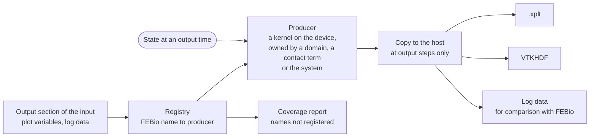

# Output registry

First template for discussion, November 26, 2026 (v0.2). Design only: there is no code for this note. Nothing here is settled. Part of the set introduced in [remaining_areas.md](remaining_areas.md).

**Status, November 28, 2026.** Still design only. The templates written since keep further values in the results that the registry would name: nodal velocity in a dynamic step; for springs, FEBio's `discrete element force` and `discrete element signed force` by discrete set; for trusses, `truss stretch` and the axial force (not a FEBio variable); and, as a kernel output, the chord force on a node set ([trusses_and_springs.md](trusses_and_springs.md)).

**Scope.** How the variables a FEBio input asks for, in its plot file and its log file, are produced from a State. The writers themselves (`.xplt`, VTKHDF) are in pull request 5 and are not changed.

## 1. Summary

- **The writers take any variable; only three are produced.** Displacement, stress and reaction force.
- **The two application inputs ask for nine plot variables between them**, and the mitral input also asks for log data.
- **Log data matters most for verification.** FEBio's log has 12 digits; its plot file is single precision.
- **Proposal: a registry from FEBio's variable names to a kernel on the State**, with data moved to the host at output steps only.

## 2. From a State to a file

## 3. What the inputs ask for

| Plot variable | Mitral | TPVR (file 3599) | FEBio class | Produced today | Would come from |
| --- | --- | --- | --- | --- | --- |
| `displacement` | yes | yes | `FEPlotNodeDisplacement` | yes | The State |
| `stress` | yes | yes | `FEPlotElementStress` | yes | Domain point data |
| `reaction forces` | | yes | `FEPlotNodeReactionForces` | yes | The system |
| `relative volume` | yes | yes | `FEPlotRelativeVolume` | no | Domain point data (J is already computed) |
| `Lagrange strain` | yes | yes | `FEPlotLagrangeStrain` | no | Domain point data (from F) |
| `shell thickness` | yes | yes | `FEPlotShellThickness` | no | Shell domain |
| `contact gap` | yes | yes | `FEPlotContactGap` | no | Contact term |
| `contact pressure` | yes | yes | `FEPlotContactPressure` | no | Contact term |
| `discrete element force` | yes | | `FEPlotDiscreteElementForce` | no | Spring domain |

The mitral input also has log data: `Ux;Uy;Uz;s1;E1` per element for seven element sets, `contact gap` per face, and `contact area` for the contact surface.

For the contact potential, FEBio reports as the gap the smallest pair distance found at an integration point, as the pressure the magnitude of the traction there, and as the area the sum over points whose traction is not zero (`FEContactPotential.cpp`). The contact draft reports contact area and contact fraction today.

## 4. Proposed

| Topic | Proposal | Why |
| --- | --- | --- |
| Registry | A table from FEBio's name to a producer, with the data class the writer needs (per node, per element, per face) | The plot file writer of pull request 5 already takes any variable with its class |
| Producers | Each term offers the variables it owns through one call, `plot(state, name)` | Stress belongs to the domain that computed it; the gap belongs to the contact term |
| Element values from point values | FEBio's rule for each variable, as the run path already follows for stress | The comparison is with FEBio's numbers |
| Log data | The same producers, with FEBio's log names (`Ux`, `s1`, `E1`) mapped to components and principal values | Log data is what the tests compare |
| Timing | Producers run on the device at output steps. One copy to the host per variable per output step | Follows the run path's rule for what crosses to the host |
| Memory | Results are streamed to the writer per output step | The run path keeps all results in memory, which the 200 states of an application would make large |
| Unknown names | Listed by the coverage report, and the run proceeds without them | An input should not be refused for a plot variable |

**Alternative considered.** Compute every derived variable on the host from displacement and stress after the run. It keeps the device code smaller. It cannot give contact or spring variables, and it repeats kinematics the domains already have.

## 5. Decision points

| ID | Decision | Options | Proposed | For |
| --- | --- | --- | --- | --- |
| O1 | How suite problems are compared. Of 374 suite inputs in the solid module, one requests log data; the suite's own stored results are step and iteration counts, the plot file size and one value | (a) Read FEBio's plot file from a pinned build run on the unmodified input (single precision). (b) Run FEBio on a copy with a log section added (12 digits) | (a) first: the input is unchanged and the plot file reader exists in pull request 5. (b) where 1e-7 is not enough | Steve |
| O2 | Where derived variables are computed | (a) On the device by the term that owns them. (b) On the host after the run | (a) | Warp team |
| O3 | Results in memory | (a) Stream each output step to the writer. (b) Keep all states, as the run path does | (a) for output. The adjoint keeps its own States ([sensitivity.md](sensitivity.md)) | Steve |
| O4 | Outputs as objectives | An output used in a gradient (a contact area, a strain, a chord force) must be a kernel on the State, so the tape can differentiate it | Producers are written as kernels with `inputs` and `outputs` declared, which serves both uses | Warp team |

## 6. Verification

FEBio test suite first. Of the 374 suite inputs in the solid module, all request `displacement` in the plot file, 368 request `stress` and 200 request `relative volume`, so those three producers can be checked on any suite problem FEBio-Warp runs. `co62` requests `contact gap` and `contact pressure`. No suite problem requests `truss stretch`.

The small inputs in `references/small_problems` log nodal displacements, velocities and reactions and element stress components at 12 digits. References for `Lagrange strain`, `contact gap` and `discrete element force` would need to be regenerated with those names added to the log.

## 7. Reserved

- `beam stress` and other beam variables.
- Variables for sticky and sliding contact.
- Output to OpenUSD, which the model note mentions.

## 8. Depends on

The results store and writers of pull request 5, and the `Term` contract of the run path.
