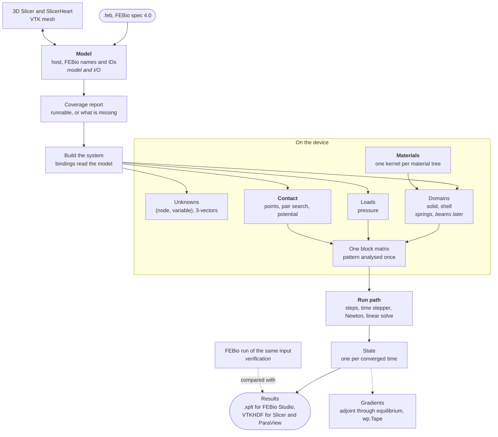
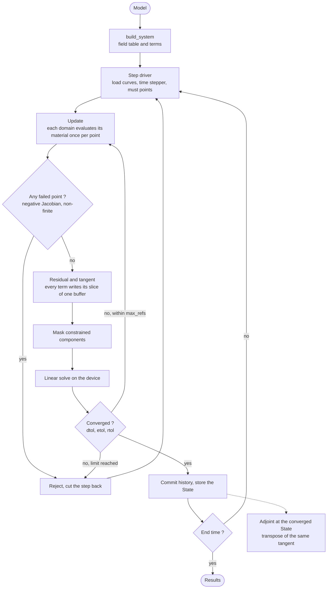

# FEBio-Warp design overview

Initial draft, November 26, 2026. This page is the entry point to the design. It shows how the pieces fit, says what state each is in, and links to the note that holds the detail. It is a summary of first drafts, not a specification. Sections 1 to 4 describe pieces that have a design note and code, merged to `main` on November 27, 2026; their open questions are the decision points of each note. Each note opens with its own diagrams. Section 5 holds first templates for the areas after that; nothing in it is settled.

**The rule the design follows.** Follow FEBio where it matters to a user or a reviewer: the same input files, the same names, the same formulations, the same outputs, and FEBio results as the reference. Build the internals for Warp: flat arrays on the device, one kernel per batch, a matrix pattern that is analysed once, state kept apart from the model, and gradients as a design requirement.

## 1. The whole path

## 2. The pieces

| Piece | What it is | State | Note | Code |
| --- | --- | --- | --- | --- |
| Model and I/O | One `Model` object holding what a FEBio input defines. Reads and writes `.feb`, writes `.xplt` and VTKHDF, exchanges meshes with 3D Slicer. A coverage report says whether an input can run and lists what is missing. | On `main` | [model.md](model.md) | [PR #5](https://github.com/JolleyLab/FEBio-Warp-Python/pull/5) |
| Materials | FEBio's material structure (typed parameters with ranges, axes and fibers, mixtures, the uncoupled split, history), composed in Python so that Warp compiles each material tree into one kernel. | On `main` | [materials.md](materials.md) | [PR #2](https://github.com/JolleyLab/FEBio-Warp-Python/pull/2) |
| Contact | Point-based contact potential after Kamensky et al. and FEBio's `FEContactPotential`: contact points, pair search on the device, force and tangent, gradients. | On `main` | [contact.md](contact.md) | [PR #1](https://github.com/JolleyLab/FEBio-Warp-Python/pull/1) |
| Verification | FEBio-Warp run on FEBio inputs and compared with pinned FEBio results, at four levels: material point, element, small problem, application. | On `main` | [verification.md](verification.md) | [PR #4](https://github.com/JolleyLab/FEBio-Warp-Python/pull/4) |
| Integration | The four drafts made consistent where they meet, before the merge to `main`. | Merged | [integration.md](integration.md) | `main` |
| Run path | From a model to a result: unknowns, terms, the Newton step, the step driver, pressure, solids on `warp.fem`, adjoint gradients. | Template on `main` | [run_path.md](run_path.md) | [PR #6](https://github.com/JolleyLab/FEBio-Warp-Python/pull/6) |

## 3. One run

## 4. Where it follows FEBio and where it differs

| Topic | Same as FEBio | Different, and why |
| --- | --- | --- |
| Input and output | `.feb` in, `.xplt` out, FEBio names for parameters and plot variables | A host `Model` that can also be built in code or from Slicer |
| Unknowns | Variable names; free, fixed and prescribed states | Numbered by (node, variable) with 3x3 blocks; constrained components masked, not removed, so the matrix pattern never changes |
| Domains and loads | What each computes, integration rules, node order, sign of the residual (external minus internal) | One contract for domains, loads and contact; flat point data; one kernel set per material tree |
| Materials | Parameters, ranges, axes, mixtures, formulas checked against FEBio source and runs | Composition happens before compilation; failure is a status code per point, since a kernel cannot throw |
| Contact potential | The law, its parameters, the default integration points, the exclusion of neighboring elements | Gates applied per point pair; an optional radius offset per point; in a run, the contact tangent in a matrix of its own. Listed in the contact notes and in [deviations.md](deviations.md) |
| Nonlinear solve | Prescribed displacements, convergence norms, `max_refs`, the time stepper and its retries; in a dynamic step, FEBio's time integration and initial accelerations | Full Newton to start; no line search or BFGS yet. The mass damping stiffness is the derivative of its force by default, with FEBio's form as a setting |
| State | What a converged step holds | A step maps one State to the next and does not modify the model, so a run can be differentiated |
| Gradients | None in FEBio | Adjoint through equilibrium using the transpose of the tangent, and `wp.Tape` for the residual. An exact tangent is available where FEBio's is approximate (symmetrized pressure stiffness) |

## 5. First templates: nothing here is settled

These areas have a first shape in the run path template, or only a placeholder. Each has a short design note with a flow diagram, a proposed approach, what has been explored and the decision points for the team. Since November 28 several have first template code on branches (trusses and springs, nodal loads, one dynamic step with mass damping, two direct linear solves, the contact potential in a run); the table below is updated for those, and [deviations.md](deviations.md) lists where that code differs from FEBio. [remaining_areas.md](remaining_areas.md) orders them along the path to the first application runs.

| Area | First template | Not yet | Design note |
| --- | --- | --- | --- |
| Elements | hex8 and tet4 solids on `warp.fem`; hex8 and quad4 shell on a dedicated kernel; two-node trusses and springs for chordae; consistent mass for hex8, quad4 shell and truss | tet4 mass; the three-field element, penta6 and tri3 shell (device path) | [chordae.md](chordae.md), [elements.md](elements.md) |
| Loads | Follower pressure on quad4 facets; nodal loads; `mass damping` on a whole part | The constant body force; mass damping on part of a part; pressure on tri3 facets | [dynamics.md](dynamics.md) for `mass damping` |
| Constraints | Fixed and prescribed displacements by masking | `normal displacement`, linear constraints, rigid bodies and joints | [constraints.md](constraints.md) |
| Linear solve | Warp's CG, BiCGSTAB and GMRES with a Jacobi preconditioner; a sparse LU on the host; optionally cuDSS on the device, which took a shell patch from 20 s to 2 s | A stronger preconditioner for large solids; the transpose solve from cuDSS factors for the adjoint; line search and quasi-Newton | [linear_solve.md](linear_solve.md) |
| Steps | One static step, or one dynamic step series with alpha_f = 1, with FEBio's time stepper | alpha_f below 1, several steps, activation by step | [dynamics.md](dynamics.md) |
| Contact in the run | The contact potential as a term, with points from the model's surfaces, pairs found at every iterate and its tangent in a matrix of its own; small cases and suite `co62` agree with FEBio | Leaflet closure of the open mitral input, which needs a line search and a step limit; FEBio's element-pair `w_tol`; contact in the adjoint | [contact_in_run.md](contact_in_run.md) |
| Sensitivity | Parameter gradients through one equilibrium solve or one dynamic step; the solve as one step on a tape; chord tension and chord force on a node set as objectives | History, several dynamic steps, contact pairing, shape gradients | [sensitivity.md](sensitivity.md) |
| Output | Displacement, stress, reaction force | The registry of FEBio plot variables | [output.md](output.md) |
| Newton (the physics library) | The step is functional and state is separate, as Newton's solvers expect | A wrapper with Newton's `step` signature; nodal forces in, positions out | [run_path.md](run_path.md), section 6 |
| Performance | Double precision, checked for correctness on CPU and on a GPU; first whole-run timings on a GPU with four linear solves | Timing at application size; single precision where it is adequate | [linear_solve.md](linear_solve.md), section 6 |

Design shells, kept in view so that nothing built now closes them off: beam elements for device frames, a superelastic nitinol law for those beams, rigid bodies and joints, sliding and sticky contact.

## 6. Targets and checks

| Application | Open FEBio input | What it adds beyond the shared core |
| --- | --- | --- |
| Atrioventricular valve closure | `P2Prolapse_Mitral.feb` (FEBio model repository, file 3572) | Chordae springs, leaflet self-contact |
| Transcatheter pulmonary valve replacement | Six deployments (files 3598 to 3603), for example `RVOT1_TPV25.feb` | Two steps, tet4 device, penta6 vessel with uncoupled HGO, tri3 shell tubes, three contact pairs |
| Patch and verification problems | Small inputs in `references/` | One feature each |

The shared core both applications need: dynamic analysis, mass damping and the contact potential. Pressure is a valve load; TPVR file 3599 has none ([remaining_areas.md](remaining_areas.md), section 1).

Checks so far compare with FEBio on the same input, in double precision, on CPU and on a GPU: material points, single elements, small meshes, pressure, two materials in two domains, reaction forces, and the automatic time stepper. Figures are in the notes linked above. No application input runs end to end yet.

## 7. Reading order

1. This page.
2. [integration.md](integration.md): how the four drafts meet.
3. [model.md](model.md), then [materials.md](materials.md) and [contact.md](contact.md).
4. [run_path.md](run_path.md): the path through all of them on small cases.
5. [verification.md](verification.md): how results are compared with FEBio.
6. [remaining_areas.md](remaining_areas.md): what is left before the application inputs run, with one short note per area.
