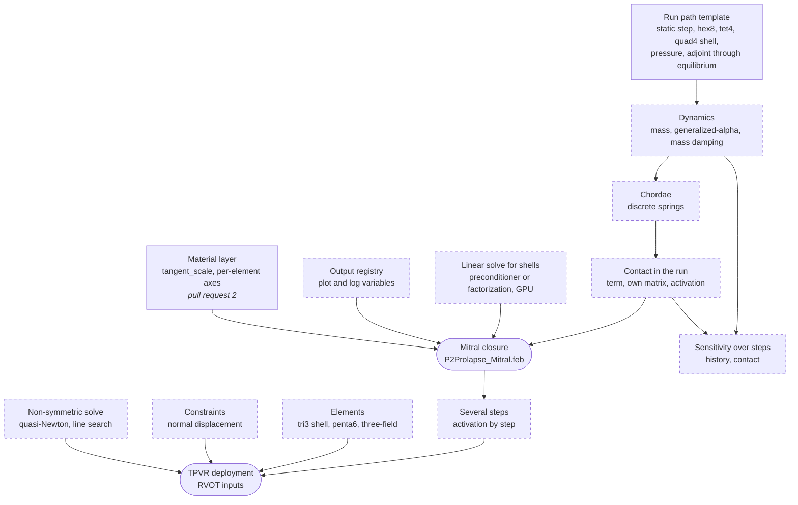

# Remaining areas: the path to the first application runs

First template for discussion, November 26, 2026. For Steve Maas, Jeff Weiss, Ryan Black and the Warp team. Design only: no code accompanies this note or the notes it links. Nothing here is settled.

**What this is.** A map of what still stands between the run path template (pull request 6) and the two open application inputs, with one short note per area. Each note has a flow diagram, the FEBio source it follows, what Warp already provides, a proposed approach with one alternative, and the FEBio input that would verify it.

**Assumptions.** The model and reader of pull request 5 are accepted in the main. The run path of pull request 6 (field table, terms, Newton step, step driver, adjoint) is the structure everything attaches to. If review changes either, the notes change with it; section 4 says which.

**The rule followed.** Same as the rest of the design: FEBio decides inputs, formulations, defaults and outputs, and is the reference for every result. The internals are built for Warp: flat device arrays, one kernel per batch, a matrix pattern analysed once, state apart from the model, gradients as a requirement.

## 1. What the two application inputs ask for

Read from the files themselves on November 26, 2026: `references/febio/originals/cardiofem/valve_pressurization/mitral_p2prolapse.feb` (the open file 3572) and open file 3599 from the FEBio model repository (one of the six TPVR deployments).

| | Mitral closure | TPVR deployment (file 3599) |
| --- | --- | --- |
| Size | 7,442 nodes, 7,200 quad4 shells, 100 springs | 65,011 nodes, 87,984 elements |
| Elements | quad4 `elastic-shell`, nodal normals, thickness per element | hex8 and penta6 (vessel), tet4 (device), tri3 shells (two tubes) |
| Materials | `isotropic Lee-Sacks` with `tangent_scale` 10 | `Holzapfel-Gasser-Ogden` (uncoupled) with per-element `mat_axis`; `isotropic elastic` with `E` on a load curve; `neo-Hookean` |
| Discrete | 8 `nonlinear spring` sets | none |
| Analysis | 1 dynamic step, 200 steps of 1e-4 | 2 dynamic steps (20 of 0.05, then 200 of 0.01) |
| Time integration | `rhoi` 0 | `rhoi` 0 |
| Nonlinear solve | BFGS (`max_ups` 10), `lstol` 0.9, symmetric | Broyden, `lstol` 0.9, non-symmetric |
| Boundary conditions | `zero displacement`, `zero shell displacement` | `zero displacement`, `normal displacement` on two surfaces |
| Loads | `pressure` on a load curve, `mass damping` | `mass damping`; no pressure load |
| Contact | 1 `contact potential`, a surface against itself | 3 `contact potential`, the third added in step 2 |
| Plot variables | displacement, stress, relative volume, contact gap, contact pressure, discrete element force, shell thickness, Lagrange strain | the same without discrete element force, plus reaction forces |

Two corrections to earlier notes follow from this reading.

- **Pressure is not part of the shared core.** File 3599 has no pressure load. What both inputs share is dynamic analysis, mass damping and the contact potential. The other five TPVR files were not re-read today.
- **Both inputs set `rhoi` to 0.** In FEBio that gives alpha_f = 1, alpha_m = 2, beta = 1, gamma = 1.5 (`FESolidSolver2::Init`). The stored small dynamic problems leave `rhoi` at its default and so use different parameters. See [dynamics.md](dynamics.md).

## 2. The path

Solid boxes exist as a template in pull request 6 or as a draft. Dashed boxes are the remaining areas.

## 3. The notes

In the order of the path. "Verified by" names an input whose FEBio reference is already in `references/`.

| # | Area | Note | Needed by | Verified by | Closes (open item in [integration.md](integration.md)) |
| --- | --- | --- | --- | --- | --- |
| 1 | Dynamics, mass damping, steps | [dynamics.md](dynamics.md) | Both | `bk_mass_damping`, `sh_lee_sacks_pressure` | |
| 2 | Chordae: discrete springs | [discrete.md](discrete.md) | Mitral | `ch_chord_slack_tension` | 5 |
| 3 | Contact in the run | [contact_in_run.md](contact_in_run.md) | Both | `bk_contact_potential_patch`, `sh_self_contact_fold`, `bk_ring_in_tube` | 1, 2 |
| 4 | Linear solve and GPU | [linear_solve.md](linear_solve.md) | Both | The 1,863-element shell patch | |
| 5 | Output registry | [output.md](output.md) | Both | Log data of the inputs above | |
| 6 | Elements: tri3 shell, penta6, three-field | [elements.md](elements.md) | TPVR | `bk_hgo_three_field`; single elements to add | 3, 4 |
| 7 | Constraints: normal displacement | [constraints.md](constraints.md) | TPVR | An input to add | |
| 8 | Sensitivity over steps | [sensitivity.md](sensitivity.md) | Both, for gradients | The gradient check case, extended | |

Not given a note of their own:

- **Quasi-Newton and line search.** Both inputs use them. The run path showed full Newton reaches the same solution as FEBio's BFGS to 2e-9 with different iteration counts, so they are needed to reproduce FEBio's step sequence, not to run. They attach inside `solve_step` and are listed in [linear_solve.md](linear_solve.md) with the non-symmetric solve.
- **Material items.** `tangent_scale`, per-element `mat_axis` and a mixture's own `mat_axis` (open items 3 and 6) belong to the material layer of pull request 2. [elements.md](elements.md) says what the domains need from it.
- **Assembly.** Decided on November 24 (full assembly). The record is [assembly.md](assembly.md).
- **Beams, rigid bodies, joints, sticky and sliding contact.** Design shells. Each note says what it reserves for them.

## 4. What these notes depend on

Four choices made in the open drafts carry through every note. If review changes one, this is what moves.

| Choice | Where it is proposed | Notes it affects |
| --- | --- | --- |
| Unknowns numbered by (node, variable), 3x3 blocks, constrained components masked | Run path, point 1 for review | All; most of all dynamics (velocity and acceleration arrays), constraints and the linear solve |
| FEBio's residual sign (external minus internal) in every term | Run path, point 3 | Contact in the run |
| `warp.fem` for solids to start, dedicated kernels where it has no element | Run path, section 5 | Elements |
| One `Term` contract for domains, loads, springs and contact | Run path, point 2 | Dynamics, chordae, contact in the run |

## 5. What was found while writing these

Each is stated in the note named, with its source.

| Finding | Note |
| --- | --- |
| The stored dynamic references use FEBio's default time integration parameters. Both application inputs use `rhoi` 0. | [dynamics.md](dynamics.md) |
| FEBio's `mass damping` stiffness is C/dt. The derivative of its force is C gamma/(beta dt). It is a third tangent that Newton may use and the adjoint may not, after the symmetrized pressure stiffness and `tangent_scale`. | [dynamics.md](dynamics.md), [sensitivity.md](sensitivity.md) |
| FEBio's penta6 solid and tri3 shell use the same six integration points and weights, as hex8 and the quad4 shell use the same eight. One wedge kernel could serve both. | [elements.md](elements.md) |
| FEBio runs uncoupled materials on hex8 and penta6 as `three-field-solid` by default, and not on tet4. | [elements.md](elements.md) |
| Warp 1.19.0 has a factorized sparse approximate inverse preconditioner (`FSAI`) for symmetric positive definite block matrices, built on the device, with a pattern that can be reused. It has not been tried here. | [linear_solve.md](linear_solve.md) |

## 6. What was checked, and what was not

Checked on November 26, 2026:

- The two application inputs, read directly (section 1).
- FEBio source at `e4df3f8`: `FESolidSolver2.cpp` (time integration parameters, kinematic update, residual and stiffness passes), `FEMassDamping.cpp`, `FEElasticShellDomain.cpp` and `FEElasticSolidDomain.cpp` (mass, inertial force, body force), `FEDiscreteElasticDomain.cpp`, `FENonlinearSpring.cpp`, `FEPrescribedNormalDisplacement.cpp`, `FESolidDomainFactory.cpp`, `FEModelBuilder.cpp` (element defaults), `FEElementTraits.cpp` (integration points), `FE3FieldElasticSolidDomain`, `FEContactPotential.cpp`, `FEAnalysis.cpp`, and the registrations in `FEBioMechModule.cpp`.
- Warp 1.19.0 as installed: `warp.optim.linear` (solvers, preconditioner types, `FSAI`), `warp.sparse`, and the geometry types of `warp.fem`.
- The code on `mattjolley/run-path-template`: the `Term` contract, the field table, the spring law, the contact interface and the linear solve wrapper.

Not checked:

- Nothing in these notes has been run. Every "proposed" is a design statement.
- No GPU was available.
- Review comments on the pull requests on GitHub were not read. Only the branches were.
- TPVR files 3598 and 3600 to 3603 were not re-read. Statements about TPVR are from file 3599.
