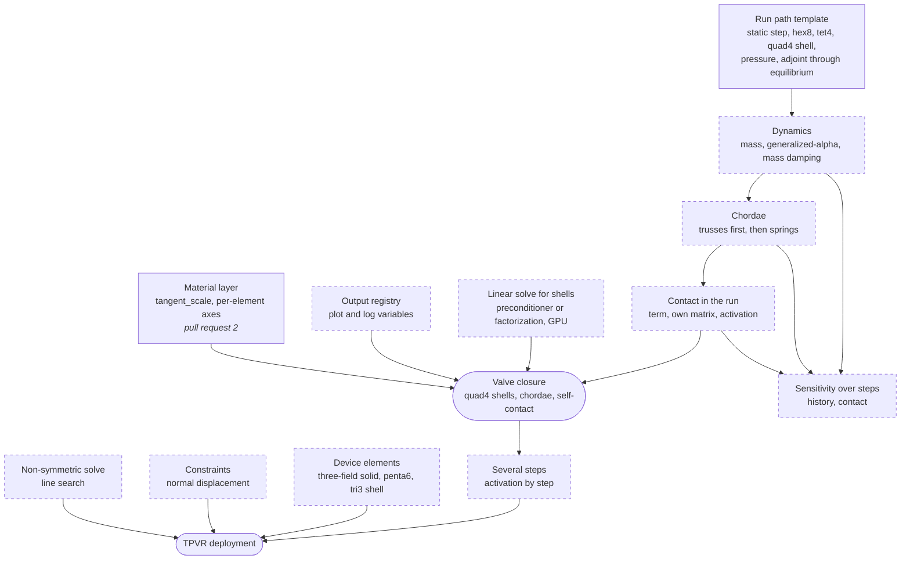

# Remaining areas: the path to the first application runs

First template for discussion, November 26, 2026 (v0.2). For Steve Maas, Jeff Weiss, Ryan Black and the Warp team. Design only: no code accompanies this note or the notes it links. Nothing here is settled.

**What this is.** A map of what still stands between the run path template (pull request 6) and the first applications, with one short note per area. Each note has a flow diagram, the FEBio source it follows, what Warp already provides, a proposed approach, what has been explored so far, the decision points for the team, and the FEBio test suite problems that would verify it.

**What is asked of a reader.** Not a code review. The notes are meant to help plan the architecture: where a proposal is wrong, which option to take at each decision point, and what is missing. Section 5 lists the decisions by who is best placed to make them. [work_plan.md](work_plan.md) turns the notes into work packages that can proceed in parallel.

**Assumptions.** The model and reader of pull request 5 are accepted in the main. The run path of pull request 6 (field table, terms, Newton step, step driver, adjoint) is the structure everything attaches to. If review changes either, the notes change with it; section 8 says which.

**The rule followed.** FEBio decides inputs, formulations, defaults and outputs, and is the reference for every result. The internals are built for Warp: flat device arrays, one kernel per batch, a matrix pattern analysed once, state apart from the model, and gradients as a requirement. Gradients of a solution are the one place with no FEBio design to follow (section 6).

## 1. What the targets ask for

The guide is how these simulations have been set up in FEBio in the published work, and the inputs are the ones published with it in the FEBio model repository user projects.

| Work | Setup in FEBio | Open input |
| --- | --- | --- |
| Wu et al. 2022 (J Biomech Eng), Wu et al. 2023 (J Mech Behav Biomed Mater) | quad4 shell leaflets, isotropic Lee-Sacks; chordae as tension-only two-node springs with a displacement threshold; potential-based contact; pressure ramp over 0.005 s; implicit dynamics with mass damping to reach the quasi-static state; automatic time stepping; tolerances 0.001 and 0.01 | |
| Aslan et al. (arXiv 2509.22865) | The same valve setup with contact potential `kc` 2, `p` 4, `R_in` 0.2, `R_out` 0.5, `w_tol` 0.6; generalized-alpha with mass damping on the leaflets; clip steps with sticky contact | Project 134: `P2Prolapse_Mitral.feb` (file 3572), `Dilation_Mitral.feb` (file 3571) |
| Mangine, Laurence et al. (arXiv 2411.09599) | The same leaflet setup; chordae as branched networks of `linear truss` elements; mass damping on leaflets and chords | |
| Zelonis et al. (arXiv 2507.06337) | Device as an isotropic elastic solid with a step load curve on its modulus; vessel as uncoupled Holzapfel-Gasser-Ogden with local axes; potential-based contact that changes by step; `normal displacement` on crimping tubes; mass damping on the device; full Newton | Project 136: six deployments (files 3598 to 3603) |
| Maheshwari, Wu et al. (arXiv 2601.05410) | Material sensitivity study on the TPVR setup. Not re-read for this note | |

The table below compares three of these. The first column is the open mitral input (file 3572). The second is current practice for chordae, from Mangine, Laurence et al. The third is open file 3599, one of the six TPVR deployments. All were read on November 26, 2026.

| | Open mitral input | Current valve practice | TPVR deployment (file 3599) |
| --- | --- | --- | --- |
| Leaflets or tissue | 7,200 quad4 `elastic-shell`, nodal normals, thickness per element | quad4 shells, thickness 0.396 mm | hex8 and penta6 vessel; two tri3 shell tubes |
| Material | `isotropic Lee-Sacks` with `tangent_scale` 10 | Isotropic Lee-Sacks | Uncoupled `Holzapfel-Gasser-Ogden` with per-element `mat_axis`; `isotropic elastic` with `E` on a load curve; `neo-Hookean` |
| Chordae or device | 100 `nonlinear spring` elements in 8 sets | Branched networks of `linear truss` elements, E 150 MPa, area 1.0 or 0.44 mm^2 | tet4 device |
| Analysis | 1 dynamic step, 200 steps of 1e-4, `rhoi` 0 | Dynamic, generalized-alpha, largest step 1e-4 s | 2 dynamic steps, `rhoi` 0 |
| Nonlinear solve | BFGS (`max_ups` 10), `lstol` 0.9, symmetric | Not stated | Full Newton (Broyden with `max_ups` 0), `lstol` 0.9, non-symmetric |
| Boundary conditions | `zero displacement`, `zero shell displacement` | Annulus and papillary tips fixed | `zero displacement`, `normal displacement` on two surfaces |
| Loads | `pressure` on a load curve, `mass damping` on leaflets | Pressure; mass damping on leaflets and chords | `mass damping` on the device; no pressure load |
| Contact | 1 `contact potential`, a surface against itself, `w_tol` 0.6 | Potential-based | 3 `contact potential`, the third declared in step 2, `w_tol` 0.3 |

What follows from this:

- **The valve path is quad4 shells plus chordae.** The quad4 shell exists in the run path. Chordae are trusses in current practice and springs in the open input. The truss is the first new element.
- **What both applications share** is dynamic analysis, mass damping and the contact potential. Pressure is a valve load.
- **Both inputs set `rhoi` to 0**, which in FEBio gives alpha_f = 1, alpha_m = 2, beta = 1, gamma = 1.5.
- **Device elements** (tri3 shell, penta6, three-field solid) are needed only by TPVR and come after the valve path.

## 2. The path

Solid boxes exist as a template in pull request 6 or as a draft. Dashed boxes are the remaining areas.

## 3. The notes

In the order of the path. Each note's decision points are linked.

| # | Area | Note | Decisions | Needed by | Closes (open item in [integration.md](integration.md)) |
| --- | --- | --- | --- | --- | --- |
| 1 | Dynamics, mass damping, steps | [dynamics.md](dynamics.md) | [D1 to D5](dynamics.md#7-decision-points) | Both | |
| 2 | Chordae: trusses, then springs | [chordae.md](chordae.md) | [C1 to C5](chordae.md#7-decision-points) | Valve | 5 |
| 3 | Contact in the run | [contact_in_run.md](contact_in_run.md) | [K1 to K5](contact_in_run.md#7-decision-points) | Both | 1, 2 |
| 4 | Linear solve, nonlinear strategy, GPU | [linear_solve.md](linear_solve.md) | [L1 to L6](linear_solve.md#7-decision-points) | Both | |
| 5 | Output registry | [output.md](output.md) | [O1 to O4](output.md#5-decision-points) | Both | |
| 6 | Elements: order of work, device elements | [elements.md](elements.md) | [E1 to E5](elements.md#7-decision-points) | Device | 3, 4 |
| 7 | Constraints: normal displacement | [constraints.md](constraints.md) | [B1 to B3](constraints.md#5-decision-points) | Device | |
| 8 | Sensitivity over steps | [sensitivity.md](sensitivity.md) | [S1 to S10](sensitivity.md#6-decision-points) | Gradients for both | |

Not given a note of their own:

- **Material items.** `tangent_scale`, per-element `mat_axis` and a mixture's own `mat_axis` (open items 3 and 6) belong to the material layer of pull request 2.
- **Assembly.** Decided on November 24 (full assembly). The record is [assembly.md](assembly.md).
- **Beams, rigid bodies, joints, sticky and sliding contact.** Design shells. Each note says what it reserves for them.

## 4. Verification: the FEBio test suite first

The principle is the one Steve gave for the verification harness: run FEBio-Warp on a FEBio input and compare with a pinned FEBio result from the same input. The inputs are taken in this order:

1. **The FEBio test suite** (https://github.com/febiosoftware/TestSuite, commit `986005f`, 549 inputs, 374 in the solid module), for each feature on its own.
2. **The open user project models** in the FEBio model repository (projects 134 and 136), for the applications.
3. **Small generated inputs** in `references/small_problems`, each mirroring a suite problem or a setting of an open model, only where neither of the first two has a case that fits.

The pilot-phase examples and data are not used for testing. They were exploratory and can mislead. Where an earlier note cites one, it is being replaced by a suite problem.

| Area | Suite problems that fit | What the suite lacks | Small input that fills it |
| --- | --- | --- | --- |
| Dynamics | `dy01`, `dy07` (hex8); `sh32`, `sh34`, `sh58` (quad4 shells); `dy10`, `dy11`, `dy13`, `dy14` (`rhoi` 1) | A simple problem at `rhoi` 0 | To add |
| Several steps | `ms01`, `ms02`, `ms03`, `ms05` (one static and one dynamic step) | A load or contact switched on by step | To add |
| Mass damping | `dy17` (on trusses) | Mass damping on solids or shells | `bk_mass_damping`, `sh_lee_sacks_pressure` |
| Trusses | `bt01` (static), `dy16`, `dy17` (dynamic) | Trusses sharing nodes with shells | To add |
| Springs | `di01`, `di02`, `di03` (linear), `di04` (nonlinear) | The slack curve of the mitral input | `ch_chord_slack_tension` |
| quad4 shells | `sh52`, `sh54`, `sh02`, `sh06`, `sh05`, `sh56` | Lee-Sacks on shells (no suite problem uses that material) | `sh_lee_sacks_pressure` |
| Pressure | `sh54`, `sh06`, `sh05`, `sh56` (shells), `oi11` (hex8) | | |
| Contact potential | `co62` | Shells, self-contact, several interfaces | `bk_contact_potential_patch`, `sh_self_contact_fold`, `bk_ring_in_tube` |
| Linear solve at size | `sh11` (2,048 quad4 shells) | Shells with contact and trusses | To add |
| Three-field solid | `ma34` (with a rigid body) | Uncoupled HGO without rigid bodies | `bk_hgo_three_field` |
| penta6, tri3 shell | `sh25` (mixed, with a rigid wall), `sh65` (23,268 elements) | Single elements | To add |
| `normal displacement` | `ma49` (uses a material that is not planned) | A runnable case | To add |
| Gradients | None. FEBio has no gradient of a solution. The `op` problems fit parameters with its optimization module | A reference gradient | Finite differences; see [sensitivity.md](sensitivity.md), decision S6 |

Three facts about the suite shape how it can be used.

- **Suite inputs carry no log data.** One of the 374 solid-module inputs requests any. The suite's own stored results are step and iteration counts, the plot file size and one value. So the comparison is with FEBio's plot file from a pinned build (decision O1 in [output.md](output.md)).
- **Iteration counts compare only with full Newton.** 167 of the 374 inputs set `max_ups` to 0. The rest use quasi-Newton updates, where results can be compared and counts cannot until quasi-Newton exists here.
- **The suite repository has no license file**, so its inputs are referenced by commit and not copied. That question is already with Steve in the verification note.

Running the suite problems named above needs three small load terms the run path does not have: `nodal_load`, `nodal_force` and the constant `body force`. The reader of pull request 5 already reads the truss, spring, contact, shell and two-step suite inputs tried (`bt01`, `dy16`, `dy17`, `di04`, `co62`, `dy13`, `sh54`, `sh11`, `ms03`), and its coverage report names what each is missing.

## 5. Decisions, by who is best placed to make them

A selection. Every decision has an ID and sits in a table in its note with the options and what is proposed. This includes the notes of the earlier pull requests (M model and I/O, T materials, N contact law, V verification, R run path).

**Steve and Jeff (formulation and fidelity to FEBio)**

| ID | Decision | Note |
| --- | --- | --- |
| C1 | Chords in compression: FEBio's `linear truss` has no tension-only form | [chordae.md](chordae.md#7-decision-points) |
| C2 | The route to a nonlinear chord material (follows question 7 of the materials note) | [chordae.md](chordae.md#7-decision-points) |
| D3 | Whether to build stress at an interpolated deformation now, to use the suite's `rhoi` 1 problems | [dynamics.md](dynamics.md#7-decision-points) |
| K3 | Contact gates per element pair, as FEBio, for the reference tier | [contact_in_run.md](contact_in_run.md#7-decision-points) |
| O1 | How suite problems are compared: plot file, or a copy with log data added | [output.md](output.md#5-decision-points) |
| E1 | Quad shell formulation for valves | [elements.md](elements.md#7-decision-points) |
| S2 | The exact-tangent contract for every term | [sensitivity.md](sensitivity.md#6-decision-points) |
| R1, R2, R3 | Contract v0: unknowns by (node, variable), one term contract, FEBio's residual sign | [run_path.md](run_path.md#12-decision-points) |
| M1, M2 | Features as generic records or typed classes; where FEBio's parameter defaults come from | [model.md](model.md#9-decision-points) |
| T1 to T6 | Material trees composed before compilation, fiber geometry, fixed options, Lee-Sacks ranges, HGO at k2 = 0, the material-point reference | [materials.md](materials.md#decision-points) |
| T8, T14 | Uncoupled or coupled HGO for the vessel wall; the true tangent beside `tangent_scale` | [materials.md](materials.md#decision-points) |
| N1, N2 | Pair multiplicity in self-contact; how `kc` is specified with more than one pair class | [contact.md](contact.md#decision-points) |
| V1, V2 | The FEBio build references are pinned to; suite inputs referenced by commit, not copied | [verification.md](verification.md#decision-points) |

**Warp team (device-side structure and differentiation)**

| ID | Decision | Note |
| --- | --- | --- |
| S1 | Adjoint per converged step, or a tape over the whole run | [sensitivity.md](sensitivity.md#6-decision-points) |
| S3 | How non-differentiable choices (contact pairs, gates, step sizes) are treated | [sensitivity.md](sensitivity.md#6-decision-points) |
| L2 | Iterative or direct linear solve at application size | [linear_solve.md](linear_solve.md#7-decision-points) |
| L5 | The adjoint solve may be non-symmetric even where Newton's matrix is symmetric | [linear_solve.md](linear_solve.md#7-decision-points) |
| K2 | Contact blocks in their own matrix | [contact_in_run.md](contact_in_run.md#7-decision-points) |
| E2 | Whether shells belong in `warp.fem` | [elements.md](elements.md#7-decision-points) |
| S9 | A nodal-force term as the port to Newton, the physics library | [sensitivity.md](sensitivity.md#6-decision-points) |
| M3, M4 | Precision where a model meets Newton; elements Newton does not have | [model.md](model.md#9-decision-points) |
| T10 to T13 | How kernels are grouped and shipped, precision by domain, `warp.fem` for nonlinear solids, shells | [materials.md](materials.md#decision-points) |
| R5, R6 | Running the forward solve without recording it; a direct solver or stronger preconditioner for shells | [run_path.md](run_path.md#12-decision-points) |
| N3, N7 | Integration weights where exact derivatives matter; precision of contact queries and kernels | [contact.md](contact.md#decision-points) |

**Ryan (solvers and assembly)**

| ID | Decision | Note |
| --- | --- | --- |
| L2, L4 | Solver choice, and indefinite tangents from slack chords and contact | [linear_solve.md](linear_solve.md#7-decision-points) |
| K2 | One operator or a summed matrix for structure and contact | [contact_in_run.md](contact_in_run.md#7-decision-points) |
| T9 | What the MFEM exchange returns from the material layer | [materials.md](materials.md#decision-points) |

**Andras (3D Slicer and SlicerHeart)**

| ID | Decision | Note |
| --- | --- | --- |
| M5, M6, M7 | How SlicerHeart gets the code; units and coordinate system; a FEBio model in the Slicer scene | [model.md](model.md#9-decision-points) |

**MJ (scope and order)**

| ID | Decision | Note |
| --- | --- | --- |
| C4, C5 | Trusses before springs; an open valve input with truss chordae | [chordae.md](chordae.md#7-decision-points) |
| L1 | Measure Warp's preconditioners and try cuDSS before choosing between an iterative and a direct solve | [linear_solve.md](linear_solve.md#7-decision-points) |
| S4 | Which parameters are differentiable from the start | [sensitivity.md](sensitivity.md#6-decision-points) |
| V3 | Where larger references live once fields are compared | [verification.md](verification.md#decision-points) |
| M8, R8 | Whether the test fixture of pull request 5 is corrected or left, since the run path replaces it | [model.md](model.md#9-decision-points) |

## 6. Adjoints and automatic differentiation

FEBio has forward-mode automatic differentiation by dual numbers (`FECore/ad.h`), used locally, for example for the tangents of `neo-Hookean AD` and `Mooney-Rivlin AD`. It has no adjoint, that is, no derivative of a solution with respect to a parameter through the solve. Its parameter identification goes through its optimization module, which reruns the forward model. So this is the part of the design that FEBio does not specify, and where the choices are FEBio-Warp's own.

What that means for each area:

| Area | What gradients require of it | State |
| --- | --- | --- |
| Every term | `update` and `residual` written as kernels the tape can differentiate, with inputs and outputs declared; `linearize(exact=True)` returning the true derivative | In the run path template |
| Materials | Parameters as device arrays; the unscaled tangent beside `tangent_scale` | Parameters done; `tangent_scale` open |
| Pressure | The exact follower-load tangent beside FEBio's symmetrized one | Done in the template, with a measured wrong-sign gradient when the symmetrized one is used |
| Dynamics | Velocity and acceleration in the State; the exact damping tangent | Proposed (D2, D4) |
| Trusses | Nothing extra: FEBio's truss tangent is exact and the law is smooth. Area, modulus and rest length as arrays | Proposed (C3) |
| Springs | The corner of the slack curve handled as a fixed choice | Proposed (S3) |
| Contact | Pairs and gates frozen at each converged state | In the contact draft for one state (K4) |
| Linear solve | A non-symmetric transpose solve: GMRES or BiCGSTAB, or the transpose solve of cuDSS from Newton's factors | Proposed (L5) |
| Boundary values | Prescribed values as device arrays | Proposed (B2) |
| Output | Outputs used as objectives written as kernels | Proposed (O4) |
| Three-field solid | Its tangent checked against finite differences before use | Open (E5) |

Known places where FEBio's Newton tangent is not the derivative of the residual: the symmetrized pressure stiffness, `tangent_scale`, and the `mass damping` stiffness (C/dt in FEBio; the derivative is C gamma/(beta dt)). The last was found in the source while writing these notes.

How a gradient is checked when FEBio has none is decision S6: finite differences of FEBio-Warp, closed forms on single elements, central differences of two FEBio runs on a suite problem, and recovery of the parameter in one of the suite's `op` problems.

## 7. A possible order for the first code

For planning only. None of it is started. This is the order for one person working alone; [work_plan.md](work_plan.md) splits the same work into packages for several people.

| Step | Piece | Verified by (suite first) | Unlocks |
| --- | --- | --- | --- |
| 1 | Nodal force and constant body force terms | Needed by the problems below | Suite truss, spring and dynamic problems; the port to Newton (S9) |
| 2 | Truss domain, static | `bt01` | Chordae as trusses |
| 3 | Dynamics at default parameters, mass, mass damping | `dy01`, `sh32`, `dy16`, `dy17` | Everything dynamic |
| 4 | Spring domain | `di01` to `di04`, `ch_chord_slack_tension` | The open mitral input's chordae |
| 5 | Preconditioner measurements | `sh11` | The linear solve decision |
| 6 | Contact as a term | `co62`, `bk_contact_potential_patch` | Self-contact on shells |
| 7 | Gradient over a few dynamic steps | One hex8 and one truss, against finite differences | Sensitivity over a run |
| 8 | A quad4 leaflet patch with truss chordae, pressure, mass damping and self-contact | A small input to add | The valve application |

## 8. What these notes depend on

Four choices made in the open drafts carry through every note. If review changes one, this is what moves.

| Choice | Where it is proposed | Notes it affects |
| --- | --- | --- |
| Unknowns numbered by (node, variable), 3x3 blocks, constrained components masked | Run path, point 1 for review | All; most of all dynamics (velocity and acceleration arrays), constraints and the linear solve |
| FEBio's residual sign (external minus internal) in every term | Run path, point 3 | Contact in the run |
| `warp.fem` for solids to start, dedicated kernels where it has no element | Run path, section 5 | Elements |
| One `Term` contract for domains, loads, trusses, springs and contact | Run path, point 2 | Dynamics, chordae, contact in the run |

## 9. What was found while writing these

Each is stated in the note named, with its source.

| Finding | Note |
| --- | --- |
| The FEBio test suite has three truss problems, and one of them (`dy17`) is its only problem with mass damping. | [chordae.md](chordae.md), [dynamics.md](dynamics.md) |
| FEBio's `linear truss` carries compression, and its stiffness is the exact derivative of its force. | [chordae.md](chordae.md) |
| Both application inputs use `rhoi` 0. No simple suite problem does; the suite's small dynamic problems use the defaults or `rhoi` 1. | [dynamics.md](dynamics.md) |
| FEBio's `mass damping` stiffness is C/dt, not the derivative of its force. | [dynamics.md](dynamics.md), [sensitivity.md](sensitivity.md) |
| On a surface with free edges the exact pressure tangent differs from FEBio's symmetrized form, so the adjoint solve is expected to be non-symmetric even for the mitral case. Not yet measured. | [linear_solve.md](linear_solve.md) |
| cuDSS, suggested in review, solves with the transpose from existing factors. As we understand it, the adjoint would then cost two substitutions where Newton's tangent is the exact one. Read from the documentation, not tried. | [linear_solve.md](linear_solve.md) |
| Both applications set `w_tol` above zero, where the contact draft and FEBio apply the gate differently. | [contact_in_run.md](contact_in_run.md) |
| FEBio's penta6 solid and tri3 shell use the same six integration points and weights. | [elements.md](elements.md) |
| FEBio runs uncoupled materials on hex8 and penta6 as `three-field-solid` by default, and not on tet4. | [elements.md](elements.md) |
| Warp 1.19.0 has an approximate inverse preconditioner (`FSAI`) and block-Jacobi variants that have not been tried; the run path used scalar Jacobi. | [linear_solve.md](linear_solve.md) |
| TPVR file 3599 has no pressure load. | Section 1 |

## 10. How these notes are meant to be reviewed

The notes are documents, and no area needs a pull request of its own until code for it starts. The suggestion is one docs-only draft pull request that holds this set, so that comments can be made line by line on a note or on a decision table. When code for an area begins, its note moves into that pull request with the code, as the design index describes.

## 11. What was checked, and what was not

Checked on November 26, 2026:

- The two application inputs, read directly, and the full text of arXiv 2411.09599.
- FEBio source at `e4df3f8`: the solid solver (time integration, residual and stiffness passes), `FEMassDamping`, the shell and solid domains (mass, inertial force, body force), `FELinearTrussDomain`, `FETrussMaterial`, `FEElasticTrussDomain`, `FEDiscreteElasticDomain`, `FENonlinearSpring`, `FEPrescribedNormalDisplacement`, `FESolidDomainFactory`, `FEModelBuilder` (element defaults), `FEElementTraits` (integration points), `FE3FieldElasticSolidDomain`, `FEContactPotential`, `FEAnalysis`, `FECore/ad.h`, and the registrations in `FEBioMechModule.cpp`.
- The FEBio test suite at `986005f`: every input scanned for module, analysis, elements, materials, domains, contact, loads, boundary conditions, time integration and quasi-Newton settings, and requested output.
- Warp 1.19.0 as installed: `warp.optim.linear` (solvers, preconditioner types, `FSAI`), `warp.sparse`, and the geometry types of `warp.fem`.
- The code on `mattjolley/run-path-template`: the `Term` contract, the field table, the truss and spring laws and their tests, the contact interface, the linear solve wrapper, and the reader on nine suite inputs.

Not checked:

- Nothing in these notes has been run in FEBio-Warp. Every "proposed" is a design statement. FEBio was not run for these notes.
- No GPU was available.
- Review comments on the pull requests on GitHub were not read. Only the branches were.
- TPVR files 3598 and 3600 to 3603 were not re-read. Statements about TPVR are from file 3599.
- Whether an open valve input with truss chordae exists in the FEBio model repository.
