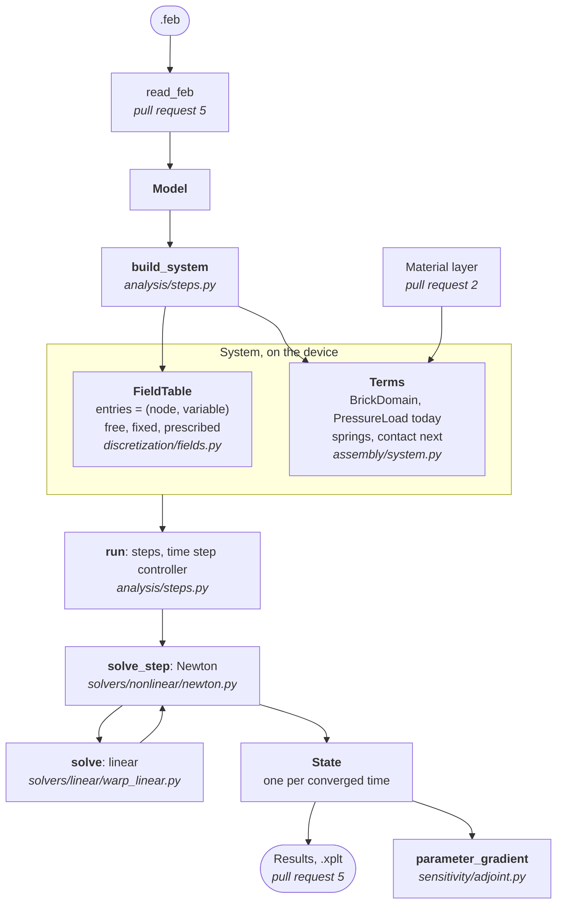
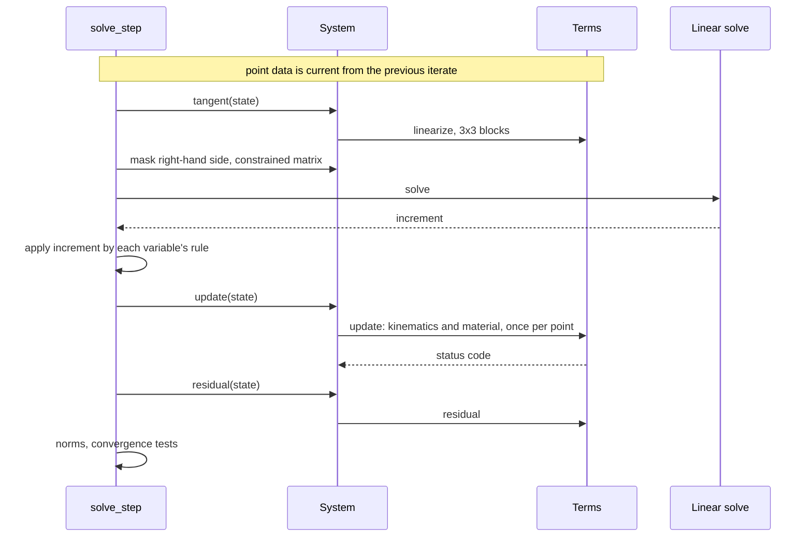
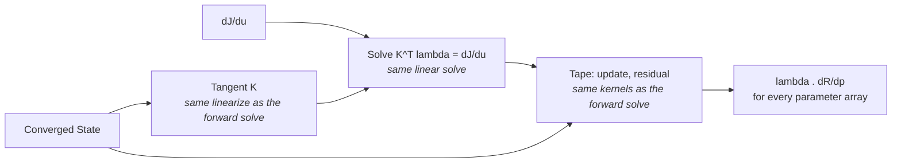

# Run path: from a compiled model to a result

Draft v0.2 for discussion, November 26, 2026. For Steve Maas, Jeff Weiss, Ryan Black and the Warp team. The code is a local template on branch `mattjolley/run-path-template`, stacked on `mattjolley/integration-base`. Nothing is merged or pushed.

**Scope.** The structure that takes a model and drives it through steps to a result: unknowns, terms, the Newton step, the step driver, and gradients. It is shown on the basic example Steve suggested (one element, one material, prescribed nodal displacements, with free unknowns and a Newton solve), and on the same kind of element under a pressure load, which is the standing case for checking gradients.

**Not in scope.** New elements, loads other than pressure, dynamics, contact in a run, performance. Each has a marked place to attach and no implementation.

**What it replaces.** The test fixture of pull request 5 (`compiled.py`, `analysis/static.py`), which ran the same example in one piece. The model, reader, writers, material layer and contact are used unchanged.

## 1. Summary

- **The solver sees a field table and a list of terms, and nothing else.** A domain and a pressure load are terms today; a set of springs and a contact interface would be too.
- **It follows FEBio's structure.** The same passes as `FESolidSolver2`, FEBio's residual sign, FEBio's treatment of prescribed displacements, FEBio's convergence tests and time step controller.
- **It departs from FEBio in three places, each for Warp.** Unknowns are numbered by (node, variable) so every matrix block is 3x3. Each domain is a batch with flat point data. State is separate from the model.
- **Gradients are part of the structure.** A gradient with respect to material parameters costs one extra linear solve and one reverse pass of the residual, using the same kernels as the forward solve.
- **It reproduces the fixture and FEBio** on the four inputs the fixture ran, and agrees with a stored FEBio run of a shell patch under pressure (section 6).
- **Newton and the adjoint do not always want the same tangent.** FEBio's default pressure stiffness is a symmetrized form. Newton uses it; the adjoint asks each term for its exact tangent (section 5).
- **Four points need Steve's view** (section 7).

## 2. The path

| Here | FEBio | What is the same | What differs |
| --- | --- | --- | --- |
| `FieldTable` | `DOFS`, `FESolver::InitEquations` | Variable names; free, fixed, prescribed | Numbered by (node, variable); constrained components masked, not removed |
| `Term` | `FEElasticDomain`, `FEModelLoad`, `FEContactInterface` | What each computes; the sign | One contract for all of them |
| `BrickDomain` | `FEElasticSolidDomain`, `FEElasticShellDomain` | Update, internal force, stiffness; integration points | Flat point data; one kernel set per material tree |
| `PressureLoad` | `FEPressureLoad`, `FESurface::LoadVector`, `LoadStiffness` | Parameters and defaults; load vector; both stiffness forms; 2x2 Gauss on quad4 facets; shell front and back face | The pressure is a device array; an exact tangent on request |
| `System` | `FEModel` as `FESolidSolver2` uses it | The three passes | Holds no application knowledge |
| `solve_step` | `FENewtonSolver::SolveStep`, `FESolidSolver2::Quasin` | Prescribed displacements; `dtol`, `etol`, `rtol`, `min_residual`, `max_refs` | Full Newton, no line search yet |
| `run` | `FEAnalysis`, `FETimeStepController` | Control settings; retries; must points | A step maps one State to the next |
| `parameter_gradient` | none | | Added |

## 3. One Newton iteration

The material is called in one place, `update`, once per integration point per iterate. The residual that gives the convergence norms and the tangent of the next iteration both read the same stored point data.

## 4. The three departures from FEBio, and why

### Unknowns by (node, variable)

An entry is one node and one FEBio variable (`displacement`, `shell displacement`), holding a 3-vector. The solution is one array of 3-vectors and the matrix has 3x3 blocks.

- Warp's sparse matrix stores fixed-size blocks, and its solvers and preconditioner work on them directly.
- The contact draft already assembles 3x3 blocks, so contact and structure share one layout.
- Each variable has an update rule. Both variables here add. A beam's `rotation` would compose through the exponential map, as FEBio's beam domain does, and the Newton step already looks the rule up.
- Constrained components stay in the system and are masked, as the fixture did. The sparsity then depends on the mesh only.

### A domain is a batch with flat point data

`BrickDomain` is one element block with one material tree. Its three kernels have no branch on element or material type.

| Call | FEBio | Kernel launch | Writes |
| --- | --- | --- | --- |
| `update` | `Update` | elements x points | Cauchy stress, 6x6 tangent, spatial shape gradients, weight, status |
| `residual` | `InternalForces` | elements x nodes | The global residual, by atomic subtraction |
| `linearize` | `StiffnessMatrix` | elements x nodes x nodes | One 3x3 block per node pair |

FEBio throws on a negative Jacobian. A kernel cannot, so `update` writes a status code per point and the host reads the worst one, using the codes of the material layer.

### State apart from the model

`State` is the solution at one time. A step produces a new one and keeps the old until the new one converges, so a failed attempt has nothing to undo, and a converged state can be handed to the adjoint afterward.

## 5. How Warp is used for the GPU and for gradients

### On the device

| Stays on the device | Crosses to the host |
| --- | --- |
| Solution, residual, point data, matrix blocks, the matrix, the linear solve | Per iterate: the worst status code and four norms |
| | Per step: target values of prescribed components, from the load curves |
| | Per output state: displacement and stress for the writers |

Three things in the template are not yet as they should be for a GPU, and are marked in the code. The matrix is rebuilt from triplets each iteration, although its pattern is fixed and Warp can refill values through a stored map. Blocks from several terms are joined through the host. Nothing has been run on a GPU or captured as a CUDA graph.

### Gradients through equilibrium

A converged state satisfies R(u, p) = 0, and K = -dR/du is the tangent the Newton step already forms. For an output J(u):

    dJ/dp = lambda . dR/dp,        K^T lambda = dJ/du

- **Cost.** One linear solve and one reverse pass, whatever the number of parameters. The Newton iterations are not recorded.
- **One implementation of the element.** The reverse pass runs the forward `update` and `residual` kernels under `wp.Tape`. This is why those two are written for reverse mode (fixed loop bounds, no array element written twice) and `linearize` is kept separate.
- **Parameters are device arrays.** Each term lists its own (`Term.parameters()`), which is what the material layer already provides. A term with a closed-form derivative can supply it instead, as contact does with `residual_parameter_vjp`.

### Pressure, and the tangent the adjoint needs

`PressureLoad` follows `FEPressureLoad`: the same four parameters and defaults, the same load vector on the current facet geometry, and both of FEBio's stiffness forms.

FEBio's default (`symmetric_stiffness = 1`) is a symmetrized stiffness. On a facet with free edges it is not the derivative of the load vector. That is acceptable for Newton, which only needs a direction, and it keeps the matrix symmetric. It is not acceptable for the adjoint, whose formula holds only for the true derivative.

So `linearize` takes an `exact` flag. Newton calls it as the input file asks. The adjoint calls it with `exact=True`, and a term must then return the true derivative. For pressure that is FEBio's own non-symmetric form. The same flag is where `tangent_scale` on the leaflet material will be handled.

Measured on the single-element pressure case:

| | FEBio's default form | Exact form |
| --- | --- | --- |
| Newton iterations over four load steps | 7, 9, 11, 13 | 3, 3, 3, 3 |
| Converged solution | Same to 1e-9 | Same to 1e-9 |
| Adjoint gradient of the top displacement with respect to Poisson's ratio | 0.0020 (wrong sign) | -0.0350 (matches the closed form) |

The slow convergence in the first column comes from the symmetrized form on a single facet with free edges under full Newton. FEBio has not been run on this input, so its iteration counts there are not known.

## 6. The basic example, and what was checked

`examples/run_path/basic_example.py` runs the path on `hex8_neo_hookean.feb` in six numbered stages: read, build, run, compare with FEBio, write a plot file, compute a gradient.

| Function | File | Role |
| --- | --- | --- |
| `build_field_table(model)` | `discretization/fields.py` | Entries and boundary condition states |
| `select_domain(...)` | `analysis/steps.py` | FEBio's domain choice for one element block |
| `build_system(model, device)` | `analysis/steps.py` | Coverage check, field table, term list |
| `System.update`, `residual`, `tangent` | `assembly/system.py` | The three passes |
| `solve_step(system, state, time, ...)` | `solvers/nonlinear/newton.py` | One time step |
| `solve(A, b, method)` | `solvers/linear/warp_linear.py` | CG, BiCGSTAB, GMRES on the device; dense on the host for checks |
| `run(system)` | `analysis/steps.py` | The step, with the time step controller |
| `parameter_gradient(system, state, dJ_du)` | `sensitivity/adjoint.py` | Adjoint gradient |
| `PressureLoad`, `inspect_load` | `loads/pressure.py` | The pressure term and its coverage rule |
| `check_parameter_gradients(system, output)` | `sensitivity/check.py` | Adjoint against finite differences for every parameter of every term |

Results, CPU only, Warp 1.19.0, double precision:

| Check | Inputs | Result |
| --- | --- | --- |
| Displacement and stress against FEBio log data | Single hex8, single quad4 shell, 8-element block, 9-element curved shell patch | Largest relative difference 4e-12 |
| The same with Warp's CG, BiCGSTAB and GMRES | The same four | Largest relative difference 4e-11 |
| Same output times and Newton iteration counts as the fixture | The same four | Equal; displacements agree to 1e-11 |
| Tangent equals minus the finite-difference derivative of the residual | Single hex8, single quad4 shell | 1e-8 relative; symmetric to 1e-12 |
| Adjoint gradient against central differences of complete runs | Single hex8, single quad4 shell, 8-element block | Agree to 1e-6 relative for Poisson's ratio; zero for the modulus in both |
| An input needing unsupported features is refused with the coverage report | Open mitral closure input | Refused |

The gradient check on these four inputs has a limit. They are displacement-driven, so the modulus has no effect on the displacements and only Poisson's ratio gives a nonzero gradient. The pressure case exercises all parameters.

### The gradient check case

`references/single_element/hex8_pressure.feb`: one unit hex8, neo-Hookean, symmetry conditions on three faces, follower pressure on the top face. The deformation is homogeneous uniaxial stress with Cauchy stress equal to minus the pressure, so there is a closed-form solution, and it depends on the modulus, Poisson's ratio and the pressure. `examples/run_path/gradient_check_case.py` runs it.

| Check | Result |
| --- | --- |
| Displacement and stress against the closed form, four load steps | 1e-9 absolute |
| The same with `linear = 1` (load on the reference area) | 1e-9 absolute |
| Exact pressure tangent against finite differences of the residual: hex8 face, shell front face, shell back face | 1e-8 relative |
| Adjoint gradient of the top displacement with respect to E, v and pressure, against the closed form | 2e-9 relative |
| The same against central differences of complete runs | 2e-8 relative |

| Parameter | Value | Adjoint | Central difference |
| --- | --- | --- | --- |
| E | 1 | 0.178478623 | 0.178478623 |
| v | 0.3 | -0.034977172 | -0.034977172 |
| pressure | 0.2 | -0.892393115 | -0.892393116 |

`check_parameter_gradients` is written to be reused as terms are added. It walks every parameter array that any term exposes, so a new term is covered by the same call on this case or a small extension of it.

### Against FEBio on a real mesh

The repository holds a FEBio 4.9 run of a 1,863-element quad4 shell patch under a follower pressure (static, `isotropic elastic`), from the pilot phase. Using only the FEBio input and FEBio's plot file, the run path agrees with FEBio's displacements at all 17 output times to 8e-8 relative, which is the precision of the single-precision plot file. The test in the suite checks the first three times.

That comparison used a sparse direct solve from SciPy on the host. With Warp's CG and a block-diagonal preconditioner the first load step took 470 to 990 iterations per solve, so a better preconditioner or a direct solver on the device is needed before shell models of this size are practical.

No FEBio result is stored yet for `hex8_pressure.feb` itself. FEBio was not built in this session, so the closed form stands in for it.

The whole test suite on this branch: 134 tests, 130 pass and 4 skip (two need a GPU, two need VTK and h5py).

## 7. Points for review

Each was checked against the FEBio source (`e4df3f8`), Warp 1.19.0 and the code on the integration branch.

1. **Numbering by (node, variable).** FEBio numbers each free degree of freedom and removes constrained ones. Here every entry is a 3-vector and constrained components are masked. Does this lose anything FEBio relies on that we should plan for now, for example linear constraints or rigid bodies, which this template does not have?
2. **One contract for domains, loads and contact.** FEBio keeps these as separate class families that the solver calls in turn. Here they share `Term`. Is there a case in FEBio where the order or the separation of those passes matters to the result?
3. **Residual sign.** The template uses FEBio's (external minus internal). The contact draft documents the opposite. The proposal is to change contact to FEBio's.
4. **Approximate tangents.** The symmetrized pressure stiffness and `tangent_scale` are two places where FEBio gives Newton a tangent that is not the derivative of the residual. The adjoint needs to know every such place. Are there others in the features the valve and device models use, for example in the contact potential or the shell formulation?

## 8. Where the next features attach

| Feature | Attaches as | In |
| --- | --- | --- |
| tet4, penta6, tri3 domains; three-field domain | A branch of `select_domain` returning another `Term` | `analysis/steps.py`, `elements/` |
| `mass damping`; `pressure` on tri3 facets | A `Term` appended in `build_system`, as `pressure` is | `loads/` |
| Chordae (`Discrete`, nonlinear spring) | A `Term` on the uniaxial law of the material layer | `elements/` |
| Contact potential | The contact draft's interface as a `Term`, with its blocks kept in their own matrix | `contact/` |
| Several steps, per-step activation | A loop in `run` that switches terms and conditions | `analysis/steps.py` |
| Dynamic analysis | Inertia from the domains through the same terms; generalized-alpha in the step | `analysis/`, `solvers/nonlinear/` |
| Beams, rigid bodies | New variables in the field table with their own update rule | `discretization/fields.py` |

## 9. Limits

- Static analysis, one step, hex8 solids and quad4 shells, the materials the binding accepts, fixed and prescribed displacements, and pressure on quad4 facets given as one number with a load curve.
- One small change outside the new files: `inspect` in `compiled.py` takes an optional function through which a run path says which loads it can build. The fixture's behavior is unchanged.
- No history, so `commit` and `rollback` are called and do nothing.
- CPU only. No timing was taken, and none would mean much at this size.
- The first-iteration handling of prescribed displacements and the convergence tests were carried over from the fixture, which was compared with FEBio; they were not re-derived from the FEBio source for this note.
