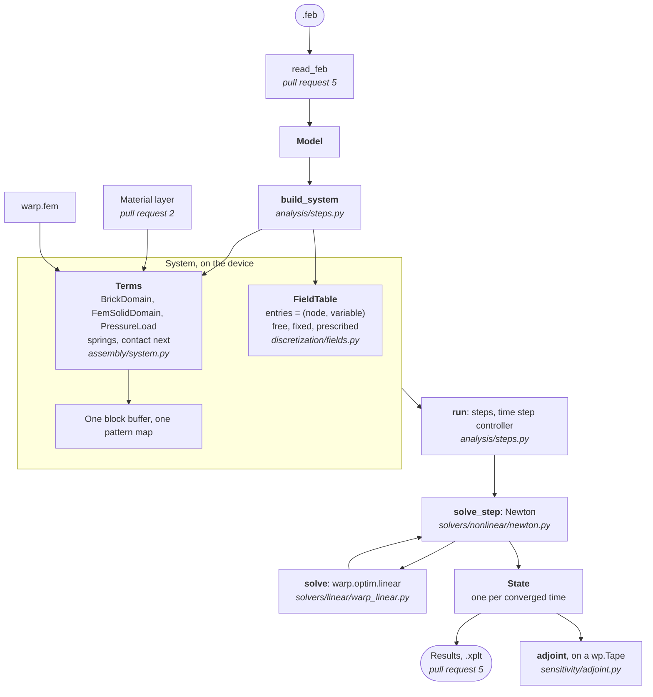
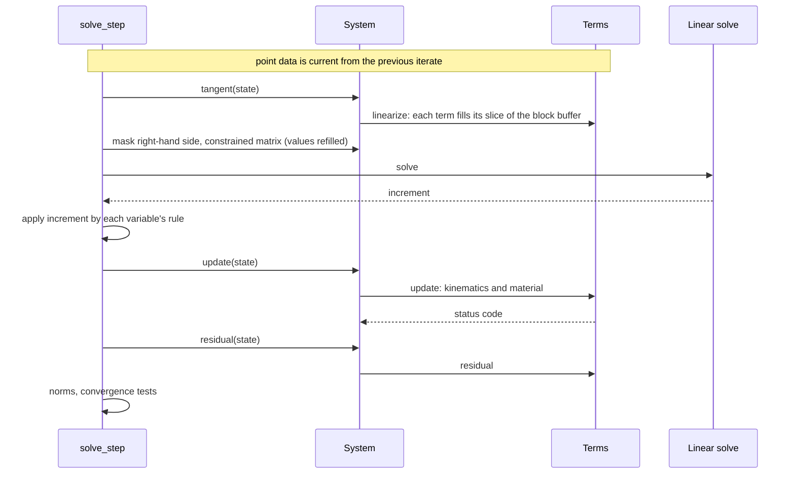
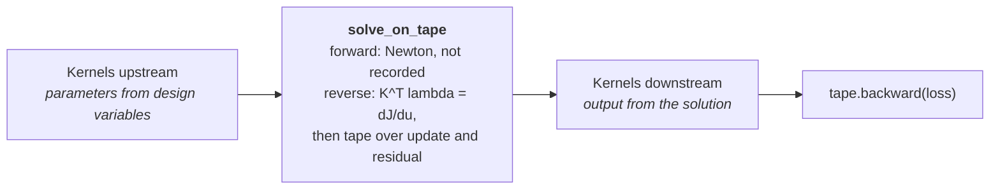

# Run path: from a compiled model to a result

Draft v0.3 for discussion, November 26, 2026. For Steve Maas, Jeff Weiss, Ryan Black and the Warp team. The code is a template in draft pull request 6, on branch `mattjolley/run-path-template`, stacked on `mattjolley/integration-base`. Nothing is merged. The [design overview](overview.md) shows where this sits among the other drafts.

**Scope.** The structure that takes a model and drives it through steps to a result: unknowns, terms, the Newton step, the step driver, and gradients. It is shown on the basic example Steve suggested (one element, one material, prescribed nodal displacements, with free unknowns and a Newton solve), and on one element under a pressure load, which is the standing case for checking gradients.

**Not in scope.** Dynamics, contact in a run, springs, shells beyond quad4, performance tuning. Each has a marked place to attach and no implementation.

**What it replaces.** The test fixture of pull request 5 (`compiled.py`, `analysis/static.py`), which ran the basic example in one piece. The model, reader, writers, material layer and contact are used unchanged.

**Layout.** This note follows the layout of the design set: a flow diagram, what has been explored, and decision points with options and a proposal (section 8 for what was explored, section 12 for decision points). The [design overview](overview.md) shows where it sits, [remaining areas](remaining_areas.md) lists every decision by reviewer, and the [work plan](work_plan.md) says what depends on it.

## 1. Summary

- **The rule followed.** FEBio decides what goes in and what comes out: input files, formulations, parameters and defaults, result files, and the reference every result is compared with. The internals are built for Warp: flat device arrays, one kernel per batch, a matrix whose pattern is fixed, and state kept apart from the model so a solve can be differentiated.
- **The solver sees a field table and a list of terms, and nothing else.** A solid or shell domain and a pressure load are terms today; springs and contact would be too.
- **Warp's own pieces are used where they fit.** Block sparse matrices with a reusable pattern map, the iterative solvers, the tape, and `warp.fem`, which now provides the tet4 element and a second, independent hex8.
- **Gradients are part of the structure.** A gradient with respect to any number of parameters costs one transpose solve and one reverse pass of the residual, with the same kernels as the forward solve. The solve can sit on a `wp.Tape` as one step, so it composes with other Warp kernels.
- **Newton and the adjoint do not always want the same tangent.** FEBio's default pressure stiffness is a symmetrized form. Newton uses it; the adjoint asks each term for its exact tangent.
- **Checked against FEBio** on nine inputs, to 4e-12 where FEBio's log data is available (section 8), with the same Newton iteration counts.
- **Newton, the physics library, is kept in view.** The step is a function from one state to the next, as Newton's solvers are. Section 6 lists what Newton expects and where this stands.

## 2. The path

| Here | FEBio | What is the same | What differs |
| --- | --- | --- | --- |
| `FieldTable` | `DOFS`, `FESolver::InitEquations` | Variable names; free, fixed, prescribed | Numbered by (node, variable); constrained components masked, not removed |
| `Term` | `FEElasticDomain`, `FEModelLoad`, `FEContactInterface` | What each computes; the sign | One contract for all of them |
| `BrickDomain` | `FEElasticSolidDomain`, `FEElasticShellDomain` | Update, internal force, stiffness; integration points | Flat point data; one kernel set per material tree |
| `FemSolidDomain` | `FEElasticSolidDomain` on hex8 and tet4 | Element, node order, integration rule | Integrated by `warp.fem` over the reference configuration |
| `PressureLoad` | `FEPressureLoad`, `FESurface::LoadVector`, `LoadStiffness` | Parameters and defaults; load vector; both stiffness forms; 2x2 Gauss on quad4 facets; shell front and back face | The pressure is a device array; an exact tangent on request |
| `System` | `FEModel` as `FESolidSolver2` uses it | The three passes | Holds no application knowledge; one block buffer |
| `solve_step` | `FENewtonSolver::SolveStep`, `FESolidSolver2::Quasin` | Prescribed displacements; `dtol`, `etol`, `rtol`, `min_residual`, `max_refs` | Full Newton, no line search yet |
| `run` | `FEAnalysis`, `FETimeStepController` | Control settings; retries; must points | A step maps one State to the next |
| `parameter_gradient`, `solve_on_tape` | none | | Added |

## 3. One Newton iteration

## 4. Internals built for the device

### Unknowns by (node, variable)

An entry is one node and one FEBio variable (`displacement`, `shell displacement`), holding a 3-vector. The solution is one array of 3-vectors and the matrix has 3x3 blocks.

- Warp's sparse matrix stores fixed-size blocks, and its solvers and preconditioners work on them directly.
- The contact draft already assembles 3x3 blocks, so contact and structure share one layout.
- Each variable has an update rule. Both variables here add. A beam's `rotation` would compose through the exponential map, as FEBio's beam domain does.
- Constrained components stay in the system and are masked, as the fixture did.

### One block buffer, one pattern map

For a given mesh the tangent blocks have a fixed count and fixed (row, column) pairs. The system owns one device buffer, and every term writes its blocks into its own slice of it. Nothing is gathered on the host.

The sparsity is analysed once. `warp.sparse` builds a map from the block list to the matrix (`bsr_set_from_triplets` with `build_mapping`), and every later iteration only refills values through it (`bsr_set_from_mapped_values`). The product needed for prescribed displacements is taken straight from the blocks, so only one matrix is ever formed.

### A domain is a batch

`BrickDomain` is one element block with one material tree. Its three kernels have no branch on element or material type.

| Call | FEBio | Kernel launch | Writes |
| --- | --- | --- | --- |
| `update` | `Update` | elements x points | Cauchy stress, 6x6 tangent, spatial shape gradients, weight, status |
| `residual` | `InternalForces` | elements x nodes | The global residual, by atomic subtraction |
| `linearize` | `StiffnessMatrix` | elements x nodes x nodes | One 3x3 block per node pair |

FEBio throws on a negative Jacobian. A kernel cannot, so `update` writes a status code and the host reads the worst one.

### State apart from the model

`State` is the solution at one time. A step produces a new one and keeps the old until the new one converges, so a failed attempt has nothing to undo, and a converged state can be handed to the adjoint.

### What crosses to the host

| When | What |
| --- | --- |
| Per iterate | The worst status code and four norms |
| Per step | Target values of prescribed components, from the load curves |
| Per output state | Displacement and stress for the writers |

Not yet done: nothing has been run on a GPU or captured as a CUDA graph. `FemSolidDomain` evaluates the material in the force pass and again in the stiffness pass, and reads the Jacobians of all points on the host for its status check.

## 5. What is taken from Warp and Newton

Checked against Warp 1.19.0 as installed and Newton at `12bf1e6`.

| Piece | Used for | Status |
| --- | --- | --- |
| `warp.sparse` block matrices, triplet map | The global matrix, analysed once and refilled | In use |
| `warp.optim.linear` (CG, BiCGSTAB, GMRES, block preconditioners) | The linear solve | In use |
| `wp.Tape`, `Tape.record_func` | Reverse pass of the residual; the solve as one taped step | In use. Warp's `example_elastic_shape_optimization` handles a linear solve the same way |
| `warp.fem` geometry, spaces, quadrature, `integrate`, `interpolate` | Solid domains: tet4, and a second hex8 | In use (`FemSolidDomain`) |
| `warp.fem` boundary sides | Pressure on any facet type | Candidate; pressure is a hand-written kernel on quad4 today |
| `wp.HashGrid` | Contact search | Used by the contact draft |
| Newton `Model.state`, `SolverBase.step` conventions | The shape of the step | Followed in spirit (section 6) |
| Newton's solvers (Featherstone, MuJoCo, XPBD, VBD, Style3D, implicit MPM, semi-implicit, Kamino, Steel, coupled) | | Not used. They target rigid bodies, particles, cloth and granular material. We did not find a finite element solid or shell domain to reuse |
| Newton's Kamino factorizations (block-sparse LDL, blocked LLT with reordering, written in Warp) | A direct solve on the device for shell models | Candidate. They are built for per-world rigid-body systems; whether they suit a finite element matrix of this size is not known (section 8) |

### What the `warp.fem` domain showed

- **It reproduces the hand-written hex8.** Residual and tangent of `FemSolidDomain` and `BrickDomain` agree to 1e-12 at a random state, in double precision, with FEBio's node order and the material layer called inside the integrands.
- **tet4 came without writing an element.** The same class on `fem.Tetmesh` with a one-point rule matches FEBio on a six-element block to 2e-12.
- **It is differentiable as is.** The adjoint's reverse pass goes through `fem.integrate`, and the gradient check passes.
- **It does not cover shells.** `warp.fem` has no thick shell, so quad4 shells stay on the dedicated kernel. Question 13 of the materials draft asks the Warp team about this.
- **Speed is open.** The assembly note measured a dedicated kernel at about four times the `warp.fem` route on CPU. Nothing has been measured on a GPU.

So the earlier either-or between dedicated kernels and `warp.fem` becomes: `warp.fem` for solids to start, dedicated kernels where `warp.fem` has no element or measurements say it is needed, and each as a check on the other for hex8.

## 6. What Newton expects, and where this stands

From Newton's `SolverBase`, `State` and the experimental `CouplingInterface`.

| Newton | Here | Gap |
| --- | --- | --- |
| `Model.state()`; `solver.step(state_in, state_out, control, contacts, dt)`; states are double-buffered | `system.state()`; `solve_step(system, state, time)` returns a new State | The step takes an absolute time, for FEBio's load curves, not `dt`. A thin wrapper can give Newton's signature |
| External forces are inputs in `state_in.particle_f`; a solver reads them and never writes them | No nodal force input yet | A nodal-force term is the natural port: forces in, node positions out |
| Particles and bodies are the shared currency, in single precision | Nodes as entries, in double precision | Cast at the boundary. Question 3 of the model note asks the Newton team |
| `CouplingInterface`: effective mass at endpoints, forces harvested on proxies, notice of input state changes | None | Needs a mass matrix, so it follows dynamics |
| `notify_model_changed(flags)` | Parameters are device arrays changed in place | Map the flags when the wrapper is written |
| States can require gradients; a step can be taped | `solve_on_tape` | Compatible |

Nothing here is implemented against Newton. The point is that no choice made so far closes it off: the step is functional, state is separate, forces and parameters are device arrays.

## 7. Gradients

### Through equilibrium

A converged state satisfies R(u, p) = 0, and K = -dR/du is the tangent the Newton step already forms. For an output J(u):

    dJ/dp = lambda . dR/dp,        K^T lambda = dJ/du

- **Cost.** One linear solve and one reverse pass, whatever the number of parameters. The Newton iterations are not recorded.
- **One implementation of each term.** The reverse pass runs the forward `update` and `residual` kernels under `wp.Tape`. Those are written for reverse mode; `linearize` is separate and never taped.
- **Parameters are device arrays.** Each term lists its own (`Term.parameters()`), as the material layer already provides.
- **Two ways in.** `parameter_gradient` takes dJ/du as an array. `solve_on_tape` registers the solve on a tape as one step, so kernels before and after it are differentiated by Warp as usual.

### The tangent the adjoint needs

FEBio's default pressure stiffness (`symmetric_stiffness = 1`) is a symmetrized form. On a facet with free edges it is not the derivative of the load vector. Newton only needs a direction, so that is acceptable there. The adjoint formula holds only for the true derivative.

So `linearize` takes an `exact` flag. Newton calls it as the input file asks. The adjoint calls it with `exact=True`. The same flag is where `tangent_scale` on the leaflet material will be handled.

Measured on the single-element pressure case:

| | FEBio's default form | Exact form |
| --- | --- | --- |
| Newton iterations over four load steps | 7, 9, 11, 13 (FEBio itself: 7, 9, 11, 13) | 3, 3, 3, 3 |
| Converged solution | Same to 1e-9 | Same to 1e-9 |
| Adjoint gradient of the top displacement with respect to Poisson's ratio | 0.0020 (wrong sign) | -0.0350 (matches the closed form) |

### Designed for, not implemented

| Case | How the same structure extends |
| --- | --- |
| Dynamics | Each step solves R_n(u_n; previous state, p) = 0. The reverse sweep visits the stored States backward, with one transpose solve per step and the tape giving the dependence on the previous state and on p. Step sizes chosen by the time step controller are treated as fixed |
| Material history | `commit` and `rollback` already separate trial from committed history, which is what a reverse sweep needs to revisit a step |
| Contact | Pairs are frozen at the converged state, as the contact draft does |
| Outputs that read stress or parameters directly | The explicit term dJ/dp is added to the adjoint term |
| Gradients with respect to prescribed displacements or nodal forces | The adjoint solution lambda is already the sensitivity to a nodal force |

## 8. The examples, and what was checked

| Function | File | Role |
| --- | --- | --- |
| `build_field_table(model)` | `discretization/fields.py` | Entries and boundary condition states |
| `select_domain(...)`, `select_load(...)` | `analysis/steps.py` | FEBio's choice of domain and load class |
| `build_system(model, device, solids)` | `analysis/steps.py` | Coverage check, field table, term list |
| `System.update`, `residual`, `tangent`, `constrained_matrix` | `assembly/system.py` | The passes of an iteration |
| `solve_step(system, state, time, ...)` | `solvers/nonlinear/newton.py` | One time step |
| `solve(A, b, method)` | `solvers/linear/warp_linear.py` | CG, BiCGSTAB, GMRES on the device; dense on the host for checks |
| `run(system)` | `analysis/steps.py` | The step, with the time step controller |
| `parameter_gradient`, `solve_on_tape` | `sensitivity/adjoint.py` | Adjoint gradients |
| `check_parameter_gradients(system, output)` | `sensitivity/check.py` | Adjoint against finite differences for every parameter of every term |

`examples/run_path/basic_example.py` runs the path on `hex8_neo_hookean.feb`. `examples/run_path/gradient_check_case.py` runs the gradient check.

### Against FEBio

CPU only, Warp 1.19.0, double precision. FEBio log data has 12 digits.

| Input | Elements | What it exercises | Largest relative difference |
| --- | --- | --- | --- |
| `hex8_neo_hookean.feb` | 1 hex8 | Prescribed displacement, free unknowns | 2e-12 |
| `quad4_shell_neo_hookean.feb` | 1 quad4 shell | Shell as displacement plus shell displacement | 2e-12 |
| `hex_block.feb` | 8 hex8 | Assembly; also run through `warp.fem` | 2e-12 |
| `shell_patch.feb` | 9 quad4 shells | Curved shell patch | 4e-12 |
| `hex8_pressure.feb` (new) | 1 hex8 | Follower pressure; also run through `warp.fem` | 3e-12, same iteration counts as FEBio |
| `tet4_block.feb` (new) | 6 tet4 | tet4 from `warp.fem` | 2e-12 |
| `two_material_pressure.feb` (new) | 8 hex8 in 2 domains, neo-Hookean and isotropic elastic | Several domains, pressure, reaction forces; both solid paths | 4e-12 displacement, 2e-12 stress, 7e-13 reactions; same iteration counts |
| `hex8_pressure_autostep.feb` (new) | 1 hex8 | Automatic time stepper, must points | Same ten step times and iteration counts |
| Shell patch under pressure, FEBio 4.9, from the pilot phase | 1,863 quad4 shells | Pressure on a real shell mesh, 17 output times | 8e-8 (single-precision plot file) |

The first four are also run with Warp's CG, BiCGSTAB and GMRES (4e-11), and give the same output times and iteration counts as the fixture.

### Checks made as a reviewer would

These were run to find what the first cases did not exercise. Four of them found errors, which are fixed on this branch.

| Check | Finding |
| --- | --- |
| Two materials in two domains | The dedicated domain matched FEBio. The `warp.fem` domain did not: `warp.fem` caches the kernels it generates by integrand name, so the second material reused the first material's kernels. Each material now gets integrands with their own names. |
| Reaction forces | FEBio's nodal `R` is minus the internal force at free and prescribed components and zero at fixed ones. It is not the residual at constrained components. `collect` now follows FEBio, and `StateResult` has `reaction_force`. |
| Automatic time stepper | FEBio passes the number of Newton iterations of the converged step to `AutoTimeStep`. The run path passed one fewer, as the fixture does, and took larger steps than FEBio. |
| Reformation limit | With full Newton FEBio allows `max_refs` iterations. The run path allowed one more, as the fixture does. With `max_refs` 8 on the stepper case FEBio fails 13 attempts and stops at t = 0.955516; the run path now converges the same ten steps, fails the same 13 attempts and stops at the same point. |
| FEBio's default BFGS (`max_ups` 10) against full Newton | Same solution to 2e-9 on the two-material case. Iteration counts differ, so step sequences under the automatic stepper can differ from a FEBio run that uses BFGS. |

The time stepper and reformation limit findings apply to `analysis/static.py` in the model and I/O draft as well. On a displacement-driven single element with `opt_iter` 3, FEBio keeps the step at 0.1 for ten steps and the fixture grows it and finishes in six. This is noted for that draft and not changed here.

### The gradient check case

`references/single_element/hex8_pressure.feb`: one unit hex8, neo-Hookean, symmetry conditions on three faces, follower pressure on the top face. The deformation is homogeneous uniaxial stress with Cauchy stress equal to minus the pressure, so there is a closed-form solution, and it depends on the modulus, Poisson's ratio and the pressure.

| Check | Result |
| --- | --- |
| Displacement and stress against the closed form, and with `linear = 1` | 1e-9 absolute |
| Exact pressure tangent against finite differences of the residual: hex8 face, shell front face, shell back face | 1e-8 relative |
| Adjoint gradient with respect to E, v and pressure, against the closed form | 2e-9 relative |
| The same through `warp.fem` | 2e-8 relative against central differences |
| The solve on a tape between two Warp kernels, gradient with respect to an upstream design variable | 1e-6 relative or better |

| Parameter | Value | Adjoint | Central difference |
| --- | --- | --- | --- |
| E | 1 | 0.178478623 | 0.178478623 |
| v | 0.3 | -0.034977172 | -0.034977172 |
| pressure | 0.2 | -0.892393115 | -0.892393116 |

`check_parameter_gradients` walks every parameter array that any term exposes, so a new term is covered by the same call.

### The linear solver on shells

On the 1,863-element shell patch, Warp's CG with the `diag` preconditioner took 470 to 990 iterations per solve. On a block matrix that preconditioner is scalar Jacobi; Warp's block-Jacobi and approximate inverse (`FSAI`) preconditioners were not tried ([linear_solve.md](linear_solve.md)). The comparison above used a sparse direct solve from SciPy on the host. A better preconditioner or a direct solver on the device is needed before shell models of this size are practical. Newton's Kamino solver has direct factorizations written in Warp (`kamino/_src/linalg/factorize`), which have not been tried here. cuDSS, NVIDIA's sparse direct solver for the GPU, was suggested in review and has not been tried either; it can solve with the transpose from the same factors, which the adjoint of section 7 needs ([linear_solve.md](linear_solve.md), section 4).

### Tests and the FEBio build

The whole test suite on this branch: 144 tests, 140 pass and 4 skip (two need a GPU, two need VTK and h5py).

FEBio for the new references is 4.13.0 built from source at `e4df3f8` without MKL, by `tools/build_febio.sh`. That build reproduces the stored results for `hex8_neo_hookean.feb`, made at `552138d`, exactly.

## 9. Points for review

Each was checked against the FEBio source (`e4df3f8`), Warp 1.19.0, Newton (`12bf1e6`) and the code on the integration branch.

**For Steve and Jeff**

1. **Numbering by (node, variable).** FEBio numbers each free degree of freedom and removes constrained ones. Here every entry is a 3-vector and constrained components are masked. Does this lose anything FEBio relies on that we should plan for now, for example linear constraints or rigid bodies?
2. **One contract for domains, loads and contact.** FEBio keeps these as separate class families that the solver calls in turn. Is there a case where the order or the separation of those passes matters to the result?
3. **Residual sign.** The template uses FEBio's (external minus internal). The contact draft documents the opposite. The proposal is to change contact to FEBio's.
4. **Approximate tangents.** The symmetrized pressure stiffness and `tangent_scale` are two places where FEBio gives Newton a tangent that is not the derivative of the residual. Are there others in the features the valve and device models use?

**For the Warp team**

5. **Recording.** `solve_on_tape` must run its forward iterations without recording them. Warp 1.19 has no public way to pause a tape or to ask whether one is active, so it asks to be called outside the `with tape:` block. Is there a preferred way?
6. **A direct solver.** Thin shells need more than a block-diagonal preconditioner (section 8). Warp's `warp.optim.linear` is iterative only. Newton's Kamino solver has block-sparse LDL and blocked LLT factorizations in Warp. Are those meant to be usable outside Kamino for a matrix of 10^4 to 10^6 unknowns, or is another route recommended? Since this was written, cuDSS was suggested in review ([linear_solve.md](linear_solve.md), section 4).

## 10. Where the next features attach

| Feature | Attaches as | In |
| --- | --- | --- |
| penta6, tri3 domains; three-field domain | A branch of `select_domain` returning another `Term` | `analysis/steps.py`, `elements/` |
| `mass damping`; `pressure` on tri3 facets | A `Term` appended in `build_system`, as `pressure` is | `loads/` |
| Nodal forces (the port for Newton) | A `Term` whose parameter is the force array | `loads/` |
| Chordae (`Discrete`, nonlinear spring) | A `Term` on the uniaxial law of the material layer | `elements/` |
| Contact potential | The contact draft's interface as a `Term`, with its blocks in their own matrix | `contact/` |
| Several steps, per-step activation | A loop in `run` that switches terms and conditions | `analysis/steps.py` |
| Dynamic analysis | Inertia from the domains through the same terms; generalized-alpha in the step | `analysis/`, `solvers/nonlinear/` |
| Beams, rigid bodies | New variables in the field table with their own update rule | `discretization/fields.py` |

## 11. Limits

- Static analysis, one step. hex8 and tet4 solids, quad4 shells, the materials the binding accepts, fixed and prescribed displacements, and pressure on quad4 facets given as one number with a load curve.
- One small change outside the new files: `inspect` in `compiled.py` takes two optional functions through which a run path says which loads and element types it can build. The fixture's behavior is unchanged.
- No history, so `commit` and `rollback` are called and do nothing.
- CPU only. No timing was taken.
- The first-iteration handling of prescribed displacements and the convergence tests were carried over from the fixture, which was compared with FEBio. The reformation limit and the iteration count given to the step controller were checked against the FEBio source and corrected (section 8); the rest was not re-derived.
- Solver settings that are read but have no effect: `lstol`, `lsmin`, `lsiter` (no line search), `qn_method` (always full Newton), and the solver's `symmetric_stiffness` (FEBio uses it to choose matrix storage; here the matrix is always general). The coverage report lists each of them.
- The command line (`python -m warp_febio run`) still runs the fixture, which refuses pressure. The run path is reached from Python.
- There are two hex8 implementations (the dedicated brick domain and `warp.fem`). They agree to round-off on every case here. Keeping one is a decision for after the review.
- The FEBio references are from a source build without MKL, not an official release.

## 12. Decision points

Each row summarizes a point of section 9, where the full text is given. IDs follow the scheme of the design set (R for the run path). R1 to R3 are the contract every other area builds on; the [work plan](work_plan.md) calls them contract v0.

| ID | Decision | Options | Proposed | For | Detail |
| --- | --- | --- | --- | --- | --- |
| R1 | How unknowns are numbered | (a) By (node, variable), each a 3-vector, with constrained components masked. (b) FEBio's equation numbers, with constrained ones removed | (a). 3x3 blocks throughout and a pattern that never changes | Steve, Jeff | Point 1 |
| R2 | One contract for domains, loads and contact | (a) One `Term` contract and a list. (b) Separate families called in turn, as FEBio | (a) | Steve, Jeff | Point 2 |
| R3 | Residual sign | (a) FEBio's, external minus internal, everywhere. (b) The sign the contact draft documents | (a) | Steve | Point 3 |
| R4 | Tangents Newton and the adjoint do not share | A term returns FEBio's tangent for Newton and the true derivative on request | Keep `linearize(exact=True)`. Known cases: symmetrized pressure, `tangent_scale`, and `mass damping` ([sensitivity.md](sensitivity.md), section 4) | Steve, Jeff | Point 4 |
| R5 | Running the forward solve without recording it | Call the solve outside the tape block, or a supported way to pause a tape | Open | Warp team | Point 5 |
| R6 | A direct solver or stronger preconditioner for shells | Warp's `FSAI` and block Jacobi, a factorization on the device (cuDSS was suggested in review), or another route | Measure the preconditioners and try cuDSS ([linear_solve.md](linear_solve.md), decisions L1 and L2) | Warp team | Point 6 |
| R7 | Two hex8 implementations | (a) `warp.fem` for solids, dedicated kernels where it has no element. (b) Dedicated kernels throughout | (a) to start; both agree to round-off | Steve, Warp team | Section 5 |
| R8 | The fixture of pull request 5 | It differs from FEBio in two places found here. Correct it there, or leave it since this path replaces it | Leave it, recorded in section 8 | Steve, MJ | Section 8 |

For gradients: R1, R2 and R4 are the ones the adjoint depends on. State apart from the model, one implementation of each term for the forward and reverse passes, and an exact tangent on request are what make a gradient cost one transpose solve.
