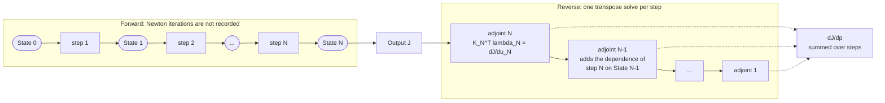

# Sensitivity over steps

First template for discussion, November 26, 2026. Design only: there is no code for this note beyond what the run path already has. Nothing here is settled. Part of the set introduced in [remaining_areas.md](remaining_areas.md).

**Scope.** How the adjoint of the run path, which differentiates one equilibrium solve, extends to a dynamic run of many steps with history and contact. FEBio has no counterpart, so this note follows Warp's conventions and the structure of the run path.

## 1. Summary

- **What exists.** A gradient through one converged static state, with respect to every parameter any term exposes, at the cost of one transpose solve. The solve can sit on a `wp.Tape` as one step. Checked against a closed form and finite differences on the pressure case.
- **What both applications need.** A gradient through a dynamic run: 200 steps for the mitral input, more than 200 for TPVR.
- **The extension is a reverse sweep over the stored States**, one transpose solve per step, with the tape giving the dependence of each step on the one before.
- **Every term must be able to give its exact tangent.** There are now three known places where FEBio's Newton tangent is not the derivative of the residual.
- **Memory is modest for the first targets** if only converged States are stored.

## 2. Forward run and reverse sweep

For step n with residual R_n(u_n; s_{n-1}, p) = 0, where s holds u, v, a and committed history:

- solve K_n^T lambda_n = (the derivative of J with respect to u_n, plus what later steps passed back);
- run the tape backward over `update` and `residual` of step n to get lambda_n times the derivatives with respect to p and to s_{n-1};
- add the first to dJ/dp and pass the second to step n-1.

The kernels are the forward ones. `linearize` is never taped.

## 3. What each area must supply

| Area | For the reverse sweep | State |
| --- | --- | --- |
| Run path | `linearize(exact=True)`; `parameters()` per term; the solve as one taped step | In the template |
| Dynamics | The update of v and a as a kernel, so the tape gives its derivatives; the mass term in the exact tangent | [dynamics.md](dynamics.md) |
| Materials with history | Trial and committed history kept apart, so a step can be revisited | In the material layer for uniaxial models; `commit` and `rollback` are called and do nothing in the run path |
| Contact | Pairs frozen at each converged State and stored with it | The contact note does this for one state |
| Time step controller | Step sizes treated as fixed in the reverse sweep | The run path note states this |
| Springs, pressure, mass damping, boundary values | Their parameters as device arrays | Pressure exists; the others are proposed in their notes |

## 4. Tangents that are not derivatives

Newton only needs a direction, so FEBio is free to use an approximate tangent. The adjoint formula holds only for the true derivative. Known cases in the features the applications use:

| Feature | FEBio's Newton tangent | Exact tangent | Source |
| --- | --- | --- | --- |
| `pressure` with `symmetric_stiffness` 1 | Symmetrized form | The full follower-load derivative | Run path note, measured |
| `tangent_scale` on `isotropic Lee-Sacks` | `c0` multiplied by the scale in the tangent only | The unscaled tangent | Integration note |
| `mass damping` | C/dt | C gamma/(beta dt) | `FEMassDamping::stiffness`; found while writing [dynamics.md](dynamics.md) |

Point 4 of the run path note asks Steve and Jeff whether there are others. The third row is one answer found in the source.

## 5. Proposed

| Topic | Proposal | Why |
| --- | --- | --- |
| Storage | Keep every converged State on the device (u, v, a, history, contact pairs) | The reverse sweep needs each one. See the estimate below |
| Entry points | `parameter_gradient` and `solve_on_tape` extended from one step to a run, with the same signatures | Code that uses a static gradient today keeps working |
| Outputs | J may read any stored State, not only the last | Closure is judged over the cycle; a device's final shape is one state |
| Checks | `check_parameter_gradients` on a dynamic single element over three steps, for every parameter | The standing gradient case, extended. It runs in the unit tests |
| Checkpointing | Not now | Only needed when stored States no longer fit |

Storage estimate, converged States only, double precision, without history or pairs:

| | Entries | Per State (u, v, a) | States | Total |
| --- | --- | --- | --- | --- |
| Mitral closure | Up to 14,884 | About 1.1 MB | 200 | About 0.2 GB |
| TPVR (file 3599) | At least 65,011 | About 4.7 MB | 220 at the nominal step sizes | About 1 GB |

## 6. Design variables the applications point to

Listed to show which parameters must be device arrays. None is implemented.

| Application | Variable | Where it lives |
| --- | --- | --- |
| Valve | Chord slack length and stiffness | Spring curve points and `scale` ([discrete.md](discrete.md)) |
| Valve | Leaflet material parameters | Material parameter arrays (pull request 2) |
| Valve | Pressure | The pressure array of the run path |
| Device | Vessel wall parameters, which are often unknown for a patient | Material parameter arrays |
| Device | Crimp depth | `scale` of `normal displacement` ([constraints.md](constraints.md)) |

## 7. Reserved

- **Gradients through a change of contact pairs.** The pair list is piecewise constant in the positions.
- **Shape gradients.** Derivatives with respect to node coordinates.
- **Gradients with respect to step sizes** chosen by the time step controller.
- **Single-precision reverse passes.**

## 8. Depends on

State apart from the model, and one implementation of each term for forward and reverse (run path, sections 4 and 7).
