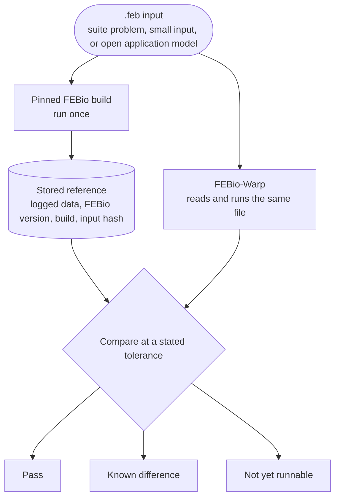
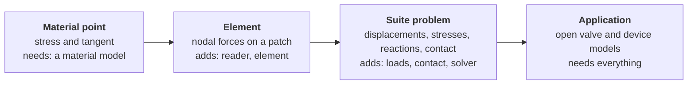

# Verification against FEBio: design note

**Draft for discussion, v2.2, November 24, 2026.** Revised after review by Steve Maas on pull request #4. **Tabled until FEBio-Warp can read and run a FEBio input file.** It is posted to agree the shape of the harness and to keep the inputs and references assembled so far in one place while input and output is worked on.

**Layout.** This note follows the layout of the design set: a flow diagram, what has been explored, and decision points with options and a proposal ("Initial explorations" and "Decision points" below). The [design overview](overview.md) shows where it sits, [remaining areas](remaining_areas.md) lists every decision by reviewer, and the [work plan](work_plan.md) says what depends on it.

## Goal

Make it easy to validate FEBio-Warp against FEBio.

## The harness

1. Take a FEBio input file.
2. Run it once in a pinned FEBio build and store the results as the reference.
3. Run the same input file in FEBio-Warp.
4. Compare the two at a stated tolerance and report pass, known difference, or not yet runnable.

It does not check FEBio against anything. The first draft did (FEBio against closed forms and against the test suite's stored values), and that has been removed. What was built along the way and serves steps 1 and 2 is kept below.

## At a glance

The harness, and what each comparison level needs from FEBio-Warp.

## What has to come first

Step 3 needs FEBio-Warp to read and run a FEBio input file. On this branch it cannot: `src/warp_febio/io/` is a stub, and elements, loads and solvers are not started. A draft reader and central model are now in pull request #5, written in this repository and not on pyfebio, with a minimal path that runs single-element and small-mesh inputs. Input and output comes ahead of this harness, and the harness will be rebased on it.

Comparisons become possible in this order, each needing more of FEBio-Warp than the one before:

| Comparison | Needs from FEBio-Warp | State |
|---|---|---|
| Material point: stress and tangent for a given deformation | A material model | Working (below) |
| Element: nodal forces for a patch with every node prescribed | Reader, material, element | Waits on the reader |
| Suite problem: displacements, stresses, reactions, contact | Reader, elements, loads, contact, solver | Waits on the reader |
| Application: the open valve and device models | Everything | Waits on the reader |

## What can be compared today

`tests/test_febio_agreement_material_point.py` takes the material and the deformation from a FEBio input file, evaluates the FEBio-Warp material model of that FEBio type, and compares Cauchy stress and spatial tangent with the stored FEBio reference for that same file. The inputs are single elements under FEBio's `prescribed deformation` boundary condition, so the deformation is uniform and FEBio's logged element values are point values.

With the models in the materials draft (#2), all twelve material-point cases agree to 1e-10: Lee-Sacks under four deformations, HGO unconstrained under three and HGO uncoupled under three (one of each with material axes away from the global frame), isotropic elastic under one, and neo-Hookean under one. The measured differences are about 1e-12, the limit of FEBio's log output. The test reads the material axes from the input's `mat_axis` vectors, and for an uncoupled material it adds the volumetric terms as `FEUncoupledMaterial` does before comparing. The chord case is compared in the same file: the FEBio-Warp spring, evaluated at the elongations FEBio logged, reproduces FEBio's logged force through slack and tension. The test is skipped on `main`, which has no material models yet.

## Step 1: inputs assembled so far

**The FEBio test suite** (https://github.com/febiosoftware/TestSuite, commit `986005f`), 549 input files. `references/febio_suite/survey.py` lists the materials, elements, contact types and loads each one needs, so that at any time we can say which suite inputs FEBio-Warp should be able to run. By material alone today: 156 use only materials FEBio-Warp has, 194 need a missing material, 35 are rigid only, and 164 are fluid, mixture or FSI and set aside.

How far the suite covers what the valve and device models use (problems in scope):

| Feature | Used by | Suite problems | Examples |
|---|---|---|---|
| Hexahedral (hex8) solids | Device (vessel) | 295 | most of the suite |
| Neo-Hookean | Device (crimping tubes) | 220 | most of the suite |
| Quadrilateral (quad4) shells | Valve | 51 | `sh` series |
| Dynamic analysis | Valve, device | 44 | `dy` series |
| Pressure load | Valve | 24 | `ma06`, `ma11` |
| Load curve on a material parameter | Device (frame modulus) | 13 | `ma20` to `ma25` |
| Isotropic elastic | Device (frame) | 12 | `dy10`, `mi02` |
| Tetrahedral (tet4) solids | Device (frame) | 10 | `ar05`, `ar09` |
| Sticky contact | Valve (dilation model) | 3 | `co42`, `sh30`, `sh31` |
| Triangular (tri3) shells | Device (crimping tubes) | 3 | |
| Nonlinear spring | Valve (chordae) | 2 | `di04`, `oi05` |
| Local material axis | Device (vessel fibers) | 2 | |
| Uncoupled Holzapfel-Gasser-Ogden | Device (vessel) | 1 | `ma34` |
| Contact potential | Valve, device | 1 | `co62` |
| Mass damping | Valve, device | 1 | `dy17` (trusses) |
| `normal displacement` boundary condition | Device (crimping tubes) | 1 | `ma49` |
| Wedge (penta6) solids | Device (vessel) | 1 | |
| Isotropic Lee-Sacks | Valve | 0 | none |

The general machinery is well covered. The features most specific to these models are thin.

**Small inputs where the suite is thin,** in `references/small_problems/inputs/`. Twenty FEBio 4.0 input files, each mirroring or extending a suite problem, all generated geometry.

| Inputs | Feature | Mirrors or extends |
|---|---|---|
| `mp_lee_sacks_*` (4) | Isotropic Lee-Sacks | Leaflet parameters of the open mitral model |
| `mp_hgo_*` (6) | HGO, uncoupled and unconstrained; two with material axes away from the global frame | Parameters of `ma34` |
| `mp_isotropic_elastic_general` | Isotropic elastic | Device frame constants of the open TPVR inputs |
| `mp_neo_hookean_general` | Neo-Hookean, as a control | Parameters of `co62` |
| `ch_chord_slack_tension` | Nonlinear spring through slack and tension | `di04`; chord of the open mitral model |
| `bk_contact_potential_patch` | Contact potential, non-matching meshes | `co62` |
| `sh_self_contact_fold` | Contact potential self-contact of one shell surface | The open mitral model's leaflet contact |
| `sh_lee_sacks_pressure` | Lee-Sacks shells under pressure, with mass damping | The open mitral model's settings |
| `bk_mass_damping` | Mass damping on a solid | `dy17` |
| `bk_modulus_load_curve` | A modulus on a load curve | `ma20` to `ma25` |
| `bk_ring_in_tube` | Crimp under contact potential, then a modulus step | The open device model's mechanism |
| `bk_hgo_three_field` | Three-field HGO on a 2x2x2 block | `ma34` |

**The open application models** in the FEBio model repository (https://repo.febio.org/modelRepo/UserProjects). They are public, so the harness refers to them there and nothing is copied here.

| Project | Files | Size |
|---|---|---|
| 134, mitral valve (Aslan et al., arXiv 2509.22865) | `P2Prolapse_Mitral.feb`, `Dilation_Mitral.feb` | 7,442 and 12,376 nodes |
| 136, pulmonary valve deployment (Zelonis et al., arXiv 2507.06337) | Six deployments: two devices in three outflow tracts | 65,011 nodes for `RVOT1_TPV25.feb` |

Read from the files: the valve models are Lee-Sacks quad4 shells with contact potential self-contact, nonlinear spring chordae, pressure and mass damping, in implicit dynamics. In the device model the frame is isotropic elastic on tet4 elements with its modulus on a step load curve, the vessel is uncoupled HGO on hex8 and penta6 elements with a local material axis, and the crimping tubes are neo-Hookean tri3 shells driven by `normal displacement`.

## Step 2: references

`references/small_problems/make_references.py` runs FEBio on an input and stores the logged data with the FEBio version, a description of the build, and the hash of the input file. A reference is valid only for the input whose hash it carries. The script records what FEBio produced and checks nothing.

References for the 20 small inputs are in `references/small_problems/febio/`. They come from provisional FEBio 4.13.0 builds from source (commit `552138d`, no MKL) and are labelled as such. The three added on November 25 come from a second build of the same commit and options, which reproduced the 17 earlier references exactly.

What a pinned build needs:

- **An official FEBio release.** The provisional build is adequate for the small inputs and should not be the reference of record.
- **Pardiso (Intel MKL).** The open device model and the valve dilation model use a non-symmetric stiffness, which FEBio's fallback solver does not support. About one in six of the suite inputs tried on the provisional build stopped for the same reason or for memory.
- **A version that reads the open valve files.** Current FEBio source stops on both at `<laugon>PENALTY</laugon>` in the contact potential block.

Notes for reading a reference:

- Log data carries 12 significant digits and plot files are single precision, so agreement can be shown to about 1e-11 from the log and 1e-7 from a plot file, and no tighter.
- Element log variables are averages over the element's integration points. They are point values only where the deformation is uniform.
- The 21 tangent log variables are read by position: value n is entry (n % 6, n // 6) of the 6x6 in the order xx, yy, zz, xy, yz, xz.
- A reaction force is logged for a prescribed degree of freedom, not for a fixed one.

## Step 4: tolerances

Set per case, with a recorded reason, and never chosen to make a case pass. In double precision the floor is the precision of the reference. Single precision is looser and reported separately.

One measured guide: the suite stores its values separately for Linux, macOS and Windows. Of 563 problems with a value on all three, 446 are identical, 28 differ by more than 1e-6, and 8 by more than 1 percent. A tolerance tighter than FEBio achieves between its own platforms on a problem is not meaningful for that problem.

## What is needed

- The input reader, first (draft in pull request #5).
- An official FEBio release with Pardiso that the harness can use to generate references.
- For the two open application models to start with (`P2Prolapse_Mitral.feb` and `RVOT1_TPV25.feb`): the FEBio version they were run with, and one completed run of each to check a reference against.

## Order of inputs

Agreed since this note was first written. The inputs are taken in this order:

1. The FEBio test suite, for each feature on its own.
2. The open user project models in the FEBio model repository, for the applications.
3. Small generated inputs, each mirroring a suite problem or a setting of an open model, only where neither of the first two has a case that fits.

Pilot-phase examples are not used for testing. The [remaining areas note](remaining_areas.md) lists, area by area, the suite problems that fit and what the suite lacks.

## Initial explorations

| Explored | Result |
| --- | --- |
| A survey of the FEBio test suite by material, element, contact and load | 549 inputs classified; coverage table above |
| Twenty small inputs with FEBio references | Stored, from a provisional build |
| Material-point comparison with FEBio | Twelve cases agree to 1e-10 |
| How far FEBio agrees with itself across platforms | Of 563 suite values, 446 identical on all three platforms |
| The open application models on current FEBio source | Both valve files stop at `laugon` in the contact potential block |
| What the suite inputs offer for comparison | One of the 374 solid-module inputs requests log data; the suite's stored results are counts and one value |
| A suite problem run in FEBio-Warp and compared | Six, through the fixture of pull request 5; none yet through a runner |

## Decision points

IDs follow the scheme of the design set (V for verification).

| ID | Decision | Options | Proposed | For | Detail |
| --- | --- | --- | --- | --- | --- |
| V1 | The FEBio build references are pinned to | (a) An official release with Pardiso. (b) A source build, as now | (a). The source build is adequate for small inputs only | Steve | Question 1 |
| V2 | Suite input files | (a) Referenced by commit, not copied. (b) Stored here | (a), since the suite repository has no license file | Steve | Question 2 |
| V3 | Where larger references live | In git, or outside it once fields are compared | Open | Steve, MJ | Question 3 |
| V4 | How a suite problem is compared | Plot file from the pinned build on the unmodified input (single precision), or a copy with log data added (12 digits) | See decision O1 in the [output note](output.md#5-decision-points) | Steve | |
| V5 | Tolerances | Set per case with a recorded reason, never tighter than FEBio achieves between its own platforms | As stated under "Step 4" | Steve | |
| V6 | Checking gradients, which FEBio does not provide | Finite differences of FEBio-Warp, closed forms, differences of two FEBio runs, the suite's optimization problems | See decision S6 in the [sensitivity note](sensitivity.md#6-decision-points) | Steve, Warp team | |

In the [work plan](work_plan.md) the comparison runner is item C of the spine. It can start before the other drafts settle, and every work package uses it as its definition of done.

## Questions

1. Which FEBio release should references be pinned to?
2. The test suite repository has no license file. May its input files be stored here, or should they stay referenced by commit?
3. Where should larger references live once fields are compared? Small ones are in git now.

## Next steps

1. Input and output: read a FEBio input file into FEBio-Warp (draft in pull request #5).
2. Then steps 3 and 4 of the harness, starting with the simplest suite inputs FEBio-Warp can run.
3. Regenerate the stored references on an official FEBio release.
