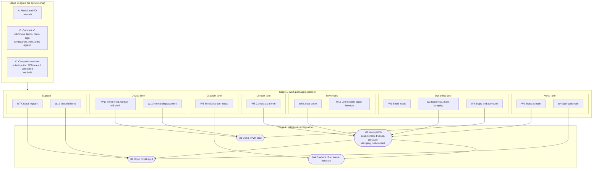

# Work plan: what can be built in parallel, and what has to be agreed first

First template for discussion, November 26, 2026. For Steve Maas, Jeff Weiss, Ryan Black, the Warp team and the Jolley Lab. A proposal for how to organize the work, not an assignment. Nothing here is settled.

**Status, November 27, 2026.** The first implementations (model and I/O, materials, contact, the run path template) are on `main` and tested on CPU and on a GPU, so stage 0 is partly done: A is in place, B exists as a template whose four choices still need an answer, and C is not built. No work package has started. The packages, lanes and milestones below are unchanged.

**What this is.** The design notes say what has been explored and what needs deciding. This page turns them into a plan in which several people can work on different parts at the same time. It names the few things that must be agreed first, splits the rest into work packages that do not touch each other's files, and says how each one is known to be done.

**How to read it.** Section 1 is the shape of the plan. Section 2 is the short list that blocks everything else. Section 3 is the work packages. Section 5 is how a person picks one up.

## 1. The shape

## 2. Stage 0: the spine

Three things every work package depends on. They are the serial part of the plan, and the most useful review time is spent here.

| | What | Where it is | What is asked |
| --- | --- | --- | --- |
| A | The model and the reader | On `main` (pull request 5), [model.md](model.md) | Done as a first implementation; review continues on the note's decision points |
| B | Contract v0: unknowns numbered by (node, variable) in 3x3 blocks; constrained components masked; one `Term` contract for domains, loads and contact; FEBio's residual sign; State apart from the model | On `main` as a template (pull request 6), [run_path.md](run_path.md), [decisions R1 to R3](run_path.md#12-decision-points) | A yes, a no, or a change on each of the four. Once given, the contract is frozen as v0 and packages build against it |
| C | A comparison runner: run a FEBio test suite input in FEBio-Warp and compare with the plot file of a pinned FEBio build | Not built. Proposed in [output.md](output.md) decision O1 and [verification.md](verification.md). The command line (`python -m warp_febio run`) already runs an input and writes a plot file, which is the first half | Agreement on plot file or added log data, and on the pinned build |

B is the one that matters most. If numbering or the term contract changes after packages start, each of them is reworked. If they are frozen as v0, even provisionally, packages can proceed, and a later change is one migration.

C can start now. It does not depend on B, and every package's definition of done uses it. It is the most useful next piece of code.

## 3. Stage 1: work packages

Each package owns its files, attaches through contract v0, and is done when the named FEBio test suite problems agree with FEBio. "Decisions" are the ones that block the package; the rest of each note's decisions can be made as the work proceeds.

| ID | Package | Note | Owns | Depends on | Done when | Decisions first |
| --- | --- | --- | --- | --- | --- | --- |
| W1 | Small loads: `nodal_load`, `nodal_force`, constant `body force` | [chordae.md](chordae.md), [dynamics.md](dynamics.md) | `loads/` (new files) | B | Used by the problems below | none |
| W2 | Truss domain | [chordae.md](chordae.md) | `elements/` (truss) | B, W1 | `bt01`; with W3 `dy16`, `dy17` | C1 |
| W3 | Dynamics, mass, mass damping | [dynamics.md](dynamics.md) | `analysis/`, mass in each domain | B, W1 | `dy01`, `dy07`, `sh32`, `sh34`, `sh58`; `bk_mass_damping` | D2, D4 |
| W4 | Spring domain | [chordae.md](chordae.md) | `elements/` (discrete) | B | `di01` to `di04`, `ch_chord_slack_tension` | none |
| W5 | Contact as a term | [contact_in_run.md](contact_in_run.md) | `contact/` | B | `co62`, `bk_contact_potential_patch`; then `sh_self_contact_fold` | K1, K3 |
| W6 | Linear solve: interface, preconditioner measurements, and a first trial of cuDSS as a direct solver on the device | [linear_solve.md](linear_solve.md) | `solvers/linear/` | B | Measurements 1, 2 and 7 on `sh11` reported; a recommended method | L1, L2 |
| W7 | Output registry | [output.md](output.md) | `results.py`, producers per term | B, C | `relative volume` and `Lagrange strain` on any suite problem that runs | O1 |
| W8 | Sensitivity over steps | [sensitivity.md](sensitivity.md) | `sensitivity/` | W3 | Adjoint against finite differences over three dynamic steps, one hex8 and one truss | S1, S2, S3 |
| W9 | Several steps and activation | [dynamics.md](dynamics.md) | `analysis/` | W3 | `ms01`, `ms02`, `ms03`, `ms05` | none |
| W10 | Device elements: three-field solid, wedge, tri3 shell | [elements.md](elements.md) | `elements/` (new files) | B, W12 | `bk_hgo_three_field`; single penta6 and tri3 shell elements | E3, E4 |
| W11 | `normal displacement` | [constraints.md](constraints.md) | `constraints/` | B | A small tube input, to add | none |
| W12 | Material items: `tangent_scale`, per-element axes | [materials.md](materials.md) | `materials/` | The material layer on `main` | Coverage report no longer lists them on the open inputs | none |
| W13 | Line search and quasi-Newton | [linear_solve.md](linear_solve.md) | `solvers/nonlinear/` | W5, W6 | Iteration counts of suite problems with `max_ups` 10 | L6 |

What can start as soon as contract v0 is frozen, with no dependence on each other: W1, W2, W4, W5, W6, W11, and C. W3 follows W1 by a small step. That is six or seven pieces of work in parallel.

### Lanes

Packages grouped by who is placed to carry them. Groups first; a name appears only as a suggestion to be confirmed with that person. Review and decisions on formulation stay with the FEBio team throughout, and input on device-side structure and differentiation is sought from the Warp team.

| Lane | Packages | Group | Suggested lead, to confirm |
| --- | --- | --- | --- |
| Spine | A, B, C | Jolley Lab drafts; FEBio team reviews and decides | |
| Valve | W2 truss, W4 springs, milestones M1 and M2 | Jolley Lab, valve modeling | Seda Aslan |
| Dynamics | W1 small loads, W3 dynamics and mass damping, W9 steps | Jolley Lab, mechanics | |
| Solver | W6 linear solve, W13 line search and quasi-Newton | Jolley Lab, solvers; Warp team input on preconditioners and factorization | Ryan Black |
| Contact | W5 contact as a term | Jolley Lab, mechanics; FEBio team on the gates | |
| Gradient | W8 sensitivity over steps, milestone M4 | Jolley Lab; Warp team input on the tape and the adjoint | |
| Device | W10 device elements, W11 normal displacement, milestone M3 | Jolley Lab, device modeling | |
| Support | W7 output, W12 material items, the comparison runner | Jolley Lab; FEBio team on the pinned build | |

A lane can be carried by a person working with coding agents. The packages are sized for that: one note, one set of files, one set of suite problems.

### Where packages would collide

| Shared place | Packages | How to avoid it |
| --- | --- | --- |
| `select_domain`, `select_load` and `build_system` in `analysis/steps.py` | Every package that adds a term | Decision P1 below: a registry, so a new term registers itself and does not edit a shared function |
| `analysis/steps.py` (`run`) | W3, W9 | W9 after W3, same lane |
| `solvers/nonlinear/newton.py` | W3 (time integration), W5 (step limit), W13 | W3 first; W5 adds its rule through a hook the term provides; W13 last |
| `State` | W3 (velocity, acceleration), W8 (history, stored pairs) | W3 defines the layout as part of decision D2 |
| The coverage report | Every package | Each package only adds its own names |

## 4. Decision points of the plan itself

| ID | Decision | Options | Proposed | For |
| --- | --- | --- | --- | --- |
| P1 | How a new term enters the system | (a) Each package edits `select_domain` or `build_system`. (b) A registry keyed by FEBio's type names, where a package registers its own builder | (b). It is what lets packages land in any order without conflicts, and it mirrors how FEBio registers classes | Steve, Warp team |
| P2 | Whether contract v0 is frozen before its review is complete | (a) Wait. (b) Freeze provisionally on the four choices, with one planned migration if review changes them | (b). The template is on `main`, so packages can already build against it | Steve, MJ |
| P3 | How a package is tracked | (a) A pull request per package from the start. (b) The lanes table on this page, with coordination where the team already talks; a draft pull request opened only when a package has code | Decided November 27: (b), without long-lived drafts. Notes hold the plan, and code comes as short-lived pull requests against `main`. The README table links each area to its note and its decisions, and this page says who has what | MJ |
| P4 | The reference tier and the faster tier | (a) Every package delivers the reference tier first (double precision, matches FEBio). (b) Some packages go straight to GPU performance | (a), except W6, whose purpose is performance | Team |
| P5 | Who needs a GPU and a pinned FEBio build | W6 needs a GPU. C and every "done when" need the pinned FEBio build, with Pardiso for the non-symmetric inputs | GPU: settled for testing. Every package runs its tests on a GPU as well as on CPU ([CONTRIBUTING](../../CONTRIBUTING.md#writing-and-running-tests)); a workstation GPU is used for this, and the GPU runner in CI is started by hand only, because it is billed. The pinned FEBio build is still to settle | MJ, Steve |

## 5. Picking up a package

1. Read the package's note: what FEBio does, what is proposed, what has been explored, its decision points.
2. Check that the decisions listed for the package in section 3 have an answer. If not, that is the first conversation.
3. Work on a branch named `username/short-description`, in the files the package owns. Branch from `main` and do not stack branches on each other.
4. Done means: the named suite problems agree with FEBio through the comparison runner; the tangent agrees with finite differences of the residual; a gradient check passes for every parameter the term exposes; the tests take their device from `tests/support.py` and pass on CPU and on a GPU; the coverage report and the note are updated.
5. Open a pull request against `main` when there is code to look at, keep it small, and merge it once the full test tier passes on CPU and on a GPU. A package can land in several such pull requests. The note stays in `docs/design/` and is updated with it.

## 6. Stage 2: milestones

| | Milestone | Needs | Input |
| --- | --- | --- | --- |
| M1 | A quad4 leaflet patch with truss chordae, pressure, mass damping and self-contact | W2, W3, W5, W6 | A small input to add |
| M2 | The open mitral input | M1, W4, W7, W12; W13 to match its step sequence | Project 134, `P2Prolapse_Mitral.feb` |
| M3 | An open TPVR input | W3, W5, W9, W10, W11, W12, a non-symmetric solve | Project 136 |
| M4 | The gradient of a closure measure with respect to chord cross-sectional area | M1, W8 | The M1 input |

M1 and M4 are the first results that show what FEBio-Warp adds: a valve-like problem on the GPU, and a gradient FEBio does not provide.

## 7. What is not in this plan

Beams, rigid bodies and joints, sticky and sliding contact, and the superelastic nitinol law. Each has a reserved place in the notes and no package yet.
